# Gamer Perú — Canonical Commerce Domain Model Specification

---

## 1. Executive Summary

This document defines the canonical **Commerce Domain Model** for **Gamer Perú** (`gamerperu.com`). It establishes the authoritative entities, aggregates, state machines, business invariants, data relationships, transactional boundaries, concurrency controls, and lifecycle rules required for multi-brand gaming peripherals e-commerce in Peru.

Following the technology architecture established in **GP-003** (Modular Monolith, Next.js 16 Active LTS, Supabase PostgreSQL 16+, Drizzle ORM, Better Auth, Cloudflare R2, and Inngest), this domain model provides the single source of truth for all domain entities and business workflows implemented in **GP-005** and subsequent roadmap gates.

---

## 2. Domain Principles

1. **PostgreSQL as Authoritative Source of Truth**: Commerce state, inventory levels, order facts, and financial transactions are governed exclusively by deterministic PostgreSQL transactions. Browser/client state is treated as untrusted presentation.
2. **ProductVariant as Sellable Unit**: Inventory, pricing, SKUs, and cart line items attach exclusively to `ProductVariant`. No "simple product" bypass exists.
3. **Integer Money Representation**: All monetary values are represented as integer minor units in Peruvian Soles (`PEN`, cents) to prevent floating-point inaccuracies.
4. **Immutable Order Snapshots**: Order line items, applied discounts, customer delivery addresses, and payment instruction versions are frozen at purchase time and never mutate when catalog or customer data changes.
5. **Human-Verified Manual Payments**: For canonical v1 methods (`YAPE_MANUAL`, `PLIN_MANUAL`), customer submission of an operation code or voucher enters a verification workflow; funds are confirmed only upon explicit server-side Admin approval.
6. **Auditable Multi-Balance Inventory Ledger**: Every stock transition records explicit deltas for on-hand, reserved, and allocated balances with an immutable ledger movement.
7. **Downstream Isolation**: External provider failures (EC OS, AI providers, email, analytics) never invalidate or roll back core storefront transactions.
8. **AI as Advisory Layer**: Artificial intelligence models never hold authority over prices, stock, order transitions, or sensitive credentials.

---

## 3. Bounded Context & Module Map

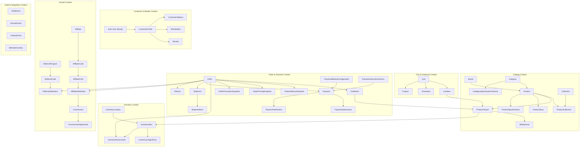

---

## 4. Identifier Strategy

To prevent business volume leakage while maintaining index locality and clean operational references, identifiers are categorized into distinct types:

| Identifier Type | Format | Example | Generation & Use |
|---|---|---|---|
| **Internal Entity ID** | `UUIDv7` (36 chars) | `019156a2-9b2f-7c1a-8e2b-4e1b2c3d4e5f` | Primary key across all PostgreSQL tables; time-ordered for optimal B-tree indexing. Generated at application layer. |
| **Human Order Number** | `GP-` + Random Alphanumeric (8 chars) | `GP-7K9M-2026` | Public customer-facing reference; unguessable and non-sequential. |
| **SKU (Stock Keeping Unit)** | Structured Alphanumeric | `WLM-BX-MAG-BLK-8K` | Machine and warehouse identifier per `ProductVariant`. |
| **Public Slug** | Kebab-case string | `wlmouse-beast-x-magnesium` | URL-safe identifier for Brands, Categories, Collections, and Products. |
| **Coupon Code** | Uppercase Alphanumeric | `LANZAMIENTO10` | Public or private promo code entered at checkout. |
| **Referral Code** | `REF-` + Uppercase Alphanumeric | `REF-LIMA99` | Customer invitation identifier. |
| **Affiliate Code** | `PRO-` + Uppercase Alphanumeric | `PRO-SHOOTER` | Registered commercial partner tracking code. |

---

## 5. Money & Currency

- **Canonical Currency**: `PEN` (Peruvian Soles, ISO 4217).
- **Storage Type**: Integer minor units (`INTEGER` / `BIGINT` in cents).
- **Calculation Rules**:
  - `S/ 129.90` is stored as `12990`.
  - `S/ 1.00` is stored as `100`.
  - All arithmetic (subtotals, discounts, shipping, taxes, refunds, commissions) is performed in integer cents. Floating-point types (`FLOAT`, `DOUBLE`) are strictly forbidden for financial calculations.
- **Financial Field Invariants**:
  - `unit_price_cents >= 0`
  - `compare_at_price_cents >= unit_price_cents` (when defined)
  - `discount_cents >= 0`
  - `shipping_cents >= 0`
  - `subtotal_cents = sum(quantity * unit_price_cents)`
  - `total_cents = subtotal_cents - discount_cents + shipping_cents` (must be $\ge 0$)
  - `refunded_amount_cents <= total_cents`

---

## 6. Time Model

- **Storage Standard**: Canonical UTC timestamps stored as `TIMESTAMPTZ` (timestamp with time zone) in PostgreSQL.
- **Display Standard**: Application presentation layers format timestamps in Peru local time (`America/Lima`, UTC-5) without altering stored UTC values.
- **Canonical Lifecycle Timestamps**:
  - `created_at`: Instant record was inserted.
  - `updated_at`: Instant record was last modified.
  - `published_at`: Instant product/story/content became publicly visible.
  - `expires_at`: Instant reservation, coupon, or session becomes invalid.
  - `submitted_at`: Instant customer submitted payment operation code/proof.
  - `verified_at`: Instant admin verified and approved/rejected payment.
  - `cancelled_at`: Instant order or reservation was terminated.
  - `shipped_at`: Instant courier received parcel.
  - `delivered_at`: Instant customer received order.

---

## 7. Data Classification

| Classification | Description | Examples | Access Policy |
|---|---|---|---|
| **PUBLIC** | Published marketing and catalog data. | Product names, public specs, published story blocks, prices, brand logos. | Crawlable, cached on CDN, open access. |
| **CUSTOMER_PRIVATE** | Personal customer details and order history. | Saved addresses, customer names, personal orders, wishlist. | Restricted strictly to authenticated owning customer and authorized staff. |
| **SENSITIVE_OPERATIONAL** | Financial evidence and operational vouchers. | Yape/Plin operation codes, payment proof images, staff verification notes. | Admin RBAC only; private R2 signed URLs with 5m TTL; excluded from public logs. |
| **INTERNAL** | Business metrics, margins, supplier data. | Variant unit cost (`cost_cents`), staff audit logs, unapproved AI research drafts. | Admin RBAC only; never exposed to customer APIs or public AI Customer Assistant. |
| **SECRET** | System credentials and master keys. | AI provider master encryption keys, auth secrets, database credentials. | Server runtime environment variables only; never stored in commerce tables. |

---

## 8. Catalog Aggregate

The Catalog Aggregate models gaming hardware products, multi-brand taxonomy, curated collections, structured category-specific technical attributes, and editorial storytelling.

```text
+-----------------------------------------------------------------------------------+
|                                CATALOG AGGREGATE                                  |
|                                                                                   |
|  [Brand] 1 --- * [Product] 1 --- * [ProductVariant] 1 --- * [InventoryItem]       |
|                     |                   |                                         |
|                     | 1                 + --- * [MediaAsset]                      |
|                     + --- 1 [ProductSpecifications] (JSONB validated by Schema)   |
|                     |                                                             |
|                     + --- 1 [ProductStory] 1 --- * [ProductStoryRevision] (Blocks)|
|                                                                                   |
|  [Category] 1 --- * [Product]                                                     |
|      |                                                                            |
|      + --- * [CategorySpecificationSchema] (Versioned JSONB Schema Definitions)   |
|                                                                                   |
|  [Collection] 1 --- * [ProductCollection] * --- 1 [Product]                       |
+-----------------------------------------------------------------------------------+
```

---

## 9. Brand

Represents hardware manufacturers (e.g., WLMouse, Wooting, Lamzu, Pulsar, Endgame Gear, Artisan).

- **Entity Attributes**:
  - `id`: `UUIDv7` (PK)
  - `name`: `VARCHAR(100)` (Unique)
  - `slug`: `VARCHAR(100)` (Unique, URL-safe)
  - `description`: `TEXT` (Nullable)
  - `website_url`: `VARCHAR(255)` (Nullable)
  - `logo_media_id`: `UUIDv7` (FK $\to$ `MediaAsset`, Nullable)
  - `status`: `ENUM('DRAFT', 'PUBLISHED', 'ARCHIVED')`
  - `created_at`, `updated_at`: `TIMESTAMPTZ`

---

## 10. Category

Represents the multi-tier gaming peripherals taxonomy (e.g., Mice, Keyboards, Audio, Mousepads, Accessories).

- **Entity Attributes**:
  - `id`: `UUIDv7` (PK)
  - `name`: `VARCHAR(100)`
  - `slug`: `VARCHAR(100)` (Unique)
  - `parent_id`: `UUIDv7` (FK $\to$ `Category.id`, Nullable for root categories)
  - `description`: `TEXT` (Nullable)
  - `display_order`: `INTEGER` (Default `0`)
  - `status`: `ENUM('DRAFT', 'PUBLISHED', 'ARCHIVED')`
  - `created_at`, `updated_at`: `TIMESTAMPTZ`

---

## 11. Collection

Represents curated merchandising groupings (e.g., "Wireless Ultralight Mice", "Hall Effect Keyboards", "Artisan FX Series", "Torneo Lima 2026 Specials").

- **Entity Attributes**:
  - `id`: `UUIDv7` (PK)
  - `name`: `VARCHAR(150)`
  - `slug`: `VARCHAR(150)` (Unique, URL-safe)
  - `description`: `TEXT` (Nullable)
  - `hero_media_id`: `UUIDv7` (FK $\to$ `MediaAsset.id`, Nullable)
  - `status`: `ENUM('DRAFT', 'PUBLISHED', 'ARCHIVED')` (Default `DRAFT`)
  - `display_order`: `INTEGER` (Default `0`)
  - `created_at`, `updated_at`: `TIMESTAMPTZ`
- **ProductCollection (Membership) Entity**:
  - `id`: `UUIDv7` (PK)
  - `collection_id`: `UUIDv7` (FK $\to$ `Collection.id`, Required)
  - `product_id`: `UUIDv7` (FK $\to$ `Product.id`, Required)
  - `display_order`: `INTEGER` (Default `0`)
  - `created_at`: `TIMESTAMPTZ`
  - *Unique Constraint*: `(collection_id, product_id)`

---

## 12. Product

Represents the conceptual hardware model or product family (e.g., "WLMouse Beast X", "Wooting 80HE").

- **Entity Attributes**:
  - `id`: `UUIDv7` (PK)
  - `brand_id`: `UUIDv7` (FK $\to$ `Brand.id`, Required)
  - `category_id`: `UUIDv7` (FK $\to$ `Category.id`, Required)
  - `name`: `VARCHAR(200)` (e.g., "Beast X Magnesium Wireless Gaming Mouse")
  - `slug`: `VARCHAR(200)` (Unique)
  - `subtitle`: `VARCHAR(255)` (Nullable)
  - `description`: `TEXT` (Rich markdown / editorial description)
  - `status`: `ENUM('DRAFT', 'PUBLISHED', 'ARCHIVED')` (Default `DRAFT`)
  - `is_featured`: `BOOLEAN` (Default `false`)
  - `primary_media_id`: `UUIDv7` (FK $\to$ `MediaAsset`, Nullable)
  - `created_at`, `updated_at`: `TIMESTAMPTZ`

---

## 13. ProductVariant

Represents the concrete sellable SKU (e.g., "Beast X - Black / Omron Optical Switches").

- **Entity Attributes**:
  - `id`: `UUIDv7` (PK)
  - `product_id`: `UUIDv7` (FK $\to$ `Product.id`, Required)
  - `sku`: `VARCHAR(50)` (Unique, Required)
  - `title`: `VARCHAR(150)` (e.g., "Black / Omron Optical")
  - `price_cents`: `INTEGER` (Selling price in Soles, Required, $> 0$)
  - `compare_at_price_cents`: `INTEGER` (Original / strikethrough price, Nullable)
  - `cost_cents`: `INTEGER` (Internal wholesale cost in Soles, Nullable, Admin only)
  - `weight_grams`: `INTEGER` (Physical product weight, Nullable)
  - `attributes`: `JSONB` (Structured variant swatches: `{"color": "Black", "switch": "Omron Optical", "layout": "ANSI"}`)
  - `status`: `ENUM('ACTIVE', 'INACTIVE', 'ARCHIVED')` (Default `ACTIVE`)
  - `display_order`: `INTEGER` (Default `0`)
  - `created_at`, `updated_at`: `TIMESTAMPTZ`
- **Invariants**:
  - Every Product must have at least one ProductVariant to be sellable.
  - Cart line items and Order items reference `ProductVariant.id`.

---

## 14. Technical Specifications & Versioning

Hardware attributes are structured dynamically per category using JSONB validated against versioned category-specific schemas.

- **CategorySpecificationSchema Entity**:
  - `id`: `UUIDv7` (PK)
  - `category_id`: `UUIDv7` (FK $\to$ `Category.id`, Required)
  - `schema_version`: `INTEGER` (e.g., `1`, `2`)
  - `field_definitions`: `JSONB` (Array of attribute definitions: name, key, data type, unit, filterable, required)
  - `is_active`: `BOOLEAN` (Default `true`)
  - `created_at`: `TIMESTAMPTZ`
  - *Unique Constraint*: `(category_id, schema_version)`
- **ProductSpecifications Entity**:
  - `product_id`: `UUIDv7` (PK, FK $\to$ `Product.id`)
  - `schema_id`: `UUIDv7` (FK $\to$ `CategorySpecificationSchema.id`, Required)
  - `schema_version`: `INTEGER`
  - `spec_values`: `JSONB` (Key-value map validated against category schema, e.g., `{"sensor": "PAW3950", "weight": "39g", "polling_rate": "8000Hz"}`)
  - `updated_at`: `TIMESTAMPTZ`
- **Evolution Invariant**: Creating a new schema version does not overwrite prior versions. Existing product specifications remain interpretable under their recorded `schema_id` until explicitly revalidated/migrated.

---

## 15. Product Story

Editorial rich media storytelling layouts for flagship PDPs, structured into 13 modular visual block types.

- **ProductStory Entity**:
  - `product_id`: `UUIDv7` (PK, FK $\to$ `Product.id`)
  - `published_revision_id`: `UUIDv7` (FK $\to$ `ProductStoryRevision.id`, Nullable)
  - `updated_at`: `TIMESTAMPTZ`
- **ProductStoryRevision Entity**:
  - `id`: `UUIDv7` (PK)
  - `product_id`: `UUIDv7` (FK $\to$ `Product.id`)
  - `revision_number`: `INTEGER` (Sequential per product)
  - `status`: `ENUM('DRAFT', 'PUBLISHED', 'ARCHIVED')`
  - `blocks`: `JSONB` (Array of structured block definitions: `block_id`, `type`, `order`, `payload`)
  - `published_at`: `TIMESTAMPTZ` (Nullable)
  - `created_by_user_id`: `VARCHAR(255)` (FK $\to$ `AuthUser.id`)
  - `created_at`: `TIMESTAMPTZ`
- **Canonical 13 Block Types**: `HeroMedia`, `FullBleedImage`, `ImageText`, `StatHighlight`, `SpecFeature`, `Video`, `Gallery`, `Comparison`, `Dimensions`, `BoxContents`, `TechnicalSpecs`, `FAQ`, `RelatedProducts`.

---

## 16. Media Assets

Encapsulates metadata for binary objects stored in Cloudflare R2.

- **Entity Attributes**:
  - `id`: `UUIDv7` (PK)
  - `object_key`: `VARCHAR(500)` (Unique, e.g., `products/wlmouse/beastx/hero-black.webp`)
  - `security_class`: `ENUM('PUBLIC_MEDIA', 'PRIVATE_PAYMENT_PROOF', 'PRIVATE_BACKUP')`
  - `media_type`: `ENUM('IMAGE', 'VIDEO', 'DOCUMENT')`
  - `mime_type`: `VARCHAR(100)` (e.g., `image/webp`, `image/jpeg`, `video/mp4`)
  - `file_size_bytes`: `INTEGER`
  - `width`: `INTEGER` (Nullable)
  - `height`: `INTEGER` (Nullable)
  - `alt_text`: `VARCHAR(255)` (Nullable)
  - `checksum_sha256`: `VARCHAR(64)` (Nullable)
  - `created_at`: `TIMESTAMPTZ`

---

## 17. User & Authentication Boundary

Separates Better Auth identity mechanics from the Gamer Perú commerce domain.

- **AuthUser Entity (Better Auth Managed)**:
  - `id`: `VARCHAR(255)` (PK)
  - `email`: `VARCHAR(255)` (Unique, Lowercase)
  - `email_verified`: `BOOLEAN` (Default `false`)
  - `created_at`, `updated_at`: `TIMESTAMPTZ`
- **Session Entity (Better Auth Managed)**:
  - `id`: `VARCHAR(255)` (PK)
  - `user_id`: `VARCHAR(255)` (FK $\to$ `AuthUser.id`)
  - `token`: `VARCHAR(255)` (Unique)
  - `expires_at`: `TIMESTAMPTZ`
  - `ip_address`, `user_agent`: `TEXT` (Nullable)

---

## 18. Customer Profile

Stores customer-facing commerce profile data linked 1-to-1 with `AuthUser`.

- **Entity Attributes**:
  - `id`: `UUIDv7` (PK)
  - `user_id`: `VARCHAR(255)` (FK $\to$ `AuthUser.id`, Unique)
  - `first_name`: `VARCHAR(100)`
  - `last_name`: `VARCHAR(100)`
  - `phone`: `VARCHAR(20)` (Nullable)
  - `document_type`: `ENUM('DNI', 'CE', 'RUC', 'PASSPORT')` (Nullable)
  - `document_number`: `VARCHAR(20)` (Nullable)
  - `default_shipping_address_id`: `UUIDv7` (FK $\to$ `CustomerAddress.id`, Nullable)
  - `created_at`, `updated_at`: `TIMESTAMPTZ`

---

## 19. RBAC Domain

Enforces authoritative server-side role-based access control.

- **Role Entity**: `id` (`UUIDv7`), `name` (`VARCHAR(50)`, Unique, e.g., `SUPER_ADMIN`, `ADMIN_CATALOG`, `ADMIN_ORDERS`, `ADMIN_SUPPORT`, `CUSTOMER`), `description` (`TEXT`).
- **Permission Entity**: `id` (`UUIDv7`), `name` (`VARCHAR(100)`, Unique, e.g., `orders:verify`, `catalog:publish`, `ai:manage_credentials`).
- **RolePermission Entity**: `role_id` (`UUIDv7`), `permission_id` (`UUIDv7`) (Composite PK).
- **UserRole Entity**: `user_id` (`VARCHAR(255)`), `role_id` (`UUIDv7`) (Composite PK).

---

## 20. Address & Address Snapshot

- **CustomerAddress Entity**: Reusable customer address book entries.
  - `id`: `UUIDv7` (PK)
  - `customer_id`: `UUIDv7` (FK $\to$ `CustomerProfile.id`)
  - `recipient_name`: `VARCHAR(150)`
  - `phone`: `VARCHAR(20)`
  - `street_address`: `VARCHAR(255)`
  - `apartment_suite`: `VARCHAR(100)` (Nullable)
  - `department`: `VARCHAR(100)` (e.g., "Lima")
  - `province`: `VARCHAR(100)` (e.g., "Lima")
  - `district`: `VARCHAR(100)` (e.g., "Miraflores")
  - `postal_code`: `VARCHAR(20)` (Nullable)
  - `reference_notes`: `TEXT` (Nullable)
  - `is_default`: `BOOLEAN` (Default `false`)
  - `created_at`, `updated_at`: `TIMESTAMPTZ`
- **OrderAddressSnapshot Entity**: Immutable snapshot of the delivery address frozen at checkout time.
  - `id`: `UUIDv7` (PK)
  - `order_id`: `UUIDv7` (FK $\to$ `Order.id`, Unique)
  - `recipient_name`, `phone`, `street_address`, `apartment_suite`, `department`, `province`, `district`, `postal_code`, `reference_notes` (Copied as immutable values).
  - `created_at`: `TIMESTAMPTZ`

---

## 21. Cart Domain

Models transient shopping intent for both guest sessions and authenticated customers.

- **Cart Entity**:
  - `id`: `UUIDv7` (PK)
  - `customer_id`: `UUIDv7` (FK $\to$ `CustomerProfile.id`, Nullable for anonymous guests)
  - `session_token`: `VARCHAR(255)` (Unique for anonymous guest carts, Nullable when authenticated)
  - `status`: `ENUM('ACTIVE', 'CONVERTED', 'ABANDONED')` (Default `ACTIVE`)
  - `currency`: `VARCHAR(3)` (Default `'PEN'`)
  - `expires_at`: `TIMESTAMPTZ` (Configured by `CART_EXPIRY_DURATION`, `[TBD BUSINESS DECISION]`)
  - `created_at`, `updated_at`: `TIMESTAMPTZ`
- **CartItem Entity**:
  - `id`: `UUIDv7` (PK)
  - `cart_id`: `UUIDv7` (FK $\to$ `Cart.id`)
  - `variant_id`: `UUIDv7` (FK $\to$ `ProductVariant.id`)
  - `quantity`: `INTEGER` ($> 0$, upper bounded by configurable `MAX_CART_LINE_QUANTITY`, `[TBD BUSINESS DECISION]`)
  - `created_at`, `updated_at`: `TIMESTAMPTZ`
- **Cart Merge Rule**: When an anonymous guest logs in, their anonymous `CartItem` entries merge into their active customer `Cart`, updating quantities where items overlap.

---

## 22. Checkout Boundary

Checkout is an atomic server-side mutation that validates preconditions and creates an `Order`.

- **Precondition Validations**:
  1. All referenced `ProductVariant` items exist, are `ACTIVE`, and their parent `Product` is `PUBLISHED`.
  2. Authoritative prices in Soles are recomputed from the database; client-supplied line prices are discarded.
  3. Applied Coupon/Promotion is validated for date eligibility, minimum spend, category/product scope, and usage limits.
  4. Real-time inventory availability ($\text{available\_to\_sell} \ge \text{requested\_quantity}$) is verified with row-level locks on the primary fulfillment location.
  5. Delivery address and active payment method selection are validated.
- **Atomic Creation Transaction**: Executes order creation, line snapshotting, discount recording, and inventory reservation within a single PostgreSQL ACID transaction.

---

## 23. Inventory Model

The inventory model tracks physical stock, allocations, and temporary reservations across warehouse locations.

- **InventoryLocation Entity**:
  - `id`: `UUIDv7` (PK)
  - `name`: `VARCHAR(100)` (e.g., "Almacén Central Lima")
  - `code`: `VARCHAR(50)` (Unique, e.g., "LOC-LIM-01")
  - `is_active`: `BOOLEAN` (Default `true`)
  - `created_at`: `TIMESTAMPTZ`
- **InventoryItem Entity**:
  - `id`: `UUIDv7` (PK)
  - `variant_id`: `UUIDv7` (FK $\to$ `ProductVariant.id`)
  - `location_id`: `UUIDv7` (FK $\to$ `InventoryLocation.id`)
  - `quantity_on_hand`: `INTEGER` (Physical units in warehouse, $\ge 0$)
  - `quantity_reserved`: `INTEGER` (Units temporarily held during checkout/verification, $\ge 0$)
  - `quantity_allocated`: `INTEGER` (Units confirmed for paid orders awaiting dispatch, $\ge 0$)
  - `reorder_point`: `INTEGER` (Default `0`)
  - `updated_at`: `TIMESTAMPTZ`
  - *Unique Constraint*: `(variant_id, location_id)`
- **Multi-Location Policy**: The schema fully supports multiple locations. Initial launch operates with one primary fulfillment warehouse (`LOC-LIM-01`). All checkout reservations lock `(variant_id, default_location_id)` row.

---

## 24. Inventory Ledger

An immutable append-only ledger recording every stock transition with explicit multi-balance deltas.

- **InventoryLedgerEntry Entity**:
  - `id`: `UUIDv7` (PK)
  - `inventory_item_id`: `UUIDv7` (FK $\to$ `InventoryItem.id`)
  - `movement_type`: `ENUM('RECEIVING', 'MANUAL_ADJUSTMENT', 'RESERVATION_CREATED', 'RESERVATION_EXPIRED', 'RESERVATION_RELEASED', 'ALLOCATION_CONFIRMED', 'FULFILLMENT_DISPATCHED', 'RETURN_RESTOCKED')`
  - `on_hand_delta`: `INTEGER` (Change in physical warehouse stock)
  - `reserved_delta`: `INTEGER` (Change in reserved hold balance)
  - `allocated_delta`: `INTEGER` (Change in confirmed allocation balance)
  - `quantity_on_hand_after`: `INTEGER`
  - `quantity_reserved_after`: `INTEGER`
  - `quantity_allocated_after`: `INTEGER`
  - `reference_type`: `ENUM('ORDER', 'PURCHASE_ORDER', 'RMA', 'MANUAL_AUDIT')`
  - `reference_id`: `VARCHAR(255)`
  - `actor_id`: `VARCHAR(255)` (Staff ID or `'SYSTEM'`)
  - `notes`: `TEXT` (Nullable)
  - `created_at`: `TIMESTAMPTZ`

---

## 25. Inventory Reservation & Allocation Model

- **InventoryReservation Entity**:
  - `id`: `UUIDv7` (PK)
  - `inventory_item_id`: `UUIDv7` (FK $\to$ `InventoryItem.id`, Required)
  - `order_id`: `UUIDv7` (FK $\to$ `Order.id`, Required)
  - `order_item_id`: `UUIDv7` (FK $\to$ `OrderItem.id`, Required)
  - `quantity`: `INTEGER` ($> 0$)
  - `status`: `ENUM('ACTIVE', 'VERIFICATION_HOLD', 'ALLOCATED', 'CONSUMED', 'RELEASED')`
  - `expires_at`: `TIMESTAMPTZ` (Initial unpaid checkout window)
  - `created_at`, `updated_at`: `TIMESTAMPTZ`
  - *Traceability*: Each order line item creates its own `InventoryReservation` linked to `(order_id, order_item_id, inventory_item_id)`.
- **Reservation Lifecycle**:
  1. `ACTIVE`: Created at order placement. `reserved_delta = +qty`. `expires_at = NOW() + RESERVATION_TTL_MINUTES` (`[TBD BUSINESS DECISION]`).
  2. `VERIFICATION_HOLD`: When customer submits operation code/voucher, reservation transitions to `VERIFICATION_HOLD`. Expiry timer is suspended during review.
  3. `ALLOCATED`: Upon Admin payment approval (`PAID`), reservation transitions to `ALLOCATED` (`reserved_delta = -qty`, `allocated_delta = +qty`).
  4. `CONSUMED`: On parcel dispatch, reservation becomes `CONSUMED` (`allocated_delta = -qty`, `on_hand_delta = -qty`).
  5. `RELEASED`: If order is cancelled, rejected, or unpaid reservation expires, reservation transitions to `RELEASED` (`reserved_delta = -qty`), immediately restoring sellable stock.

---

## 26. Inventory Concurrency & Stock Allocation

To guarantee zero overselling under high concurrency:
1. All checkout mutations lock the relevant `InventoryItem` row using `SELECT ... FOR UPDATE WHERE variant_id = $1 AND location_id = $2`.
2. Availability is strictly evaluated inside the transaction:
   $$\text{available\_to\_sell} = \text{quantity\_on\_hand} - \text{quantity\_reserved} - \text{quantity\_allocated}$$
3. If $\text{available\_to\_sell} < \text{requested\_quantity}$, the transaction aborts with an `INSUFFICIENT_STOCK` domain exception.
4. If available, `quantity_reserved` is incremented and an `InventoryReservation` record is inserted.

---

## 27. Order Aggregate

The central financial and operational entity representing a committed purchase.

- **Order Entity**:
  - `id`: `UUIDv7` (PK)
  - `order_number`: `VARCHAR(30)` (Unique human reference, e.g., `GP-7K9M-2026`)
  - `customer_id`: `UUIDv7` (FK $\to$ `CustomerProfile.id`, Nullable for guest purchases)
  - `customer_email`: `VARCHAR(255)` (Snapshot at purchase)
  - `customer_phone`: `VARCHAR(20)` (Snapshot at purchase)
  - `order_status`: `ENUM('PENDING', 'CONFIRMED', 'PROCESSING', 'FULFILLED', 'CANCELLED', 'REFUNDED')` (Default `PENDING`)
  - `payment_status`: `ENUM('UNPAID', 'SUBMITTED', 'VERIFYING', 'PAID', 'REJECTED', 'REFUNDED')` (Default `UNPAID`)
  - `fulfillment_status`: `ENUM('UNFULFILLED', 'READY_TO_PACK', 'PACKED', 'SHIPPED', 'DELIVERED', 'RETURNED')` (Default `UNFULFILLED`)
  - `subtotal_cents`: `INTEGER` (Sum of line items)
  - `discount_cents`: `INTEGER` (Total discount applied, Default `0`)
  - `shipping_cents`: `INTEGER` (Delivery fee, Default `0`)
  - `total_cents`: `INTEGER` (Final amount payable in Soles)
  - `refunded_amount_cents`: `INTEGER` (Cumulative refunded amount, Default `0`)
  - `currency`: `VARCHAR(3)` (Default `'PEN'`)
  - `customer_notes`: `TEXT` (Nullable)
  - `cancelled_at`: `TIMESTAMPTZ` (Nullable)
  - `cancel_reason`: `VARCHAR(255)` (Nullable)
  - `created_at`, `updated_at`: `TIMESTAMPTZ`

---

## 28. Order Snapshots

- **OrderItem Entity**: Immutable record of purchased variants.
  - `id`: `UUIDv7` (PK)
  - `order_id`: `UUIDv7` (FK $\to$ `Order.id`)
  - `variant_id`: `UUIDv7` (FK $\to$ `ProductVariant.id`)
  - `sku_snapshot`: `VARCHAR(50)`
  - `product_name_snapshot`: `VARCHAR(200)`
  - `variant_title_snapshot`: `VARCHAR(150)`
  - `unit_price_cents_snapshot`: `INTEGER`
  - `quantity`: `INTEGER` ($> 0$)
  - `line_total_cents`: `INTEGER` ($= \text{quantity} \times \text{unit\_price\_cents\_snapshot}$)
  - `created_at`: `TIMESTAMPTZ`
- **OrderPricingSnapshot Entity**: Records tax metadata, discount allocations, and shipping fees applied.
- **OrderPromotionSnapshot Entity**: Records coupon codes and promotion rule summaries applied to the order.

---

## 29. Payment Method Abstraction & Instruction Versioning

- **PaymentMethodConfiguration Entity**:
  - `id`: `UUIDv7` (PK)
  - `code`: `VARCHAR(50)` (Unique, e.g., `'YAPE_MANUAL'`, `'PLIN_MANUAL'`)
  - `name`: `VARCHAR(100)` (e.g., "Yape (Transferencia Móvil)")
  - `method_type`: `ENUM('MANUAL', 'GATEWAY')`
  - `is_active`: `BOOLEAN` (Default `true`)
  - `display_order`: `INTEGER` (Default `0`)
  - `created_at`, `updated_at`: `TIMESTAMPTZ`
- **PaymentInstructionVersion Entity**:
  - `id`: `UUIDv7` (PK)
  - `payment_method_code`: `VARCHAR(50)` (FK $\to$ `PaymentMethodConfiguration.code`)
  - `version_number`: `INTEGER`
  - `recipient_name`: `VARCHAR(150)` (e.g., "Gamer Perú S.A.C.")
  - `account_identifier`: `VARCHAR(50)` (e.g., "999-888-777")
  - `qr_media_id`: `UUIDv7` (FK $\to$ `MediaAsset.id`, Nullable)
  - `instruction_text`: `TEXT`
  - `is_active`: `BOOLEAN` (Default `true`)
  - `created_at`: `TIMESTAMPTZ`
  - *Unique Constraint*: `(payment_method_code, version_number)`

---

## 30. Payment Domain & Manual Yape / Plin Workflow

- **Payment Entity**:
  - `id`: `UUIDv7` (PK)
  - `order_id`: `UUIDv7` (FK $\to$ `Order.id`, Unique)
  - `payment_method_code`: `VARCHAR(50)` (FK $\to$ `PaymentMethodConfiguration.code`)
  - `instruction_version_id`: `UUIDv7` (FK $\to$ `PaymentInstructionVersion.id`)
  - `amount_cents`: `INTEGER`
  - `refunded_amount_cents`: `INTEGER` (Default `0`)
  - `currency`: `VARCHAR(3)` (Default `'PEN'`)
  - `status`: `ENUM('UNPAID', 'SUBMITTED', 'VERIFYING', 'PAID', 'REJECTED', 'REFUNDED')` (Default `UNPAID`)
  - `created_at`, `updated_at`: `TIMESTAMPTZ`
- **PaymentSubmission Entity**:
  - `id`: `UUIDv7` (PK)
  - `payment_id`: `UUIDv7` (FK $\to$ `Payment.id`)
  - `attempt_number`: `INTEGER` (Default `1`)
  - `operation_code`: `VARCHAR(50)` (Required)
  - `proof_media_id`: `UUIDv7` (FK $\to$ `MediaAsset.id`, Nullable)
  - `customer_notes`: `TEXT` (Nullable)
  - `is_late`: `BOOLEAN` (Default `false`; set true if submitted after reservation expired)
  - `submitted_at`: `TIMESTAMPTZ`
  - `ip_address`: `VARCHAR(45)`
- **PaymentVerification Entity**:
  - `id`: `UUIDv7` (PK)
  - `payment_id`: `UUIDv7` (FK $\to$ `Payment.id`)
  - `submission_id`: `UUIDv7` (FK $\to$ `PaymentSubmission.id`)
  - `verifier_user_id`: `VARCHAR(255)` (FK $\to$ `AuthUser.id`)
  - `status`: `ENUM('APPROVED', 'REJECTED')`
  - `rejection_reason`: `VARCHAR(255)` (Nullable)
  - `verification_notes`: `TEXT` (Nullable)
  - `verified_at`: `TIMESTAMPTZ`

---

## 31. Payment Lifecycle & Rejection / Resubmission Rules

- **Payment Lifecycle States**: `UNPAID` $\to$ `SUBMITTED` $\to$ `VERIFYING` $\to$ `PAID` (or `REJECTED` / `REFUNDED`).
- **Late Payment Submission Behavior**:
  - When payment is submitted after reservation expired (`ACTIVE` $\to$ `RELEASED`), `PaymentSubmission` is recorded with `is_late = true` and `Payment.status = 'SUBMITTED'`.
  - Stock is NOT automatically re-allocated. Admin reviews evidence in backoffice:
    * If stock is currently available: Admin approves payment, transaction locks `InventoryItem`, and allocates stock (`ALLOCATED`).
    * If stock is sold out: Admin approves payment and immediately records an external refund (`REFUNDED`), or rejects submission with explanation.
- **Rejection & Resubmission Policy**:
  - When an Admin rejects a submission (e.g. illegible voucher), `PaymentVerification` records `REJECTED`.
  - If rejected as non-terminal (resubmission allowed within remaining SLA): `Payment.status` returns to `UNPAID` and customer is prompted for `PaymentSubmission` with `attempt_number = 2`.
  - If rejected terminally (fraud/no funds): `Payment.status = 'REJECTED'`, `Order.order_status = 'CANCELLED'`, and reservation is `RELEASED`.

---

## 32. Shipping & Fulfillment

- **ShippingMethod Entity**:
  - `id`: `UUIDv7` (PK)
  - `name`: `VARCHAR(100)` (e.g., "Envío Express Lima Metropolitana")
  - `code`: `VARCHAR(50)` (Unique)
  - `base_price_cents`: `INTEGER`
  - `estimated_days_min`: `INTEGER`
  - `estimated_days_max`: `INTEGER`
  - `is_active`: `BOOLEAN` (Default `true`)
  - `created_at`: `TIMESTAMPTZ`
- **Shipment Entity**:
  - `id`: `UUIDv7` (PK)
  - `order_id`: `UUIDv7` (FK $\to$ `Order.id`)
  - `shipping_method_id`: `UUIDv7` (FK $\to$ `ShippingMethod.id`)
  - `status`: `ENUM('UNFULFILLED', 'READY_TO_PACK', 'PACKED', 'SHIPPED', 'DELIVERED', 'RETURNED')`
  - `courier_name`: `VARCHAR(100)` (`[TBD BUSINESS DECISION]`)
  - `tracking_number`: `VARCHAR(100)` (Nullable)
  - `tracking_url`: `VARCHAR(500)` (Nullable)
  - `shipped_at`: `TIMESTAMPTZ` (Nullable)
  - `delivered_at`: `TIMESTAMPTZ` (Nullable)
  - `notes`: `TEXT` (Nullable)
  - `created_at`, `updated_at`: `TIMESTAMPTZ`
- **ShipmentItem Entity**: `id` (`UUIDv7`), `shipment_id` (`UUIDv7`), `order_item_id` (`UUIDv7`), `quantity` (`INTEGER`).

---

## 33. Fulfillment Lifecycle

The fulfillment machine tracks parcel handling from pick/pack to courier delivery:
- `UNFULFILLED`: Order confirmed and paid, waiting for warehouse action.
- `READY_TO_PACK`: Staff claims order line items for packing.
- `PACKED`: Parcel is boxed, weighed, and shipping label affixed.
- `SHIPPED`: Handed over to courier with tracking reference.
- `DELIVERED`: Courier confirms delivery to recipient.
- `RETURNED`: Undeliverable parcel returned to warehouse or RMA processed.

---

## 34. Cancellation Model

- `PENDING / UNPAID`: Customer or Admin can cancel immediately; all associated `InventoryReservation` records transition to `RELEASED`.
- `PENDING / SUBMITTED`: Admin review required; on cancellation, reservations transition to `RELEASED`.
- `CONFIRMED / PAID`: Admin cancellation releases allocated stock via `InventoryLedgerEntry` (`allocated_delta = -qty`). Commission is `VOIDED`.
- `SHIPPED / DELIVERED`: Direct cancellation is forbidden; customer must proceed through return/RMA workflow.

---

## 35. Refund Model (Full & Partial Support)

- **Refund Entity**:
  - `id`: `UUIDv7` (PK)
  - `order_id`: `UUIDv7` (FK $\to$ `Order.id`)
  - `payment_id`: `UUIDv7` (FK $\to$ `Payment.id`)
  - `amount_cents`: `INTEGER` ($> 0$)
  - `reason`: `VARCHAR(255)`
  - `external_reference`: `VARCHAR(100)` (Bank operation code)
  - `actor_user_id`: `VARCHAR(255)` (FK $\to$ `AuthUser.id`)
  - `created_at`: `TIMESTAMPTZ`
- **Refund Invariants**:
  - `Order.refunded_amount_cents = sum(Refund.amount_cents) <= Order.total_cents`.
  - When `Order.refunded_amount_cents == Order.total_cents`: `Order.order_status = 'REFUNDED'` and `Payment.status = 'REFUNDED'`.
  - When `Order.refunded_amount_cents < Order.total_cents`: `Order.order_status` and `Payment.status` remain `CONFIRMED` / `PAID` (or `FULFILLED`), reflecting partial reimbursement.

---

## 36. Return / Restock Separation

- **Separation of Concerns**: A financial `Refund` record reflects monetary reimbursement; an `InventoryLedgerEntry` reflects physical merchandise restock.
- **Pre-Shipment Refund**: Stock allocation is released (`allocated_delta = -qty`). Physical `on_hand` is not modified because items never left the warehouse.
- **Post-Delivery Return**: Physical `on_hand` increments (`on_hand_delta = +qty`) ONLY when warehouse staff receives, inspects, and accepts the physical return (`movement_type = 'RETURN_RESTOCKED'`).

---

## 37. Promotion Domain & Target Scopes

- **Promotion Entity**:
  - `id`: `UUIDv7` (PK)
  - `name`: `VARCHAR(100)`
  - `discount_type`: `ENUM('PERCENTAGE', 'FIXED_AMOUNT')`
  - `discount_value`: `INTEGER` (Basis points or fixed cents)
  - `min_spend_cents`: `INTEGER` (Default `0`)
  - `max_discount_cents`: `INTEGER` (Nullable)
  - `start_date`, `end_date`: `TIMESTAMPTZ`
  - `total_usage_limit`: `INTEGER` (Nullable)
  - `current_usage_count`: `INTEGER` (Default `0`)
  - `is_stackable`: `BOOLEAN` (Default `false`)
  - `is_active`: `BOOLEAN` (Default `true`)
  - `created_at`, `updated_at`: `TIMESTAMPTZ`
- **PromotionTarget (Scope) Entity**:
  - `id`: `UUIDv7` (PK)
  - `promotion_id`: `UUIDv7` (FK $\to$ `Promotion.id`, Required)
  - `scope_type`: `ENUM('ALL', 'PRODUCT', 'PRODUCT_VARIANT', 'CATEGORY', 'COLLECTION')`
  - `target_id`: `UUIDv7` (Nullable; references specific target entity based on `scope_type`)
  - `created_at`: `TIMESTAMPTZ`

---

## 38. Coupon Domain & Redemption Integrity

- **Coupon Entity**:
  - `id`: `UUIDv7` (PK)
  - `promotion_id`: `UUIDv7` (FK $\to$ `Promotion.id`)
  - `code`: `VARCHAR(50)` (Unique, Uppercase)
  - `per_customer_limit`: `INTEGER` (Default `1`)
  - `is_active`: `BOOLEAN` (Default `true`)
  - `created_at`: `TIMESTAMPTZ`
- **CouponRedemption Entity**:
  - `id`: `UUIDv7` (PK)
  - `coupon_id`: `UUIDv7` (FK $\to$ `Coupon.id`)
  - `customer_id`: `UUIDv7` (FK $\to$ `CustomerProfile.id`, Nullable for guest checkout)
  - `order_id`: `UUIDv7` (FK $\to$ `Order.id`, Unique)
  - `redeemed_at`: `TIMESTAMPTZ`
  - *Concurrency Protection*: Checkout row-locks `Promotion` with `SELECT ... FOR UPDATE`, checks `current_usage_count < total_usage_limit`, increments count, and records `CouponRedemption`.

---

## 39. Wishlist Domain

- **WishlistItem Entity**:
  - `id`: `UUIDv7` (PK)
  - `customer_id`: `UUIDv7` (FK $\to$ `CustomerProfile.id`)
  - `product_id`: `UUIDv7` (FK $\to$ `Product.id`)
  - `created_at`: `TIMESTAMPTZ`
  - *Unique Constraint*: `(customer_id, product_id)`
  - *Archival Rule*: Archiving a Product does not delete customer wishlist items; presentation layer handles delisted products gracefully.

---

## 40. Reviews Foundation

- **Review Entity**:
  - `id`: `UUIDv7` (PK)
  - `product_id`: `UUIDv7` (FK $\to$ `Product.id`)
  - `customer_id`: `UUIDv7` (FK $\to$ `CustomerProfile.id`)
  - `order_id`: `UUIDv7` (FK $\to$ `Order.id`, Nullable verified purchase link)
  - `rating`: `SMALLINT` (1 to 5)
  - `title`: `VARCHAR(150)` (Nullable)
  - `comment`: `TEXT`
  - `moderation_status`: `ENUM('PENDING', 'APPROVED', 'REJECTED')` (Default `PENDING`)
  - `moderated_by_user_id`: `VARCHAR(255)` (FK $\to$ `AuthUser.id`, Nullable)
  - `moderated_at`: `TIMESTAMPTZ` (Nullable)
  - `created_at`: `TIMESTAMPTZ`

---

## 41. Referral Domain

- **ReferralProgram Entity**: Configuration of customer referral rewards (`[TBD BUSINESS DECISION]`).
- **ReferralCode Entity**:
  - `id`: `UUIDv7` (PK)
  - `customer_id`: `UUIDv7` (FK $\to$ `CustomerProfile.id`, Unique)
  - `code`: `VARCHAR(50)` (Unique, Uppercase)
  - `times_used`: `INTEGER` (Default `0`)
  - `is_active`: `BOOLEAN` (Default `true`)
  - `created_at`: `TIMESTAMPTZ`
- **ReferralAttribution Entity**:
  - `id`: `UUIDv7` (PK)
  - `referral_code_id`: `UUIDv7` (FK $\to$ `ReferralCode.id`)
  - `referred_customer_id`: `UUIDv7` (FK $\to$ `CustomerProfile.id`)
  - `order_id`: `UUIDv7` (FK $\to$ `Order.id`, Unique)
  - `status`: `ENUM('PENDING', 'QUALIFIED', 'REWARDED', 'VOIDED')`
  - `created_at`: `TIMESTAMPTZ`
- **Self-Referral Invariant**: Attribution query verifies `referral_code.customer_id != order.customer_id`. Shared IP/device fingerprints trigger an operational review flag rather than immediate silent failure.

---

## 42. Affiliate Domain

- **Affiliate Entity**:
  - `id`: `UUIDv7` (PK)
  - `user_id`: `VARCHAR(255)` (FK $\to$ `AuthUser.id`, Unique)
  - `company_name`: `VARCHAR(150)` (Nullable)
  - `contact_email`: `VARCHAR(255)`
  - `status`: `ENUM('PENDING', 'ACTIVE', 'SUSPENDED')` (Default `PENDING`)
  - `commission_rate_bps`: `INTEGER` (Basis points: e.g. `500` = 5.0%, `[TBD BUSINESS DECISION]`)
  - `payout_info`: `JSONB` (Masked banking details for manual payout)
  - `created_at`, `updated_at`: `TIMESTAMPTZ`
- **AffiliateCode Entity**: `id` (`UUIDv7`), `affiliate_id` (`UUIDv7`), `code` (`VARCHAR(50)`, Unique), `is_active` (`BOOLEAN`).

---

## 43. Attribution Model & Self-Referral Prevention

- **AffiliateClick Entity**:
  - `id`: `UUIDv7` (PK)
  - `affiliate_code_id`: `UUIDv7` (FK $\to$ `AffiliateCode.id`)
  - `visitor_session_id`: `VARCHAR(255)`
  - `ip_hash`: `VARCHAR(64)`
  - `referrer_url`: `VARCHAR(500)` (Nullable)
  - `expires_at`: `TIMESTAMPTZ` (Sliding window, e.g. 30 days)
  - `created_at`: `TIMESTAMPTZ`
- **AffiliateAttribution Entity**:
  - `id`: `UUIDv7` (PK)
  - `affiliate_id`: `UUIDv7` (FK $\to$ `Affiliate.id`)
  - `affiliate_code_id`: `UUIDv7` (FK $\to$ `AffiliateCode.id`)
  - `order_id`: `UUIDv7` (FK $\to$ `Order.id`, Unique)
  - `attribution_rule`: `ENUM('LAST_TOUCH_ELIGIBLE')`
  - `attributed_at`: `TIMESTAMPTZ`
- **Authoritative Identity Traversal**: Self-referral check asserts `affiliate.user_id != customer_profile.user_id` (via `Order.customer_id` $\to$ `CustomerProfile.user_id`).

---

## 44. Commission Lifecycle & Post-Payout Adjustments

- **Commission Entity**:
  - `id`: `UUIDv7` (PK)
  - `affiliate_id`: `UUIDv7` (FK $\to$ `Affiliate.id`)
  - `order_id`: `UUIDv7` (FK $\to$ `Order.id`)
  - `amount_cents`: `INTEGER` ($> 0$)
  - `status`: `ENUM('PENDING', 'QUALIFIED', 'APPROVED', 'PAID', 'VOIDED')` (Default `PENDING`)
  - `qualification_due_at`: `TIMESTAMPTZ` (Set to `Shipment.delivered_at + COMMISSION_QUALIFICATION_WINDOW_DAYS`, `[TBD BUSINESS DECISION]`)
  - `approved_at`, `paid_at`, `voided_at`: `TIMESTAMPTZ` (Nullable)
  - `void_reason`: `VARCHAR(255)` (Nullable)
  - `created_at`: `TIMESTAMPTZ`
- **CommissionAdjustment Entity**:
  - `id`: `UUIDv7` (PK)
  - `commission_id`: `UUIDv7` (FK $\to$ `Commission.id`)
  - `adjustment_type`: `ENUM('CLAWBACK_REFUND', 'MANUAL_CORRECTION')`
  - `amount_cents`: `INTEGER` (Negative integer)
  - `reason`: `VARCHAR(255)`
  - `order_id`: `UUIDv7` (FK $\to$ `Order.id`)
  - `refund_id`: `UUIDv7` (FK $\to$ `Refund.id`, Nullable)
  - `created_at`: `TIMESTAMPTZ`
- **Post-Payout Refund Invariant**: When an order is refunded after its commission was `PAID`, the historical `Commission` remains immutable and a `CommissionAdjustment` is inserted to offset future payouts.

---

## 45. Payout Boundary

- **CommissionPayoutBatch Entity**:
  - `id`: `UUIDv7` (PK)
  - `total_payout_cents`: `INTEGER`
  - `status`: `ENUM('DRAFT', 'PROCESSING', 'COMPLETED')`
  - `processed_by_user_id`: `VARCHAR(255)`
  - `created_at`, `completed_at`: `TIMESTAMPTZ`

---

## 46. Content Domain

- **ContentSlot Entity**: Manages dynamic homepage banners and promotional placements.
  - `id`: `UUIDv7` (PK)
  - `slot_key`: `VARCHAR(50)` (Unique, e.g., `HOME_HERO_BANNER`, `CATALOG_TOP_BANNER`)
  - `title`: `VARCHAR(150)`
  - `payload`: `JSONB` (Structured banner copy, target URL, media asset ID)
  - `is_active`: `BOOLEAN` (Default `true`)
  - `updated_at`: `TIMESTAMPTZ`

---

## 47. SEO Domain Fields

Embedded into Brand, Category, Collection, Product, and Editorial entities:
- `seo_title`: `VARCHAR(70)` (Nullable fallback to entity name)
- `seo_description`: `VARCHAR(160)` (Nullable fallback to entity subtitle)
- `canonical_url_override`: `VARCHAR(255)` (Nullable)
- `og_media_id`: `UUIDv7` (FK $\to$ `MediaAsset.id`, Nullable)
- `no_index`: `BOOLEAN` (Default `false`)

---

## 48. Audit Model

Appends an immutable audit record for every privileged or state-changing action.

- **AuditEvent Entity**:
  - `id`: `UUIDv7` (PK)
  - `timestamp`: `TIMESTAMPTZ` (Default `NOW()`)
  - `actor_type`: `ENUM('CUSTOMER', 'ADMIN', 'SYSTEM')`
  - `actor_id`: `VARCHAR(255)`
  - `action`: `VARCHAR(100)` (e.g., `orders:verify_payment`, `catalog:update_price`)
  - `target_type`: `VARCHAR(50)` (e.g., `Order`, `Payment`, `ProductVariant`)
  - `target_id`: `VARCHAR(255)`
  - `metadata`: `JSONB` (Sanitized before/after state diff; secrets and private tokens redacted)
  - `ip_address`: `VARCHAR(45)`
  - `request_id`: `VARCHAR(255)` (Correlation trace)

---

## 49. Domain Event Model

Represents factual business occurrences within Gamer Perú.

- **DomainEvent Entity**:
  - `id`: `UUIDv7` (PK)
  - `event_name`: `VARCHAR(100)` (`OrderPlaced`, `PaymentSubmitted`, `PaymentApproved`, `PaymentRejected`, `OrderCancelled`, `ShipmentDispatched`, `OrderDelivered`, `RefundIssued`, `CommissionQualified`)
  - `aggregate_type`: `VARCHAR(50)` (`Order`, `Payment`, `Inventory`, `Affiliate`)
  - `aggregate_id`: `VARCHAR(255)`
  - `payload`: `JSONB`
  - `occurred_at`: `TIMESTAMPTZ`

---

## 50. Transactional Outbox

Guarantees at-least-once delivery of outbound events to Inngest and downstream EC OS without distributed transactions.

- **OutboxEvent Entity**:
  - `id`: `UUIDv7` (PK)
  - `event_name`: `VARCHAR(100)`
  - `aggregate_type`: `VARCHAR(50)`
  - `aggregate_id`: `VARCHAR(255)`
  - `payload`: `JSONB` (Complete event snapshot)
  - `status`: `ENUM('PENDING', 'DELIVERED', 'FAILED')` (Default `PENDING`)
  - `retry_count`: `INTEGER` (Default `0`)
  - `next_attempt_at`: `TIMESTAMPTZ` (Default `NOW()`)
  - `created_at`: `TIMESTAMPTZ`
  - `delivered_at`: `TIMESTAMPTZ` (Nullable)
  - `last_error`: `TEXT` (Nullable)
- **Outbox Invariant**: Inserted inside the same PostgreSQL transaction as the commerce mutation. Inngest polls/receives outbox events and dispatches webhooks.

---

## 51. Analytics Relationship

- **Authoritative Fact vs. Behavioral Telemetry**:
  - *PostgreSQL Commerce Tables*: Source of truth for `purchase`, revenue, order counts, and affiliate commissions.
  - *PostHog Telemetry*: Receives client/server behavioral signals (`view_item`, `add_to_cart`, `begin_checkout`, `search`).
  - *Server-Side Purchase Event*: `purchase` analytics events are dispatched exclusively after server-side payment confirmation (`Payment.status = 'PAID'`), never from browser client execution alone.

---

## 52. Idempotency Model

- **IdempotencyKey Entity**:
  - `id`: `UUIDv7` (PK)
  - `idempotency_key`: `VARCHAR(255)` (Unique)
  - `operation_type`: `ENUM('ORDER_CREATION', 'PAYMENT_SUBMISSION', 'PAYMENT_VERIFICATION_APPROVE', 'PAYMENT_VERIFICATION_REJECT', 'ORDER_CANCELLATION', 'REFUND_RECORDING', 'INVENTORY_MUTATION', 'AFFILIATE_CONVERSION_QUALIFY', 'COMMISSION_PAYOUT_BATCH', 'OUTBOX_DISPATCH')`
  - `target_aggregate_id`: `VARCHAR(255)` (Nullable)
  - `response_payload`: `JSONB`
  - `created_at`: `TIMESTAMPTZ`
  - `expires_at`: `TIMESTAMPTZ` (Configured per operation class)

---

## 53. Concurrency Controls

| Race Condition Scenario | Target Record | Protection Mechanism |
|---|---|---|
| **Final Unit Concurrent Checkout** | `InventoryItem` | `SELECT ... FOR UPDATE` row-level lock on `(variant_id, location_id)`; checks $\text{available\_to\_sell} \ge \text{qty}$. |
| **Concurrent Admin Payment Verification** | `Payment` | `SELECT ... FOR UPDATE` on payment record; checks `status IN ('SUBMITTED', 'VERIFYING')`. |
| **Simultaneous Cancellation & Approval** | `Order` / `Payment` | Transactional lock on `Order`; checks state before status transition. |
| **Duplicate Webhook Delivery** | `OutboxEvent` | Idempotency check on `event_id` and unique transaction key. |
| **Concurrent Coupon Redemption** | `Promotion` / `Coupon` | Row-level lock on `Promotion`; rechecks `current_usage_count < total_usage_limit`. |

---

## 54. Logical Database Constraints

1. `ProductVariant.sku`: `UNIQUE NOT NULL`
2. `Brand.slug`, `Category.slug`, `Collection.slug`, `Product.slug`: `UNIQUE NOT NULL`
3. `CategorySpecificationSchema`: `UNIQUE(category_id, schema_version)`
4. `ProductCollection`: `UNIQUE(collection_id, product_id)`
5. `Order.order_number`: `UNIQUE NOT NULL`
6. `CartItem`: `UNIQUE(cart_id, variant_id)`
7. `WishlistItem`: `UNIQUE(customer_id, product_id)`
8. `InventoryItem`: `UNIQUE(variant_id, location_id)`
9. `CouponRedemption`: `UNIQUE(coupon_id, order_id)`
10. `PaymentMethodConfiguration.code`: `UNIQUE NOT NULL`
11. `PaymentInstructionVersion`: `UNIQUE(payment_method_code, version_number)`
12. `Quantity Constraints`: `CartItem.quantity > 0`, `InventoryItem.quantity_on_hand >= 0`, `InventoryItem.quantity_reserved >= 0`, `InventoryItem.quantity_allocated >= 0`
13. `Money Constraints`: All monetary amounts $\ge 0$; `Order.refunded_amount_cents <= Order.total_cents`
14. `RolePermission`: `PRIMARY KEY(role_id, permission_id)`
15. `UserRole`: `PRIMARY KEY(user_id, role_id)`

---

## 55. Index Strategy

| Table | Index Name | Columns | Purpose |
|---|---|---|---|
| `Product` | `idx_product_slug` | `slug` (Unique B-tree) | Storefront PDP lookup. |
| `Product` | `idx_product_brand_cat` | `brand_id, category_id, status` | Category/brand catalog filtering. |
| `Product` | `idx_product_search_gin` | `to_tsvector('spanish', name)` | Full-text search engine. |
| `Product` | `idx_product_name_trgm` | `name gin_trgm_ops` | Typo-tolerant trigram search. |
| `ProductVariant` | `idx_variant_sku` | `sku` (Unique B-tree) | SKU lookup and inventory indexing. |
| `ProductCollection` | `idx_prod_collection` | `collection_id, display_order` | Collection grid rendering. |
| `InventoryItem` | `idx_inv_variant_loc` | `variant_id, location_id` | Stock reservation and checkout locking. |
| `InventoryReservation` | `idx_inv_res_expiry` | `status, expires_at` | Reservation expiration worker. |
| `Order` | `idx_order_number` | `order_number` (Unique B-tree) | Human reference search. |
| `Order` | `idx_order_customer` | `customer_id, created_at DESC` | Customer order history list. |
| `Order` | `idx_order_verification_queue`| `order_status, payment_status` | Admin pending verification workbench. |
| `PaymentSubmission` | `idx_pay_sub_opcode` | `operation_code, submitted_at` | Duplicate submission / fraud detection. |
| `Commission` | `idx_comm_qual_due` | `status, qualification_due_at`| Commission maturation worker. |
| `OutboxEvent` | `idx_outbox_pending` | `status, next_attempt_at` | Inngest background poller/worker. |

---

## 56. Archival, Deletion & Privacy Reconciliation

- **Hard Deletion**: Restricted exclusively to transient anonymous Carts past expiration (`expires_at < NOW()`).
- **Soft Deletion / Archival (`status = 'ARCHIVED'`)**: Brands, Categories, Collections, Products, ProductVariants, Promotions, Coupons.
- **Immutable Permanent Financial Records**: Orders, OrderItems, OrderPricingSnapshots, OrderPromotionSnapshots, Payments, PaymentSubmissions, PaymentVerifications, InventoryLedgerEntries, AuditEvents.
- **Privacy & Anonymization Model**:
  - Customer account deletion immediately anonymizes `CustomerProfile` and `CustomerAddress`.
  - Order PII snapshots (`customer_email`, `customer_phone`, `OrderAddressSnapshot`) are retained for an approved legal and tax compliance period (`[TBD LEGAL/RETENTION POLICY]`), after which an automated scrubbing job anonymizes personal identifying values while preserving financial line items and totals.

---

## 57. Security Analysis

- **Authoritative Server RBAC**: Every privileged action checks `requirePermission('permission:name')` against database records. Client route hiding is never relied upon for security.
- **IDOR Protection**: Customer queries automatically inject `session.customerId` derived from the verified session cookie; client-provided user IDs are discarded.
- **Payment Voucher Security**: Voucher images reside in a private Cloudflare R2 bucket with no public read access; staff view vouchers exclusively via 5-minute pre-signed URLs.
- **Mass Assignment Prevention**: All server action and API payloads are strictly validated through Zod schemas.

---

## 58. Comprehensive Entity-Relationship Diagram

```mermaid
erDiagram
    Brand ||--o{ Product : owns
    Category ||--o{ Product : categorizes
    Category ||--o{ CategorySpecificationSchema : versions
    Collection ||--o{ ProductCollection : groups
    Product ||--o{ ProductCollection : includes
    Product ||--o{ ProductVariant : contains
    Product ||--o| ProductSpecifications : has
    CategorySpecificationSchema ||--o{ ProductSpecifications : validates
    Product ||--o| ProductStory : has
    ProductStory ||--o{ ProductStoryRevision : versions
    ProductVariant ||--o{ MediaAsset : displays
    
    AuthUser ||--o| CustomerProfile : profiles
    AuthUser ||--o{ UserRole : assigned
    Role ||--o{ UserRole : has
    Role ||--o{ RolePermission : grants
    Permission ||--o{ RolePermission : defines
    
    CustomerProfile ||--o{ CustomerAddress : saves
    CustomerProfile ||--o{ WishlistItem : saves
    Product ||--o{ WishlistItem : targeted
    CustomerProfile ||--o{ Review : writes
    Product ||--o{ Review : reviewed
    
    CustomerProfile ||--o{ Cart : owns
    Cart ||--o{ CartItem : contains
    ProductVariant ||--o{ CartItem : selected
    
    InventoryLocation ||--o{ InventoryItem : stores
    ProductVariant ||--o{ InventoryItem : tracks
    InventoryItem ||--o{ InventoryLedgerEntry : logs
    InventoryItem ||--o{ InventoryReservation : reserves
    
    CustomerProfile ||--o{ Order : places
    Order ||--o{ OrderItem : contains
    ProductVariant ||--o{ OrderItem : snapshots
    Order ||--o| OrderAddressSnapshot : ships_to
    Order ||--o| OrderPricingSnapshot : priced_as
    Order ||--o{ OrderPromotionSnapshot : discounts
    Order ||--o{ InventoryReservation : holds
    OrderItem ||--o{ InventoryReservation : reserves_for
    
    Order ||--o| Payment : pays
    PaymentMethodConfiguration ||--o{ Payment : configures
    PaymentInstructionVersion ||--o{ Payment : presents
    Payment ||--o{ PaymentSubmission : submits
    Payment ||--o{ PaymentVerification : verifies
    Order ||--o{ Refund : refunds
    
    Order ||--o{ Shipment : fulfills
    ShippingMethod ||--o{ Shipment : routes
    Shipment ||--o{ ShipmentItem : parcels
    OrderItem ||--o{ ShipmentItem : packed
    
    Promotion ||--o{ Coupon : codes
    Promotion ||--o{ PromotionTarget : scopes
    Coupon ||--o{ CouponRedemption : redeems
    Order ||--o| CouponRedemption : tracks
    
    ReferralCode ||--o{ ReferralAttribution : attributes
    Order ||--o| ReferralAttribution : rewards
    
    Affiliate ||--o{ AffiliateCode : issues
    AffiliateCode ||--o{ AffiliateClick : tracks
    AffiliateClick ||--o{ AffiliateAttribution : qualifies
    Order ||--o| AffiliateAttribution : attributes
    AffiliateAttribution ||--o| Commission : earns
    Commission ||--o{ CommissionAdjustment : adjusts
    
    ContentSlot
    AuditEvent
    DomainEvent
    OutboxEvent
    IdempotencyKey
```

---

## 59. Complete Lifecycle State Diagrams

### 1. Product Publication Lifecycle
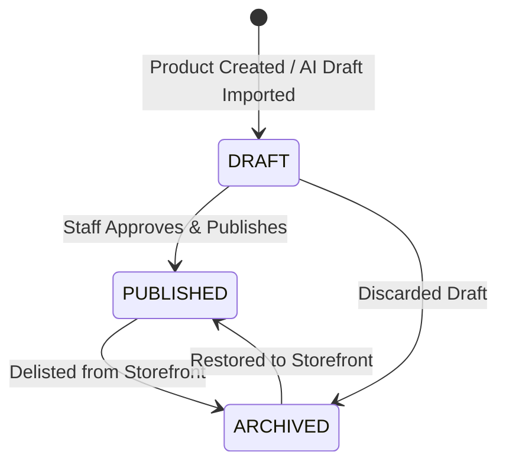

### 2. Inventory Reservation Lifecycle
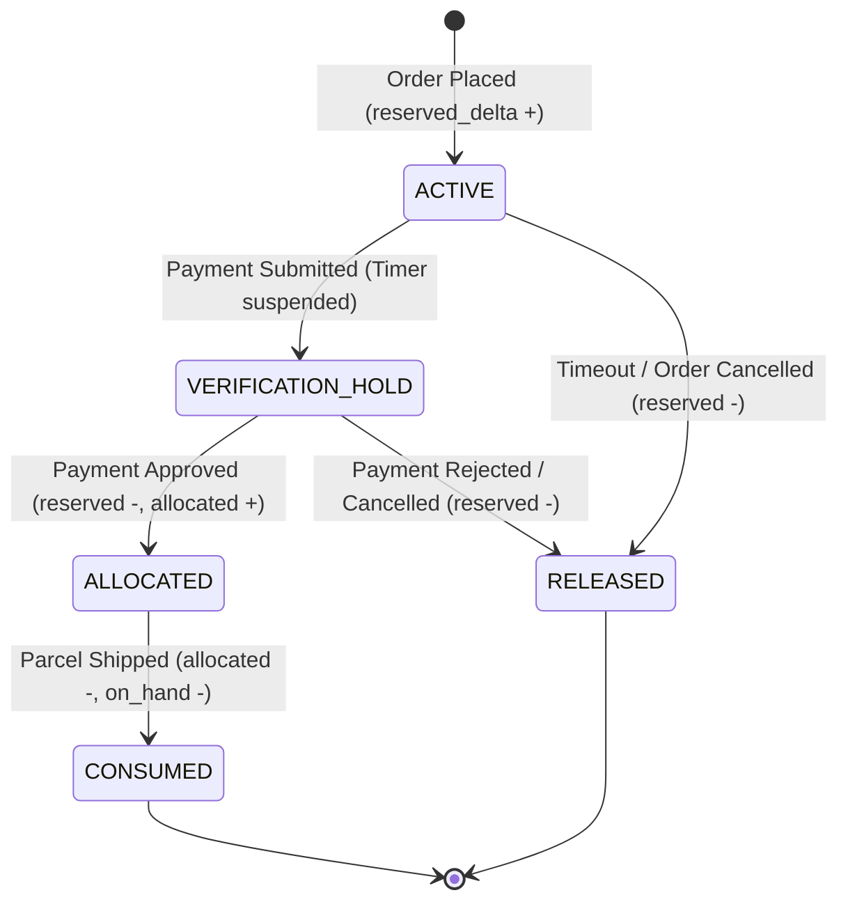

### 3. Order Lifecycle
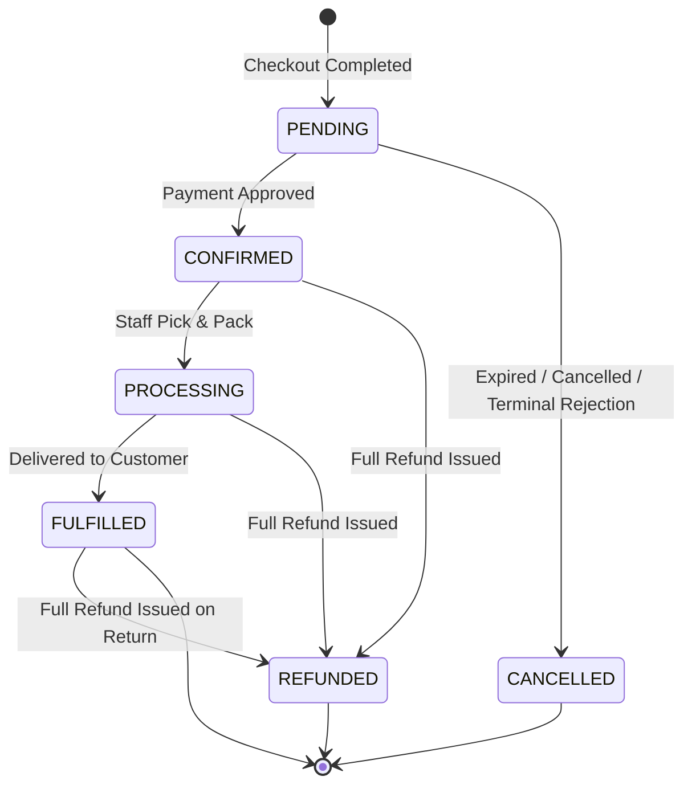

### 4. Payment Lifecycle
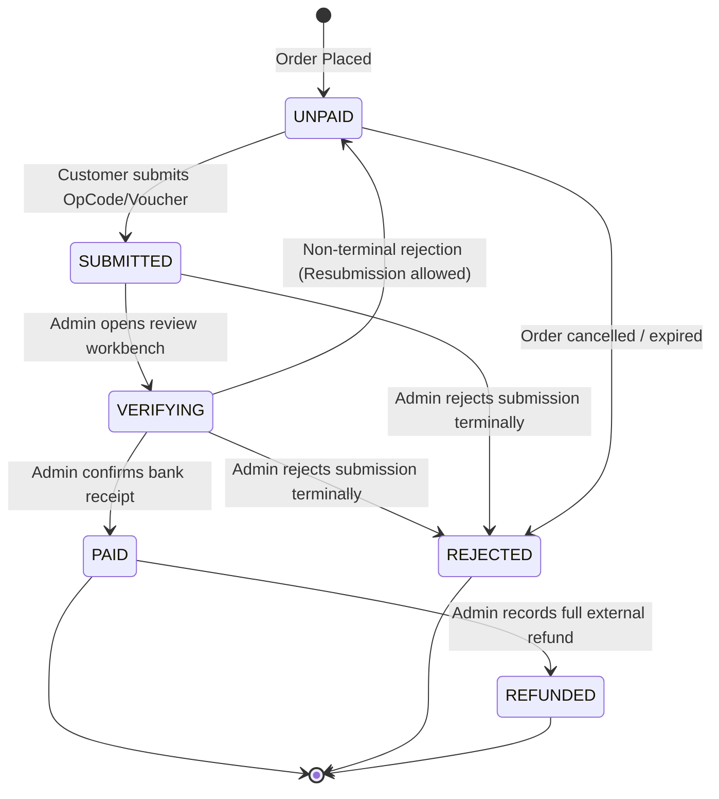

### 5. Fulfillment / Shipment Lifecycle
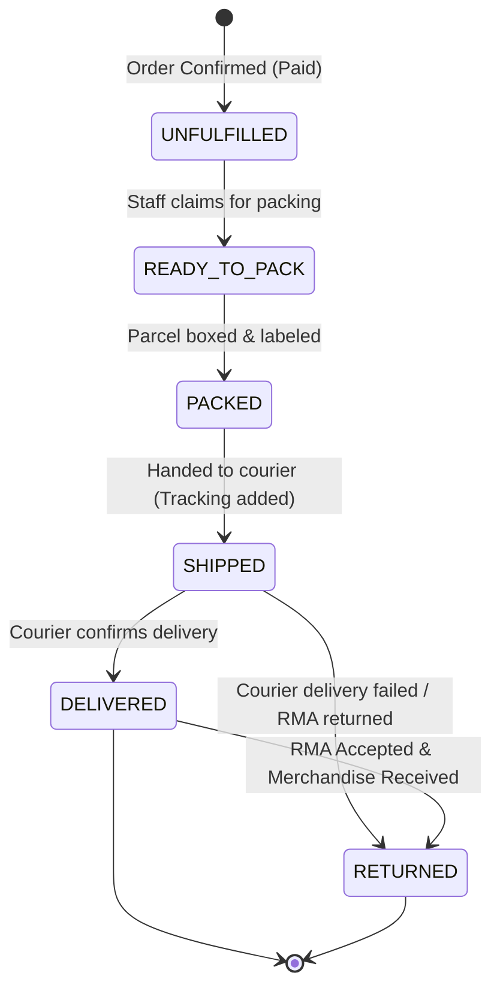

### 6. Commission Lifecycle


---

## 60. Complete Sequence Diagrams

### 1. Cart $\to$ Checkout $\to$ Order Creation
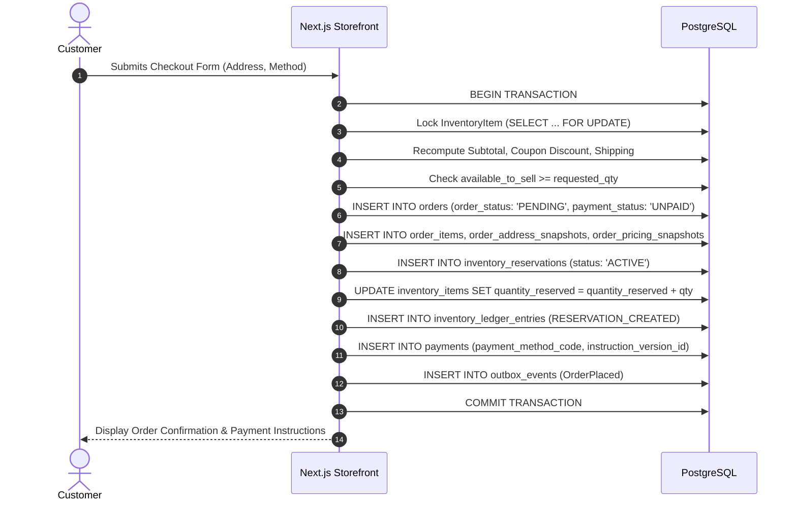

### 2. Concurrent Final-Unit Stock Allocation
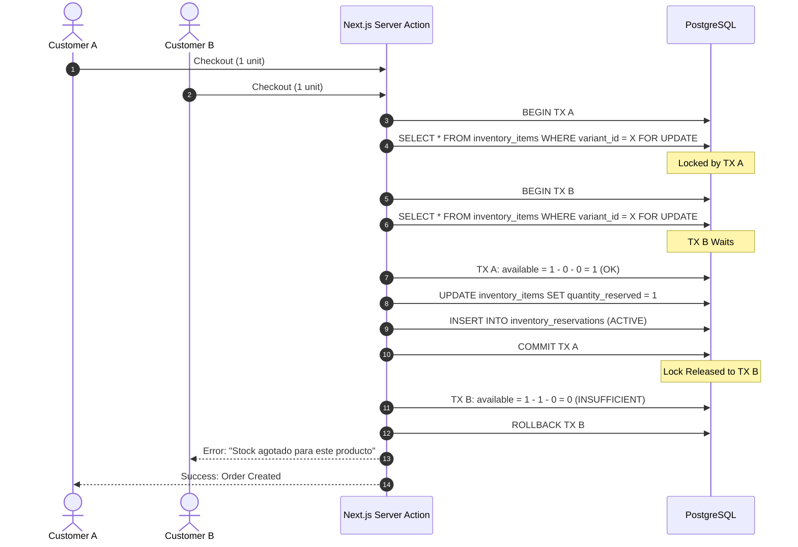

### 3. Yape / Plin Payment Submission $\to$ Admin Verification
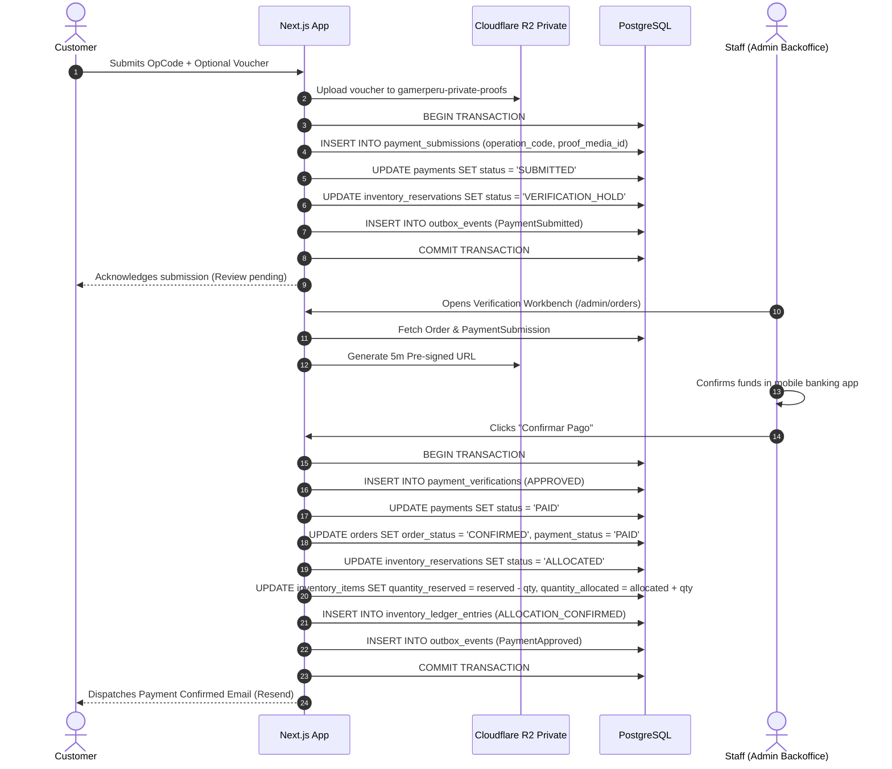

### 4. Reservation Expiry $\to$ Stock Release
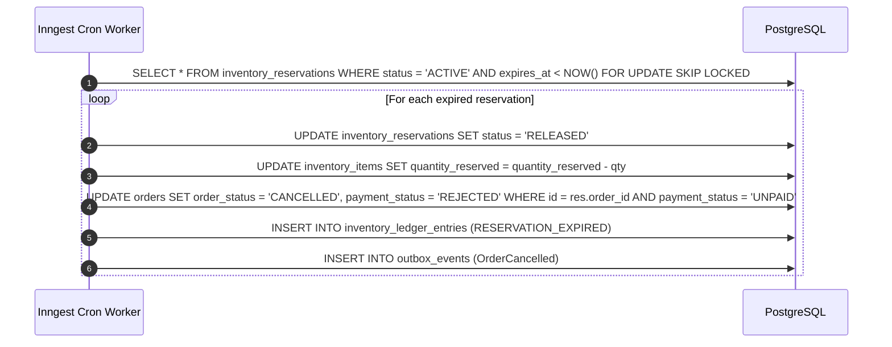

### 5. Cancellation / Refund $\to$ Financial & Inventory Effects
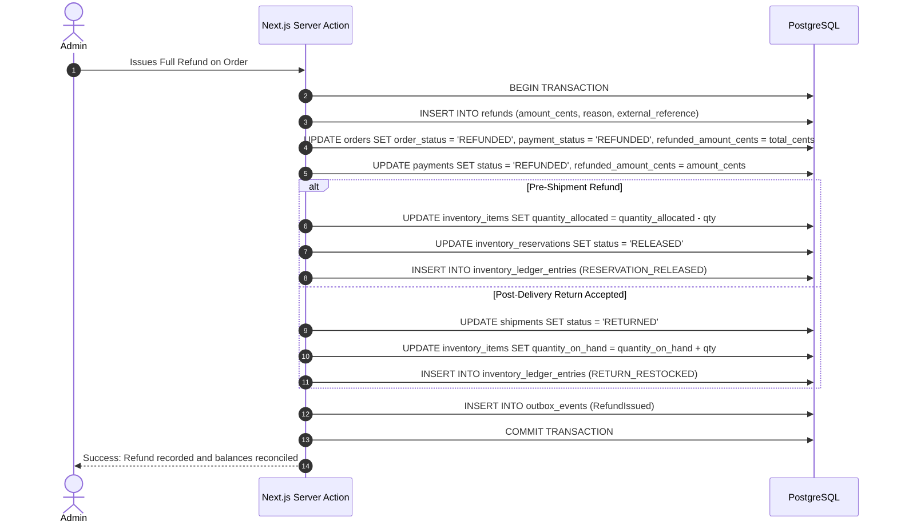

### 6. Affiliate Conversion $\to$ Commission Qualification
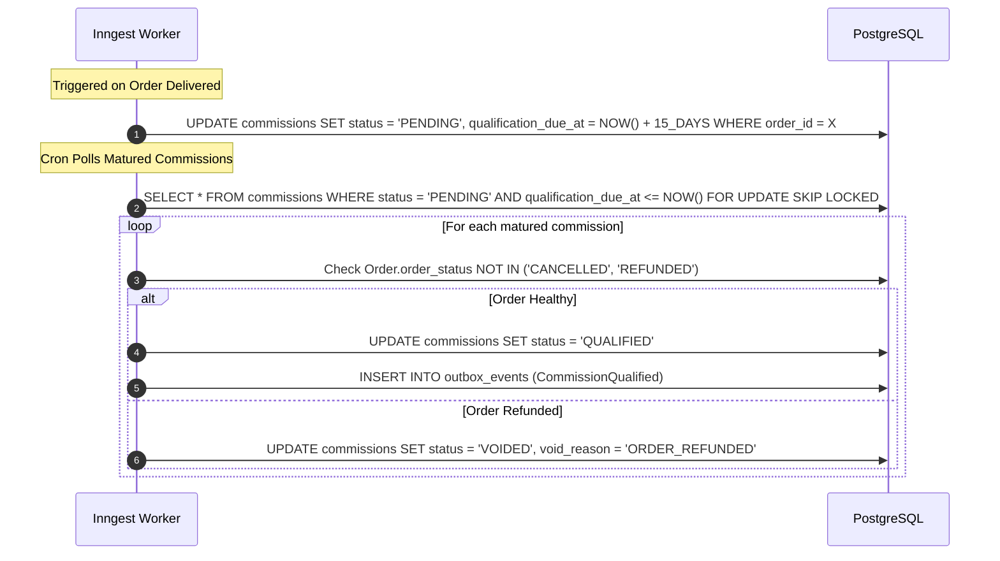

### 7. Commerce Mutation $\to$ Outbox $\to$ Inngest $\to$ EC OS
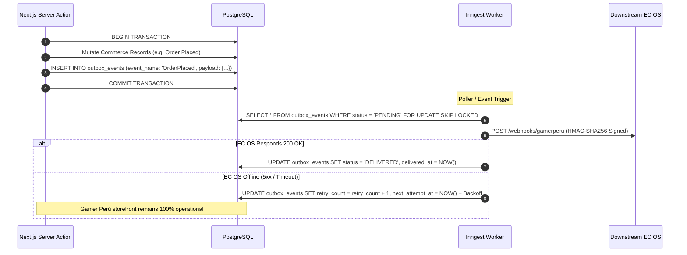

---

## 61. Complete State Transition Tables

### 1. Product Publication Transitions
| Current State | Event / Command | Next State | Allowed Actor | Preconditions | Side Effects | Audit Event |
|---|---|---|---|---|---|---|
| `DRAFT` | `publish_product` | `PUBLISHED` | `ADMIN` | $\ge 1$ active variant; specs validated | Becomes crawlable on Storefront | `catalog:publish` |
| `PUBLISHED` | `archive_product` | `ARCHIVED` | `ADMIN` | None | Delisted from Storefront | `catalog:archive` |
| `DRAFT` | `archive_product` | `ARCHIVED` | `ADMIN` | None | Draft delisted | `catalog:archive` |
| `ARCHIVED` | `restore_product` | `PUBLISHED` | `ADMIN` | Specs valid | Re-indexed on Storefront | `catalog:restore` |

*Forbidden Transitions*: `PUBLISHED` $\to$ `DRAFT`.

---

### 2. Order Transitions
| Current State | Event / Command | Next State | Allowed Actor | Preconditions | Side Effects | Audit Event |
|---|---|---|---|---|---|---|
| `PENDING` | `approve_payment` | `CONFIRMED` | `ADMIN` | Payment is `PAID` | Reservation $\to$ `ALLOCATED`. Outbox: `OrderConfirmed`. | `orders:approve_payment` |
| `PENDING` | `cancel_order` | `CANCELLED` | `CUSTOMER`/`ADMIN`/`SYS` | Unpaid or rejected | Reservation $\to$ `RELEASED`. Outbox: `OrderCancelled`. | `orders:cancel` |
| `CONFIRMED` | `start_processing`| `PROCESSING` | `ADMIN` | None | Fulfillment $\to$ `READY_TO_PACK`. | `orders:process` |
| `PROCESSING` | `confirm_delivery`| `FULFILLED` | `ADMIN`/`SYSTEM`| Shipment `DELIVERED` | Commission qualification timer starts. | `orders:fulfill` |
| `CONFIRMED`/`PROCESSING`/`FULFILLED` | `issue_full_refund`| `REFUNDED` | `ADMIN` | Cumulative refund = total | Stock adjusted. Commission voided/adjusted. | `orders:refund` |

*Forbidden Transitions*: `CANCELLED` $\to$ `CONFIRMED`; `REFUNDED` $\to$ `PROCESSING`.

---

### 3. Payment Transitions
| Current State | Event / Command | Next State | Allowed Actor | Preconditions | Side Effects | Audit Event |
|---|---|---|---|---|---|---|
| `UNPAID` | `submit_evidence` | `SUBMITTED` | `CUSTOMER` | OpCode provided | Reservation $\to$ `VERIFICATION_HOLD`. Outbox: `PaymentSubmitted`. | `payments:submit` |
| `SUBMITTED` | `start_review` | `VERIFYING` | `ADMIN` | None | Locked for admin review | `payments:review` |
| `SUBMITTED`/`VERIFYING` | `approve_payment`| `PAID` | `ADMIN` | Bank funds confirmed | Order $\to$ `CONFIRMED`. Reservation $\to$ `ALLOCATED`. | `payments:approve` |
| `SUBMITTED`/`VERIFYING` | `reject_terminal`| `REJECTED` | `ADMIN` | Fraud/No funds | Order $\to$ `CANCELLED`. Reservation $\to$ `RELEASED`. | `payments:reject` |
| `SUBMITTED`/`VERIFYING` | `reject_resubmit`| `UNPAID` | `ADMIN` | Illegible voucher | Customer prompted to resubmit | `payments:reject_resubmit` |
| `PAID` | `record_full_refund`| `REFUNDED` | `ADMIN` | Full refund recorded | Order $\to$ `REFUNDED`. | `payments:refund` |

*Forbidden Transitions*: `UNPAID` $\to$ `PAID` (customer bypass); `REJECTED` $\to$ `PAID`.

---

### 4. Inventory Reservation Transitions
| Current State | Event / Command | Next State | Allowed Actor | Preconditions | Side Effects | Audit Event |
|---|---|---|---|---|---|---|
| `ACTIVE` | `submit_payment` | `VERIFICATION_HOLD` | `SYSTEM` | Payment submitted | Timer suspended | `inventory:hold` |
| `ACTIVE` | `expire_reservation`| `RELEASED` | `SYSTEM` | `expires_at < NOW()` | `reserved_delta = -qty`. Stock restored. | `inventory:expire` |
| `ACTIVE`/`VERIFICATION_HOLD` | `cancel_reservation`| `RELEASED` | `ADMIN`/`SYS` | Order cancelled | `reserved_delta = -qty`. Stock restored. | `inventory:release` |
| `VERIFICATION_HOLD` | `approve_allocation`| `ALLOCATED` | `ADMIN` | Payment approved | `reserved_delta = -qty`, `allocated_delta = +qty`. | `inventory:allocate` |
| `ALLOCATED` | `dispatch_shipment` | `CONSUMED` | `SYSTEM` | Courier dispatched | `allocated_delta = -qty`, `on_hand_delta = -qty`. | `inventory:consume` |

*Forbidden Transitions*: `RELEASED` $\to$ `ALLOCATED` (must reacquire lock via active check); `CONSUMED` $\to$ `ACTIVE`.

---

### 5. Fulfillment Transitions
| Current State | Event / Command | Next State | Allowed Actor | Preconditions | Side Effects | Audit Event |
|---|---|---|---|---|---|---|
| `UNFULFILLED` | `start_packing` | `READY_TO_PACK` | `ADMIN` | Order `CONFIRMED` | Items claimed | `fulfillment:pack_start` |
| `READY_TO_PACK`| `complete_packing`| `PACKED` | `ADMIN` | Boxed & labeled | Ready for courier | `fulfillment:packed` |
| `PACKED` | `dispatch_courier`| `SHIPPED` | `ADMIN` | Tracking number | Reservation $\to$ `CONSUMED`. Outbox: `OrderShipped`. | `fulfillment:dispatch` |
| `SHIPPED` | `confirm_delivery`| `DELIVERED` | `ADMIN`/`SYS` | Courier confirmation | Order $\to$ `FULFILLED`. Outbox: `OrderDelivered`. | `fulfillment:deliver` |
| `SHIPPED`/`DELIVERED` | `accept_return` | `RETURNED` | `ADMIN` | RMA accepted & items received | Stock restocked via ledger (`RETURN_RESTOCKED`). | `fulfillment:return` |

*Forbidden Transitions*: `UNFULFILLED` $\to$ `SHIPPED` (must pack first).

---

### 6. Commission Transitions
| Current State | Event / Command | Next State | Allowed Actor | Preconditions | Side Effects | Audit Event |
|---|---|---|---|---|---|---|
| `PENDING` | `mature_qualification`| `QUALIFIED` | `SYSTEM` | Qualification window passed & order healthy | Eligible for payout batch | `growth:commission_qualify` |
| `PENDING`/`QUALIFIED` | `void_commission` | `VOIDED` | `SYSTEM`/`ADMIN`| Order cancelled or refunded before payout | Commission invalidated | `growth:commission_void` |
| `QUALIFIED` | `approve_payout` | `APPROVED` | `ADMIN` | Batch created | Ready for banking payout | `growth:commission_approve` |
| `APPROVED` | `execute_payout` | `PAID` | `ADMIN` | Bank transfer completed | Historical record immutable | `growth:commission_paid` |

*Forbidden Transitions*: `PAID` $\to$ `VOIDED` (post-payout refunds insert `CommissionAdjustment`).

---

## 62. Critical Invariants

| # | Invariant Rule | Enforcement Mechanism |
|---|---|---|
| 1 | **Customer Submission $\ne$ Confirmed Payment** | Payment status `PAID` is set strictly by server-side Admin mutation after verifying actual bank receipt. |
| 2 | **Server-Authoritative Pricing** | Checkout calculates line totals from database `ProductVariant.price_cents`; client prices are discarded. |
| 3 | **Zero Negative Available Stock** | $\text{available\_to\_sell} = \text{quantity\_on\_hand} - \text{quantity\_reserved} - \text{quantity\_allocated} \ge 0$. |
| 4 | **ProductVariant as Sellable Unit** | Stock, SKU, and cart lines attach exclusively to `ProductVariant`. |
| 5 | **Immutable OrderItem Snapshot** | Line item price, SKU, product name, and variant title are permanently frozen at purchase time. |
| 6 | **Immutable Address Snapshot** | Delivery address facts are frozen in `OrderAddressSnapshot`; customer address updates never alter historical orders. |
| 7 | **Immutable Promotion Snapshot** | Applied discount amounts and rules are frozen in `OrderPromotionSnapshot`. |
| 8 | **Payment Instructions Frozen** | Order records exact `payment_instruction_version_id` presented at checkout. |
| 9 | **Server-Enforced RBAC** | Privileged actions check `requirePermission('permission:name')` against database role mappings. |
| 10 | **At-Most-Once State Execution** | State transitions are idempotent; replaying a command returns identical state without duplicate side effects. |
| 11 | **Cancelled Orders Cannot Ship** | Fulfillment transitions reject orders with `order_status = 'CANCELLED'`. |
| 12 | **Delivered History Is Preserved** | Returns and refunds mark status orthogonal without erasing historical delivery timestamps. |
| 13 | **Refund $\ne$ Automatic Restock** | Financial refunds never increment physical `on_hand`; restock requires explicit warehouse return acceptance. |
| 14 | **Cumulative Refund Cap** | $\sum \text{Refund.amount\_cents} \le \text{Order.total\_cents}$. |
| 15 | **Paid Commission Immutability** | Paid commissions are never deleted or set to `VOIDED`; post-payout refunds insert `CommissionAdjustment`. |
| 16 | **Downstream Non-Blocking** | EC OS, PostHog, or Resend downtime never rolls back a PostgreSQL commerce transaction. |
| 17 | **AI Advisory Only** | Artificial intelligence never holds authority over prices, stock, order transitions, or sensitive credentials. |

---

## 63. Edge-Case Matrix (25 Complete Scenarios)

| # | Scenario | Starting State | Command / Event | Resulting State | Inventory Consequence | Payment Consequence | Audit & Domain Events | Protection / Concurrency | Configurable Policy |
|---|---|---|---|---|---|---|---|---|---|
| 1 | **Concurrent Final Unit Purchase** | `avail = 1` | Customer A & B checkout | A: `PENDING`, B: Aborts | A: `reserved + 1`, B: None | A: `UNPAID`, B: None | `OrderPlaced` (A) | `SELECT ... FOR UPDATE` row lock | N/A |
| 2 | **Price Changes While in Cart** | Cart has old price | Customer starts checkout | Price updated to current | None | None | `cart:price_recalculated` | Server-side pricing revalidation | N/A |
| 3 | **Variant Archived While in Cart** | Variant in Cart | Customer starts checkout | Checkout rejects item | None | None | None | Variant `status == 'ACTIVE'` check | N/A |
| 4 | **Coupon Expires in Cart** | Coupon in Cart | Customer clicks pay | Coupon rejected with alert | None | None | None | Real-time coupon validity check | N/A |
| 5 | **Duplicate Order Submit** | Cart active | Double-click Submit | Exactly 1 Order created | Reserved exactly once | Exactly 1 Payment | `OrderPlaced` | `IdempotencyKey` on checkout token | N/A |
| 6 | **Duplicate Payment Submission** | Payment `UNPAID` | Double-click Submit OpCode| Exactly 1 Submission added | None | Payment `SUBMITTED` | `PaymentSubmitted` | `IdempotencyKey` on submission attempt | N/A |
| 7 | **Payment Proof Omitted** | Payment `UNPAID` | Submit OpCode without image| Payment `SUBMITTED` | `VERIFICATION_HOLD` | OpCode captured | `PaymentSubmitted` | Validates proof is optional in v1 | N/A |
| 8 | **Proof Storage Unavailable** | Uploading voucher | Cloudflare R2 5xx | OpCode saved; voucher alerts| `VERIFICATION_HOLD` | OpCode captured | `payments:voucher_upload_failed`| Graceful storage degradation | `[TBD BUSINESS DECISION]` |
| 9 | **Payment Submitted at Expiry Edge**| `expires_at` in 5s | Customer submits OpCode | Payment `SUBMITTED` | `VERIFICATION_HOLD` (timer stops)| OpCode captured | `PaymentSubmitted` | Transaction acquires row lock | N/A |
| 10 | **Payment Submitted After Expiry** | Reservation `RELEASED`| Customer submits OpCode | Payment `SUBMITTED` (`is_late`)| Stock not held; manual review | OpCode captured | `payments:late_submission` | Admin manual stock allocation / refund | `[TBD BUSINESS DECISION]` |
| 11 | **Two Admins Approve Concurrently** | Payment `SUBMITTED` | Admin 1 & 2 click Approve | Admin 1 succeeds; 2 no-ops | Converted to `ALLOCATED` once| Payment `PAID` once | `PaymentApproved` (single) | Row lock on `Payment` | N/A |
| 12 | **Admin Rejects Already-Paid** | Payment `PAID` | Admin clicks Reject | Mutation rejected | Allocated stock remains | Payment remains `PAID` | `payments:invalid_transition` | State transition guard | N/A |
| 13 | **Access Other Customer Order** | Customer B logged in| GET `/orders/GP-CUST-A` | 404 / 403 Forbidden | None | None | `security:unauthorized_access` | `session.customerId` query filter | N/A |
| 14 | **Cancel Order Before Payment** | Order `PENDING` | Customer clicks Cancel | Order `CANCELLED` | Reservation $\to$ `RELEASED` | Payment `REJECTED` | `OrderCancelled` | State machine transition | N/A |
| 15 | **Cancel During Verification** | Payment `SUBMITTED` | Customer requests cancel | Admin alerted; review needed| Held until admin resolves | Resolves before cancel | `orders:cancel_requested` | Prevents releasing stock if paid | `[TBD BUSINESS DECISION]` |
| 16 | **Refund After Commission Exists** | Commission `PENDING` | Admin issues Full Refund | Commission `VOIDED` | Pre-ship: released; Post: RMA | Refund recorded | `RefundIssued`, `CommissionVoided`| Commission qualification check | N/A |
| 17 | **Product Renamed After Order** | Product name changed | Admin views past order | Order displays snapshot | None | None | None | `OrderItem.product_name_snapshot` | N/A |
| 18 | **Address Edited After Order** | Address edited in book | Customer views past order | Order displays snapshot | None | None | None | `OrderAddressSnapshot` immutability | N/A |
| 19 | **Inventory Manual Correction** | Warehouse count off | Admin inputs physical audit | `on_hand` updated | `on_hand_delta` logged | None | `inventory:manual_adjustment` | Ledger entry with actor & reason | N/A |
| 20 | **EC OS Offline During Purchase** | EC OS unreachable | Order completed on web | Order `CONFIRMED` locally | Stock allocated locally | Payment `PAID` locally | `OutboxEvent` queued | Outbox retry with backoff | N/A |
| 21 | **PostHog Offline During Purchase** | PostHog unreachable | Order completed on web | Order unaffected | Stock unaffected | Payment unaffected | Sentry logs warning | Non-blocking telemetry | N/A |
| 22 | **AI Provider Offline** | OpenAI/Anthropic 5xx | AI product research job | Job queued in Inngest | None | None | `ai:provider_error` | Inngest step retries | N/A |
| 23 | **Resend Offline During Payment** | Resend 5xx | Payment approved | Order `CONFIRMED` | Stock allocated | Payment `PAID` | Email job queued in Inngest | Async worker retries | N/A |
| 24 | **Outbox Delivery Duplicated** | Network glitch | EC OS receives duplicate | EC OS drops duplicate | None | None | `outbox:duplicate_delivered` | HMAC + `event_id` idempotency | N/A |
| 25 | **Affiliate Self-Referral Attempt**| Affiliate clicks own link| Places order | Attribution rejected | Normal stock allocation | Normal payment | `growth:self_referral_blocked`| `affiliate.user_id != cust.user_id`| N/A |

---

## 64. Business Policy TBD Boundary

The following commercial decisions remain explicitly **`[TBD BUSINESS DECISION]`** and are configured via parameters without hardcoded domain logic:
1. **Courier Provider & API Integrations**: Shalom, Olva, domestic couriers.
2. **Delivery SLA & Shipping Rates**: Fixed/dynamic rates per Peruvian department.
3. **Warranty Duration & Return Window**: Return eligibility periods (e.g. 7, 15, or 30 days).
4. **Reservation Hold TTL**: Numeric unpaid checkout duration (`RESERVATION_TTL_MINUTES`, e.g. 15, 30, or 60 minutes).
5. **Cart Expiry Duration**: Transient cart lifetime (`CART_EXPIRY_DURATION`).
6. **Max Cart Line Quantity**: Per-item ceiling (`MAX_CART_LINE_QUANTITY`).
7. **Affiliate Commission Rates**: Default basis points per partner tier.
8. **Customer Support Communication Channel**: Configuration slot for helpdesk/messaging.

---

## 65. Later-GP Ownership Map

| Domain Area | Governing GP Gate | Implementation Responsibility |
|---|---|---|
| **Authentication & Sessions** | **GP-015** | Better Auth implementation, Argon2id config, session middleware. |
| **Customer Account Portal** | **GP-016** | Customer profile, address book, personal order views. |
| **Cart Domain & Drawer** | **GP-017** | Cart state management, anonymous merge, local storage sync. |
| **Checkout Flow** | **GP-018** | Multi-step checkout, address capture, atomic order transaction. |
| **Yape / Plin Payments** | **GP-019 / GP-020** | QR code display, operation code submission, voucher upload. |
| **Orders & Inventory Engine** | **GP-021** | Inventory reservations, multi-balance ledger movements, stock tracking. |
| **Admin Catalog & Story** | **GP-024 / GP-026** | Product CRUD, 13 visual story blocks, specification schema builder. |
| **Admin Order & Verification** | **GP-027 / GP-028** | Orders workbench, payment verification review, 5m signed URLs. |
| **Referrals & Affiliates** | **GP-031 / GP-032 / GP-034** | Referral rewards, affiliate tracking, commission qualification & adjustments. |
| **AI Customer Assistant** | **GP-035** | Tool gateway, session-filtered customer order queries. |
| **Analytics Engine** | **GP-040** | PostHog event dispatch, server-side purchase tracking. |
| **EC OS Downstream Integration** | **GP-042** | Versioned event payload contracts, outbox webhook delivery. |

---

## 66. Inputs for GP-005 (Repository Bootstrap)

GP-005 will consume the following authoritative specifications from GP-004:
- **Drizzle Schema Organization**: Grouped into modular schema files under `src/db/schema/`:
  - `catalog.ts`: `brands`, `categories`, `collections`, `product_collections`, `products`, `product_variants`, `category_spec_schemas`, `product_specs`, `product_stories`, `product_story_revisions`, `media_assets`.
  - `auth.ts`: `users`, `sessions`, `roles`, `permissions`, `role_permissions`, `user_roles`.
  - `customers.ts`: `customer_profiles`, `customer_addresses`, `wishlist_items`, `reviews`.
  - `cart.ts`: `carts`, `cart_items`.
  - `inventory.ts`: `inventory_locations`, `inventory_items`, `inventory_ledger_entries`, `inventory_reservations`.
  - `orders.ts`: `orders`, `order_items`, `order_address_snapshots`, `order_pricing_snapshots`, `order_promotion_snapshots`.
  - `payments.ts`: `payment_method_configurations`, `payment_instruction_versions`, `payments`, `payment_submissions`, `payment_verifications`, `refunds`.
  - `shipping.ts`: `shipping_methods`, `shipments`, `shipment_items`.
  - `promotions.ts`: `promotions`, `promotion_targets`, `coupons`, `coupon_redemptions`.
  - `growth.ts`: `referral_programs`, `referral_codes`, `referral_attributions`, `affiliates`, `affiliate_codes`, `affiliate_clicks`, `affiliate_attributions`, `commissions`, `commission_adjustments`, `payout_batches`.
  - `system.ts`: `content_slots`, `audit_events`, `domain_events`, `outbox_events`, `idempotency_keys`.
- **UUIDv7 Strategy**: PostgreSQL `uuid` column type. UUIDv7 values generated at application layer using TypeScript RFC 9562 library.
- **Required PostgreSQL Extensions**: `pg_trgm` (for full-text and typo-tolerant search).

---

## 67. GP-004 Definition of Done

* [x] Canonical `COMMERCE_DOMAIN_MODEL.md` created covering all 67 required sections.
* [x] Complete 25-scenario edge-case matrix present and fully articulated.
* [x] All 7 required Mermaid sequence diagrams present and complete.
* [x] All 6 required Mermaid state diagrams present with exact matching enums.
* [x] State transition tables created for every major lifecycle with forbidden rules.
* [x] Collection domain modeled with membership relations.
* [x] Category specification schema versioning corrected (`UNIQUE(category_id, schema_version)`).
* [x] Payment method abstraction and instruction versioning established.
* [x] Late payment handling modeled without undeclared pseudo-states.
* [x] Full and partial refund model reconciled with cumulative cap.
* [x] Pre-shipment allocation release vs post-delivery merchandise restock separated.
* [x] Multi-balance inventory ledger (`on_hand_delta`, `reserved_delta`, `allocated_delta`) defined.
* [x] Order to InventoryReservation cardinality (1-to-many) and line traceability modeled.
* [x] Self-referral identity traversal corrected (`affiliate.user_id != customer.user_id`).
* [x] Post-payout commission adjustments modeled.
* [x] Zero application source code, Drizzle schemas, migrations, or `package.json` created.
* [x] GP-005 remains PLANNED and unexecuted.
