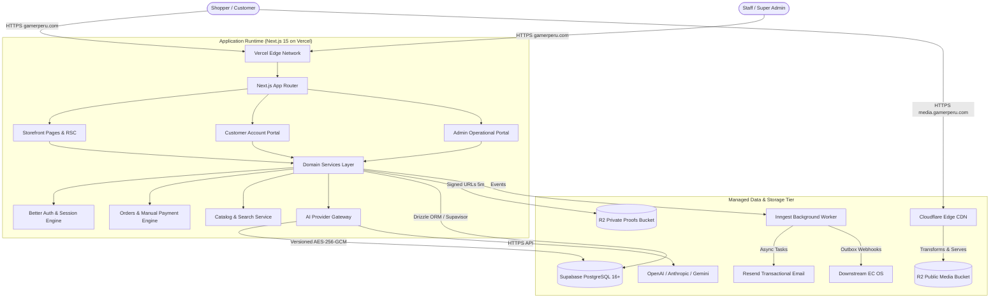
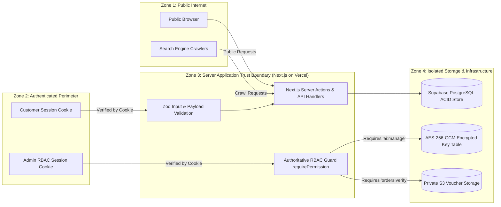

# Gamer Perú — Canonical Technology Architecture Specification

---

## 1. Executive Decision Summary

This document defines the canonical technology architecture for **Gamer Perú** (`gamerperu.com`). It establishes the authoritative software stack, runtime environments, data boundaries, security models, hosting topology, and operational infrastructure required to build a high-performance multi-brand gaming peripherals e-commerce platform in Peru.

**Canonical Decisions Summary**:
- **Architecture Paradigm**: **Modular Monolith** with managed cloud infrastructure (avoiding premature microservices).
- **Application Framework**: **Next.js (App Router, Next.js 15 Active Production Line)** with **TypeScript (5.x)** running on the **Node.js 22 LTS Runtime**, providing server-rendered catalog pages, React Server Components (RSC), streaming AI responses, and strict server-side authorization.
- **Application Hosting**: **Vercel** hosting the application domain (`gamerperu.com`) on the Vercel Edge Network with serverless Node.js execution.
- **Commerce Domain Engine**: **Custom Gamer Perú Commerce Domain** owned entirely in TypeScript, optimized for Peruvian domestic payments (`YAPE_MANUAL`, `PLIN_MANUAL`), dynamic multi-category hardware specifications, and modular Product Story layouts.
- **Database & Data Layer**: **Supabase PostgreSQL (PostgreSQL 16+)** with **Drizzle ORM** and Supavisor connection pooling, utilizing a **Free-First, Upgrade-Ready** operational strategy (zero code changes required to upgrade from Free to Pro).
- **Authentication & RBAC**: **Better Auth** with a PostgreSQL session store, **Argon2id** password hashing, and authoritative server-side Role-Based Access Control (`requirePermission`).
- **Object Storage & Media Pipeline**: **Cloudflare R2** with Cloudflare Edge Media Delivery and on-the-fly Image Transformations for public media (`media.gamerperu.com`); isolated private bucket (`gamerperu-private-proofs`) with short-lived (5-minute expiration) pre-signed URLs for customer Yape/Plin vouchers. (Supabase Storage is explicitly NOT used for the product catalog).
- **Search & Asynchronous Processing**: **PostgreSQL Full-Text Search + Trigram (`pg_trgm`)** behind a clean `SearchProvider` adapter for v1; **Inngest** for durable asynchronous background workflows (AI product imports, email retries, outbound EC OS events).
- **AI Infrastructure & Credential Security**: Multi-provider AI Gateway (OpenAI, Anthropic, Google Gemini) with versioned **AES-256-GCM** encryption-at-rest for admin-managed API keys, separated from the database runtime master key.
- **Communications, Analytics & Observability**: **Resend + React Email**, **First-Party PostgreSQL Event Ledger + PostHog**, and **Sentry + Pino** structured JSON logging with automatic PII masking.
- **Testing & Deployment**: **Vitest** (Unit/Integration) + **Playwright** (E2E & a11y) + **GitHub Actions CI/CD** with automated previews and staging promotion.

---

## 2. Decision Date & Research Method

- **Decision Date**: August 16, 2026
- **Research Method**: Every candidate technology was evaluated against official vendor and open-source project documentation, current stable production releases, enterprise support longevity, Latin American regional latency, operational complexity, and alignment with Gamer Perú's canonical specifications.
- **Primary Documentation Sources Consulted**:
  - Next.js 15 Active Production Line Documentation (`nextjs.org/docs`)
  - Node.js 22 LTS Documentation (`nodejs.org/docs/latest-v22.x/`)
  - PostgreSQL 16 Official Manual (`postgresql.org/docs/16/`)
  - Supabase Database & Supavisor Docs (`supabase.com/docs/guides/database`)
  - Drizzle ORM Documentation (`orm.drizzle.team/docs`)
  - Cloudflare R2 & Image Optimization Docs (`developers.cloudflare.com/r2/`, `developers.cloudflare.com/images/`)
  - Better Auth Documentation (`better-auth.com/docs`)
  - Inngest Durable Execution Docs (`inngest.com/docs`)
  - Resend & React Email Documentation (`resend.com/docs`, `react.email/docs`)
  - PostHog Product Analytics Docs (`posthog.com/docs`)
  - Sentry SDK Documentation (`docs.sentry.io`)
  - Web Content Accessibility Guidelines (WCAG 2.1 AA)

---

## 3. Canonical Constraints

1. **Peru-First Multi-Brand Focus**: Architecture must natively support domestic Soles (`S/`) pricing, Yape and Plin manual verification workflows, local courier integrations, and domestic inventory transparency.
2. **SEO & Performance Dominance**: Zero client-only rendering for public catalog content; all products, categories, specs, and editorial stories must render as crawlable semantic HTML with near-zero Cumulative Layout Shift (CLS).
3. **No Premature Microservices**: All core business capabilities (Storefront, Customer Hub, Cart, Checkout, Inventory, Admin, Affiliates, AI Product Assistant) reside within a single modular codebase with explicit boundaries.
4. **EC OS Operational Independence**: Downstream failure or latency in EC OS must NEVER degrade, delay, or block Gamer Perú storefront sales or administrative payment verification.
5. **AI Never Source of Truth**: Artificial intelligence is strictly an advisory, extraction, and presentation layer; prices, stock levels, orders, and payment confirmations are governed exclusively by deterministic application logic and database transactions.

---

## 4. Architecture Principles

1. **Authority at the Server**: Privileged authorization, business rule validation, inventory reservation, and payment status transitions occur strictly on the server. Client state is treated as untrusted presentation.
2. **Type Safety Across Boundaries**: A single TypeScript domain layer ensures type consistency from database schemas and domain models to server actions and React components.
3. **Data Isolation & Least Privilege**: Public marketing data, authenticated customer records, and internal business margins occupy isolated security zones.
4. **Resilient Asynchrony**: Any operation exceeding 500ms (AI research, batch imports, email delivery, outbound webhooks) is delegated to durable background workers with automatic retries and backoff.
5. **Reversibility & Standard Interfaces**: All external infrastructure (search, email, storage, AI) is accessed through domain adapter interfaces, preventing vendor lock-in.

---

## 5. Selected Architecture Overview

```text
+---------------------------------------------------------------------------------------------------+
|                                     CLIENT SURFACES                                               |
|  Public Storefront (Desktop/Mobile)  |  Customer Portal  |  Admin Operational Backoffice          |
+---------------------------------------------------------------------------------------------------+
                                                  |  (HTTPS / Next.js Server Actions / APIs)
                                                  v
+---------------------------------------------------------------------------------------------------+
|                            APPLICATION RUNTIME (Next.js 15 on Vercel)                             |
|                                                                                                   |
|  +-----------------------+  +------------------------+  +---------------------------------------+ |
|  | Route Group: Storefront|  | Route Group: Customer  |  | Route Group: Admin                    | |
|  | - Server Components    |  | - Auth Session Guard   |  | - Server-Side RBAC Guard               | |
|  | - Streaming Product SSR|  | - Customer Order Views |  | - Yape/Plin Verification Workflow    | |
|  | - JSON-LD / SEO engine |  | - Wishlist / Addresses |  | - Inventory & Product Story Builder   | |
|  +-----------------------+  +------------------------+  +---------------------------------------+ |
|                                                                                                   |
|  +----------------------------------------------------------------------------------------------+ |
|  |                           MODULAR DOMAIN SERVICES LAYER (TypeScript)                        | |
|  |  [Catalog]  [Cart & Checkout]  [Orders & Payments]  [Inventory]  [Affiliates]  [AI Gateway]  | |
|  +----------------------------------------------------------------------------------------------+ |
+---------------------------------------------------------------------------------------------------+
      |                       |                       |                      |               |
      v                       v                       v                      v               v
+-------------+      +------------------+      +-------------+      +-----------------+  +----------+
| Supabase    |      | Cloudflare R2    |      | Inngest     |      | AI Providers    |  | Resend   |
| PostgreSQL  |      | Object Storage   |      | Async Queue |      | (OpenAI/Anth/   |  | Transact |
| (Postgres16+|      | - Public Media   |      | - AI Jobs   |      |  Gemini Gateway)|  | Email    |
| + Drizzle)  |      | - Private Proofs |      | - Retries   |      | Encrypted Keys  |  | Templates|
+-------------+      +------------------+      +-------------+      +-----------------+  +----------+
```

---

## 6. Logical Architecture Diagram



---

## 7. Trust Boundary Diagram



---

## 8. Application Framework & Runtime

- **Selected Framework**: **Next.js (App Router)** with **TypeScript** on the **Next.js 15 Active Production Line** (ADR-001).
- **Server Runtime**: **Node.js 22 LTS** in serverless execution mode.
- **Rendering Strategy**:
  - *Public Catalog / Product Story*: Streaming Server-Side Rendering (SSR) with React Server Components (RSC) and On-Demand Incremental Static Regeneration (ISR) for static policy pages.
  - *Dynamic Commerce Data*: Product stock availability, cart drawers, and price checks render with fresh server data on request.
  - *Customer Hub & Admin Backoffice*: Dynamic server rendering with strict server-side session checks.
- **API & Server Mutations**: Implemented primarily via type-safe Next.js **Server Actions** backed by Zod schemas, minimizing boilerplate REST endpoint maintenance while guaranteeing server-side execution.

---

## 9. Storefront / Admin Topology

- **Topology Model**: **Single Unified Modular Application (Modular Monolith)** (ADR-001).
- **Route Structure**:
  - `app/(storefront)/*`: Public catalog, search, product detail pages, marketing, and footer pages.
  - `app/(customer)/*`: Authenticated customer profile, saved addresses, order tracking, and wishlist.
  - `app/(admin)/*`: Protected administrative backoffice, inventory management, Yape/Plin verification workbench, staff management, and AI settings.
  - `app/api/*`: Webhook endpoints (Resend, Inngest, EC OS) and specialized streaming AI endpoints.
- **Security Boundary**: Security is enforced at the layout, server action, and database query layers. Non-admin sessions attempting to access `/admin` are rejected by server middleware before any UI or data leaks.

---

## 10. Commerce Engine Strategy

- **Selected Strategy**: **Custom Gamer Perú Commerce Domain** on PostgreSQL (ADR-002).
- **Core Modules**:
  - `Cart & Pricing`: Client cart state synchronized with server-side pricing in Soles (`S/`) and promotional discount calculators.
  - `Checkout & Reservation`: Atomic inventory reservation during order placement using PostgreSQL row-level locks (`SELECT ... FOR UPDATE`).
  - `Manual Payment Verification`: State machine specifically designed for Yape/Plin domestic verification (customer submission enters verification workflow; authorized admin verifies funds before approving/rejecting; all transitions audited). Exact state machine names and timing remain deferred to GP-004 and GP-020.
  - `Multi-Category Hardware Catalog`: Dynamic specifications stored in structured JSONB columns with category-specific Zod schema validation (Mice, Keyboards, Audio, Mousepads).
  - `Product Story Engine`: Modular 13-block editorial PDP content builder.
  - `Affiliates & Commissions`: First-party affiliate tracking, coupon attribution, and commission status management with automatic invalidation upon order cancellation or return.

---

## 11. Database & Data Access

- **Managed Database Provider**: **Supabase PostgreSQL** (PostgreSQL 16+ engine) with Supavisor connection pooling (ADR-002).
- **Data Access Layer**: **Drizzle ORM** (TypeScript-native schema-as-code).
- **Free-First Operational Strategy**:
  - *Local Development*: Local PostgreSQL instance (native or Docker Compose).
  - *Early Cloud Development / Pre-Launch*: **Supabase Free Plan** (500MB storage, Supavisor connection pooling).
  - *Free-Stage Backup Strategy*: Automated scheduled logical database dumps (`pg_dump`) encrypted with AES-256 and stored in an isolated private Cloudflare R2 backup bucket (`gamerperu-db-backups-private`) with 30-day retention.
  - *Pro Upgrade Triggers*: Transition to **Supabase Pro** ($25/mo) triggered by:
    1. Sustained production customer order flow (eliminating inactivity pausing).
    2. Database size exceeding 350 MB (70% of free limit).
    3. Requirement for managed automated daily backups and 7-day Point-in-Time Recovery (PITR).
    4. Concurrency demands requiring unthrottled compute.
  - *Zero-Rewrite Guarantee*: Transitioning from Supabase Free to Supabase Pro is an infrastructure billing plan change requiring zero application code modifications.
- **Portability Boundary**: Application domain logic uses pure Drizzle ORM and standard SQL queries; proprietary Supabase client libraries are avoided in core domain services to preserve complete PostgreSQL portability.

---

## 12. Authentication

- **Authentication Framework**: **Better Auth** with a **PostgreSQL Database Session Store** (ADR-003).
- **Password Security**: Passwords hashed using **Argon2id** for robust defense against GPU-based brute force attacks.
- **Session Transport**: Encrypted, `HttpOnly`, `SameSite=Lax`, `Secure` session cookies.
- **Session Security Properties**:
  - `HttpOnly` prevents client-side JavaScript access to session tokens, mitigating token extraction via XSS.
  - `Secure` mandates HTTPS transport for all session cookies.
  - `SameSite=Lax` mitigates Cross-Site Request Forgery (CSRF) on cross-origin requests.
  - Session revocation immediately invalidates active sessions upon password reset or admin privilege modification.
- **Customer Flows**: Registration, login, password reset via signed email tokens, and profile update.

---

## 13. Authorization / RBAC Boundary

- **Authorization Model**: **Authoritative Server-Side RBAC** (ADR-003).
- **Role Definitions**:
  - `SUPER_ADMIN`: Unrestricted platform access, staff provisioning, encrypted AI credential configuration, audit export.
  - `ADMIN_CATALOG`: Product creation, spec management, pricing, category taxonomy, AI product research drafts.
  - `ADMIN_ORDERS`: Order status updates, Yape/Plin payment verification, shipping tracking assignment.
  - `ADMIN_SUPPORT`: Customer inquiry management, return/RMA review.
  - `CUSTOMER`: Standard customer account access restricted exclusively to owned records.
- **Enforcement Rules**:
  - Every administrative server action and page layout invokes `requirePermission('permission:name')`.
  - Customer queries automatically filter by `session.customerId` derived from the verified session cookie; client-supplied user IDs are ignored.

---

## 14. Public Media Storage

- **Storage Provider**: **Cloudflare R2** with **Cloudflare Edge CDN** (ADR-004).
- **Bucket**: `gamerperu-public-media` (Served via `media.gamerperu.com`).
- **Image Optimization**: Cloudflare Image Transformations dynamically generate responsive WebP and AVIF variants based on client `Accept` headers and viewport parameters.
- **Caching**: `Cache-Control: public, max-age=31536000, immutable` for immutable hashed assets.
- **Supabase Storage Boundary**: Supabase Storage is explicitly **NOT** used for the product catalog.

---

## 15. Private Payment-Proof Storage

- **Storage Provider**: **Cloudflare R2 Private Bucket** (`gamerperu-private-proofs`) (ADR-004).
- **Access Control**: Completely closed to public HTTP access (no custom domain, zero CDN caching, no public directory listing).
- **Access Model**: Authorized **short-lived S3/R2 pre-signed URLs** (5-minute expiration) generated on-demand by server actions only after verifying the admin's `orders:verify` permission.
- **Bearer Credential Semantics**: Because an unexpired signed URL functions as a temporary bearer credential, URLs are transmitted strictly over HTTPS, never logged in standard application log streams, never included in analytics, served with `Cache-Control: private, no-store`, and logged as an authorization audit event upon generation.
- **Upload Validation**: Enforces strict MIME type checks (JPEG, PNG, WebP) and a 5MB size limit.

---

## 16. Search Architecture

- **v1 Search Engine**: **PostgreSQL Full-Text Search (`tsvector`) + Trigram Similarity (`pg_trgm`)** (ADR-005).
- **Search Capabilities**: Sub-10ms queries across product titles, brand names, categories, and technical attributes with typo tolerance and Spanish stemming. (Performance benchmarks will be measured during implementation).
- **Abstraction**: Encapsulated behind a clean TypeScript **`SearchProvider`** interface.
- **Degradation Semantics**: Because PostgreSQL is the search engine, search availability is directly coupled to primary database health. If advanced trigram search is degraded, simplified SQL filtering (`ILIKE`) serves as an emergency fallback only while the database remains healthy.
- **Scale / Migration Trigger**: If the catalog exceeds 10,000 SKUs or requires complex vector similarity, `SearchProvider` can transition to **Meilisearch** or **Typesense** without altering UI or business logic.

---

## 17. Caching Architecture

- **Public Edge Caching**: Category pages, brand directories, and static editorial content cached at the Cloudflare Edge CDN with tag-based on-demand revalidation.
- **Authoritative Dynamic Boundary**: Cart calculations, checkout availability, inventory reservations, customer account data, and admin interfaces are strictly excluded from edge caching (`Cache-Control: no-store`).
- **Checkout Invariant**: Checkout always queries the database directly with row-level locks before confirming an order.

---

## 18. Background Jobs & Asynchronous Queues

- **Job Orchestrator**: **Inngest** (ADR-005).
- **Supported Workflows**:
  - Long-running AI Product Research & enrichment jobs (15–45s).
  - Batch product imports with provider rate-limiting.
  - Transactional email dispatch with exponential backoff retries.
  - Outbound EC OS integration event delivery with dead-letter queueing.
  - Cache warming workflows.
- **Reliability**: Step-level state persistence, automatic retries, idempotency keys, and full execution observability.

---

## 19. AI Provider Architecture

- **Abstraction Layer**: Implements `docs/architecture/AI_PROVIDER_ARCHITECTURE.md` (ADR-007).
- **Adapter Interface**: Unified TypeScript `AIProvider` supporting **OpenAI**, **Anthropic**, and **Google Gemini**.
- **AI Profiles**: Reusable operational profiles (`PRODUCT_RESEARCH_FAST`, `PRODUCT_RESEARCH_DEEP`, `SEO_COPY`, `PRODUCT_STORY`, `BATCH_IMPORT`, `CUSTOMER_SUPPORT`).
- **Output Safety**: All model outputs are strictly validated through Zod schemas before being presented as draft proposals for human admin approval.

---

## 20. AI Credential Storage & Security

- **Encryption Standard**: **AES-256-GCM** with authenticated data (ADR-007).
- **Key Lifecycle & Versioning**:
  - The database table stores: `ciphertext`, `iv` (12 bytes), `auth_tag` (16 bytes), and `key_version` (integer, e.g. `1`).
  - The master key (`AI_ENCRYPTION_KEY_V1`, 256-bit) is injected securely at server runtime via environment variables, completely separated from the Supabase database. The database must **NEVER** store the root encryption key.
  - **Key Rotation**: When rotating keys, a new environment variable (`AI_ENCRYPTION_KEY_V2`) is defined alongside previous versions. A migration command decrypts records using their respective `key_version` and re-encrypts them with the active version.
  - **Recovery Requirement**: Database backups contain ciphertext only. Restoring a database snapshot requires the corresponding root encryption keys from an independent, secure credential backup.
- **Admin UI Masking**: Admin settings display only masked identifiers (`sk-...abcd`) and connection health test status; plaintext keys are never returned to the client.
- **In-Memory Decryption**: Decryption occurs strictly within server-side AI adapters during job execution.

---

## 21. AI Customer Assistant Boundary

- **Architecture Boundary**: Implements `docs/architecture/AI_CUSTOMER_ASSISTANT_ARCHITECTURE.md` (ADR-007).
- **Data Zones**:
  - `PUBLIC`: Published products, prices, specifications, public FAQs.
  - `CUSTOMER_PRIVATE`: Customer's own orders, accessed strictly via session-verified tool functions (e.g. `get_my_order(session_customer_id, order_ref)`).
  - `INTERNAL`: Internal margins, supplier costs, unapproved drafts, and secrets are physically excluded from tool gateways.
- **SQL Protection**: The LLM has zero direct database or SQL execution access.

---

## 22. Validation Architecture

- **Validation Engine**: **Zod** across the entire application stack.
- **Validation Layers**:
  - *HTTP Inputs & Server Actions*: Form parameters and mutation payloads validated before execution.
  - *AI Structured Outputs*: Model JSON responses validated against strict entity schemas.
  - *Environment Variables*: Server configuration validated at startup via Zod schemas.
  - *Integration Webhooks*: EC OS and Resend webhook signatures and payloads validated.

---

## 23. Manual Payment Architecture

- **Canonical v1 Methods**: `YAPE_MANUAL` and `PLIN_MANUAL` (ADR-002).
- **Workflow Invariants**:
  1. Order placed $\to$ inventory reserved for payment window $\to$ payment instructions and QR code displayed.
  2. Customer inputs operation code and optional voucher upload. (Explicitly informs customer that submission does NOT equal confirmed payment).
  3. Payment enters verification workflow $\to$ authorized admin checks actual bank receipt.
  4. Admin confirms or rejects payment $\to$ order transitions accordingly.
  5. All status transitions are fully audited and sensitive mutations are idempotent.
  6. Exact state machine names and timing windows remain deferred to GP-004 and GP-020.

---

## 24. Email & Transactional Communications

- **Provider**: **Resend** with **React Email** (ADR-006).
- **Template Architecture**: Type-safe React components shared within the codebase.
- **Transactional Triggers**: Order confirmation, payment submitted notice, payment verified receipt, order shipped tracking, password reset.
- **Reliability**: Dispatched via Inngest background jobs with automatic retry on provider downtime.

---

## 25. Analytics Architecture

- **First-Party Commerce Ledger**: Financial revenue, orders, and affiliate commission attribution are computed exclusively from PostgreSQL records (ADR-006).
- **Product & Funnel Analytics**: **PostHog** for privacy-first, cookieless traffic and funnel metrics without heavy client scripts.
- **Outage Semantics**: If PostHog is temporarily unavailable, core commerce continues unimpeded. Non-critical behavioral event loss is accepted as best-effort; financial and order records remain 100% intact and derivable from PostgreSQL.
- **Privacy Standard**: Zero PII (passwords, vouchers, customer phone numbers) sent to external analytics.

---

## 26. Observability & Logging

- **Error & Performance Tracking**: **Sentry** for full-stack exception reporting, source map integration, and Core Web Vitals tracking (ADR-006).
- **Structured Logging**: **Pino** formatting JSON logs with automated redaction filters for passwords, API tokens, and voucher IDs.
- **Alerting**: Critical alerts on payment verification queues, AI provider failures, and 5xx spikes.

---

## 27. Hosting, CDN & Deployment Topology

- **Application Hosting Platform**: **Vercel** hosting the application domain (`gamerperu.com`) on the Vercel Edge Network with serverless Node.js execution (ADR-008).
- **Media CDN**: **Cloudflare Edge CDN** hosting the media domain (`media.gamerperu.com`) with Cloudflare Image Transformations backed by Cloudflare R2 (ADR-004).
- **Environment Separation**:
  - `LOCAL`: Developer workstations (Local Node.js + Local/Docker PostgreSQL).
  - `PREVIEW`: Ephemeral pull-request preview deployments on Vercel.
  - `STAGING`: Staging environment for pre-release validation.
  - `PRODUCTION`: High-availability production environment (`gamerperu.com`).

---

## 28. Environment Configuration Model

| Config Class | Storage Location | Example Variables | Exposure |
|---|---|---|---|
| **PUBLIC CONFIG** | `NEXT_PUBLIC_*` | `NEXT_PUBLIC_SITE_URL`, `NEXT_PUBLIC_CDN_URL` | Browser & Server |
| **SERVER CONFIG** | Server Environment | `DATABASE_URL`, `RESEND_API_KEY`, `R2_ACCESS_KEY` | Server Runtime Only |
| **MASTER SECRET** | Server Environment | `AI_ENCRYPTION_KEY_V1`, `BETTER_AUTH_SECRET` | Server Runtime Only |
| **ENCRYPTED SECRET** | PostgreSQL Table | Encrypted OpenAI/Anthropic/Gemini API Keys | In-Memory Decryption Only |

---

## 29. Local Development Architecture

- **Zero Cloud Requirement for Basic Dev**: Developers can clone the repository, run `pnpm install`, launch a local PostgreSQL container, run migrations (`pnpm db:migrate`), and start the dev server (`pnpm dev`).
- **Mock Adapters**: Built-in mock adapters for email (console output), object storage (local filesystem), and AI providers (mock responses) enable full offline feature development.

---

## 30. Testing Architecture

- **Unit & Domain Tests**: **Vitest** testing domain entities, pricing calculators, and state machines (ADR-008).
- **Integration Tests**: **Vitest** with isolated PostgreSQL database verifying Drizzle queries and transaction integrity.
- **End-to-End Tests**: **Playwright** testing multi-viewport customer journeys and admin workflows.
- **Accessibility Testing**: `@axe-core/playwright` assertions embedded in E2E suites verifying WCAG 2.1 AA compliance.

---

## 31. CI/CD Architecture

- **Pipeline Runner**: **GitHub Actions** (ADR-008).
- **Validation Gates**: Type check (`tsc`), Lint (`eslint`), Format (`prettier`), Unit/Integration test execution, Build verification, and Ephemeral Preview deployment.
- **Production Gate**: Migration verification and atomic zero-downtime deployment with instant rollback.

---

## 32. Backups & Disaster Recovery

- **Supabase Free Phase Backup Model**: Automated scheduled logical database dumps (`pg_dump`) encrypted with AES-256 and stored in an isolated private Cloudflare R2 backup bucket (`gamerperu-db-backups-private`) with 30-day retention.
- **Supabase Production Paid Phase Backup Model**: Managed automated daily backups with 7-day Point-in-Time Recovery (PITR) enabled upon upgrading to Supabase Pro ($25/mo).
- **Media Redundancy**: Object storage versioning enabled on Cloudflare R2 public and private buckets.
- **Recovery Requirement**: Restoring a database snapshot requires access to corresponding root encryption keys from an independent, secure credential backup.

---

## 33. EC OS Integration Boundary

- **Independence Principle**: Gamer Perú operates completely independently; EC OS outages never impact customer storefront transactions.
- **Outbound Event Transport**: Asynchronous outbox pattern dispatched via Inngest webhooks with HMAC-SHA256 signature verification and exponential backoff retries.
- **Event Contracts**: Governed by GP-042 (Final EC OS Integration Contract).

---

## 34. Security Architecture & Controls

| Security Control | Implementation Layer | Enforcement Mechanism |
|---|---|---|
| **Admin RBAC** | Server Actions & API | Authoritative database role check (`requirePermission`) |
| **Customer Data Isolation** | Data Access Layer | Enforced `session.customerId` filter from session cookie |
| **Payment Voucher Protection**| Private Storage | S3 private bucket + 5-minute pre-signed URLs (bearer semantics) |
| **AI Credential Protection** | Database / Server | Versioned AES-256-GCM encryption at rest + separate server master key |
| **SQL Injection Prevention** | Data Layer | Drizzle ORM parameterized SQL queries |
| **XSS & CSRF Mitigation** | Framework & HTTP | Next.js automatic encoding, SameSite=Lax HttpOnly Secure cookies |
| **Rate Limiting** | Edge / Middleware | IP & Session token bucket rate limiting on auth and AI routes |

---

## 35. SEO Architecture Validation

- [x] Full Server-Side Rendering (SSR) for all products, categories, and brand pages.
- [x] Dynamic `<title>`, meta descriptions, canonical URLs, and OpenGraph images generated per route.
- [x] Automated JSON-LD structured data injection (`Product`, `BreadcrumbList`, `Organization`).
- [x] Dynamic XML sitemap and `robots.txt` generation.
- [x] Semantic HTML headings hierarchy (`<h1>` through `<h3>`).

---

## 36. Performance Architecture Validation

- [x] Core Web Vitals target: LCP < 2.5s, CLS < 0.1, INP < 200ms.
- [x] Automatic WebP/AVIF generation with pre-allocated container aspect ratios.
- [x] Font optimization: `Plus Jakarta Sans`, `Inter`, and `JetBrains Mono` self-hosted via `next/font` with zero layout shift.
- [x] Minimal client JavaScript bundle by leveraging React Server Components.

---

## 37. Failure & Degradation Matrix

| Service / Dependency | Criticality | Behavior on Outage | Recovery / Fallback |
|---|---|---|---|
| **Vercel / App Host** | **CRITICAL** | Storefront offline | Vercel multi-region failover |
| **Supabase PostgreSQL** | **CRITICAL** | Storefront displays cached pages; mutations show graceful 503 error | Automated PITR failover |
| **Cloudflare Public Media**| **DEGRADABLE** | Storefront reachable but images fail to load; UI layout preserved via aspect ratios | Cloudflare Edge multi-POP redundancy |
| **Cloudflare Private Proofs**| **DEGRADABLE** | Orders placed; voucher uploads/reviews temporarily fail | Inngest retry / temporary hold |
| **Inngest Async Queue** | **DEGRADABLE** | Async jobs paused; customer checkout completes | Job backlog drained on recovery |
| **AI Providers** | **DEGRADABLE** | Product research paused; Customer Assistant displays helpful FAQ/search fallback | Background retry / manual input |
| **Resend Email** | **DEGRADABLE** | Emails queued in Inngest; checkout completes successfully | Inngest exponential retries |
| **PostHog Analytics** | **NON-CRITICAL** | Zero customer impact; behavioral events discarded or buffered | Telemetry best-effort recovery |
| **Sentry Observability** | **NON-CRITICAL** | Zero customer impact; local error logs preserved | Sentry buffer reconnect |
| **EC OS Downstream** | **NON-CRITICAL** | Zero customer impact; outbound events held in outbox queue | Automatic retry when EC OS returns |

---

## 38. Cost & Scalability Model

*Research Date: August 16, 2026. All costs based on official published tiers in USD.*

| Phase | Fixed Monthly Cost | Variable Usage Cost | Total Estimated Monthly Cost |
|---|---|---|---|
| **Local Development** | $0 (Local Node.js + Local PostgreSQL + Mock Adapters) | $0 | **$0 / month** |
| **Cloud Pre-Launch** | $0 (Vercel Hobby $0, Supabase Free $0, Cloudflare R2 Free, Inngest Free, Resend Free) | < $5 (AI test tokens) | **$0 – $5 / month** |
| **Initial Launch** | ~$20 (Vercel Pro $20; Supabase Free $0 with scheduled R2 backups; R2 $0; Resend $0; PostHog Free $0) | ~$15 (AI Product Research tokens) | **~$35 – $50 / month** |
| **Growth (Production Pro)**| ~$95 (Vercel Pro $20 + Supabase Pro $25 + Inngest Pro $35 + Cloudflare Images ~$15) | ~$50 – $100 (AI Customer Assistant tokens + Resend Email) | **~$145 – $210 / month** |

---

## 39. Scaling Triggers

1. **Production Launch**: Upgrade Supabase Free $\to$ Pro ($25/mo) to eliminate inactivity pausing and enable automated daily backups + PITR.
2. **Catalog Expansion (>10,000 SKUs)**: Switch `SearchProvider` from PostgreSQL FTS to dedicated Meilisearch/Typesense cluster.
3. **High Concurrency Traffic (>1,000 req/s)**: Add read replicas to Supabase PostgreSQL and enable edge caching for public catalog APIs.
4. **Media Bandwidth (>1 TB/mo)**: Cloudflare R2 scales linearly with zero egress bandwidth charges.

---

## 40. Vendor Lock-In & Exit Strategy

- **Database**: Standard PostgreSQL schema; exportable via `pg_dump` and portable to any cloud provider in minutes.
- **ORM**: Drizzle generates standard SQL migrations; domain code uses standard TypeScript interfaces.
- **Object Storage**: S3-compatible API; assets transferable via standard S3 sync tools.
- **AI Infrastructure**: Internal `AIProvider` gateway allows switching model vendors by updating configuration.

---

## 41. Technology Decision Matrix

| Technology Domain | Selected Solution | Key Alternatives Considered | Deciding Factors |
|---|---|---|---|
| **App Framework** | **Next.js 15 (App Router)** | Remix, Astro, Nuxt | SEO dominance, React Server Components, unified route groups, AI streaming. |
| **App Hosting** | **Vercel** | AWS ECS, Cloudflare Pages | Native Next.js App Router support, preview environments, zero-downtime rollouts. |
| **Commerce Engine** | **Custom Domain** | Medusa, Saleor, Shopify | Native Yape/Plin verification, custom hardware specs, zero platform rent. |
| **Managed Database**| **Supabase PostgreSQL** | Neon, AWS RDS, PlanetScale | PostgreSQL 16+, Supavisor pooling, Free-first $\to$ Pro zero-rewrite upgrade path. |
| **Data Access Layer**| **Drizzle ORM** | Prisma, Kysely, TypeORM | Zero runtime overhead, pure TypeScript schema, native SQL control, fast cold-starts. |
| **Authentication** | **Better Auth (PostgreSQL)**| Auth.js, Clerk, Auth0 | Native PostgreSQL session store, Argon2id hashing, zero MAU SaaS fees, instant revocation. |
| **Object Storage** | **Cloudflare R2** | AWS S3, Supabase Storage | Zero egress fees, global edge CDN, S3 API compatibility, private bucket support. |
| **Search Engine** | **PostgreSQL FTS/Trigram** | Meilisearch, Algolia | Zero extra infrastructure for v1, instant transactional updates, Spanish stemming. |
| **Async Background**| **Inngest** | BullMQ, Temporal | Durable TypeScript workflows, step-level retries, serverless compatibility. |
| **AI Gateway** | **Custom Multi-Provider** | Single Vendor SDK | Zero vendor lock-in, versioned AES-256-GCM credential encryption, structured Zod output. |
| **Email** | **Resend + React Email** | Postmark, SendGrid | Type-safe React components, modern developer API, reliable deliverability. |
| **Analytics** | **PostHog** | Plausible, Google Analytics | First-party PostgreSQL ledger for revenue + PostHog for cookieless product funnels. |
| **Observability** | **Sentry + Pino** | Datadog, New Relic | Deep Next.js error tracing, structured JSON logs, automated PII scrubbing. |
| **Testing** | **Vitest + Playwright** | Jest + Cypress | ESM-native speed, multi-browser E2E, integrated accessibility testing (`axe-core`). |

---

## 42. Accepted ADR Index

1. [`ADR-001: Application Framework, Runtime and Topology`](../decisions/ADR-001-application-framework-runtime.md)
2. [`ADR-002: Commerce Engine and Managed Database Architecture`](../decisions/ADR-002-commerce-engine-data-architecture.md)
3. [`ADR-003: Authentication, Session Management and RBAC`](../decisions/ADR-003-authentication-authorization-rbac.md)
4. [`ADR-004: Object Storage, Media Pipeline and Voucher Security`](../decisions/ADR-004-storage-media-pipeline.md)
5. [`ADR-005: Search and Asynchronous Job Architecture`](../decisions/ADR-005-search-asynchronous-jobs.md)
6. [`ADR-006: Communications, Analytics and Observability`](../decisions/ADR-006-communications-analytics-observability.md)
7. [`ADR-007: AI Provider Gateway and Credential Security`](../decisions/ADR-007-ai-provider-credential-security.md)
8. [`ADR-008: Testing, CI/CD and Deployment Architecture`](../decisions/ADR-008-testing-cicd-deployment.md)

---

## 43. Deferred Decisions

1. **Exact Domain Entity Schemas**: Deferred to **GP-004 (Commerce Domain Model)**.
2. **Project File Scaffolding & Lockfiles**: Deferred to **GP-005 (Repository Bootstrap)**.
3. **Database Migration Script Generation**: Deferred to **GP-005 / GP-006**.
4. **Final Downstream EC OS Event Contracts**: Deferred to **GP-042 (EC OS Integration Contract)**.
5. **Commercial Business Decisions**: Courier provider selection, warranty durations, and support channels (`[TBD BUSINESS DECISION]`).

---

## 44. Inputs for GP-004 (Commerce Domain Model)

This document provides GP-004 with exact architectural boundaries:
- Relational database schema requirements on Supabase PostgreSQL (PostgreSQL 16+).
- Core entities vs. JSONB dynamic spec extension patterns with Drizzle ORM.
- Manual Yape/Plin payment verification workflow invariants.
- Multi-brand catalog relationships and variant inventory reservation logic.
- Affiliate attribution and commission cancellation rules.

---

## 45. Inputs for GP-005 (Repository Bootstrap)

This document establishes the exact technology choices to be initialized in GP-005:
- Next.js 15 (App Router) + TypeScript + Node.js 22 LTS.
- Drizzle ORM + Drizzle Kit with Supabase PostgreSQL connection configuration.
- Better Auth setup with PostgreSQL adapter.
- Cloudflare R2 SDK clients for public media and private proofs.
- Inngest client setup.
- Vitest + Playwright testing harness.
- GitHub Actions CI workflow definitions.

---

## 46. GP-003 Definition of Done

* [x] Exactly ONE canonical technology architecture selected and documented.
* [x] Supabase PostgreSQL selected as managed database provider with Free-first $\to$ Pro upgrade path.
* [x] All 8 foundational Architecture Decision Records (ADRs 001–008) authored and ACCEPTED.
* [x] Current official documentation consulted for all technologies.
* [x] Complete 46-section `TECHNOLOGY_ARCHITECTURE.md` specification created.
* [x] Multi-brand SEO-first storefront requirements verified.
* [x] Server-side authoritative Admin RBAC verified.
* [x] Customer-private data isolation verified.
* [x] Transactional manual Yape/Plin payment architecture verified.
* [x] Private payment-proof storage isolated from public CDN assets.
* [x] Multi-provider AI Gateway and versioned AES-256-GCM credential encryption architecture defined.
* [x] AI Customer Assistant data boundaries (PUBLIC / CUSTOMER_PRIVATE / INTERNAL) verified.
* [x] EC OS operational independence guaranteed.
* [x] Backup, recovery, failure degradation, and cost models documented.
* [x] Zero application source code or database migrations prematurely created.
* [x] GP-004 and GP-005 remain PLANNED and unexecuted.
