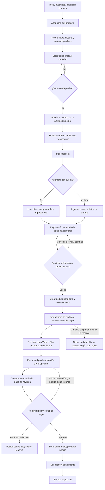
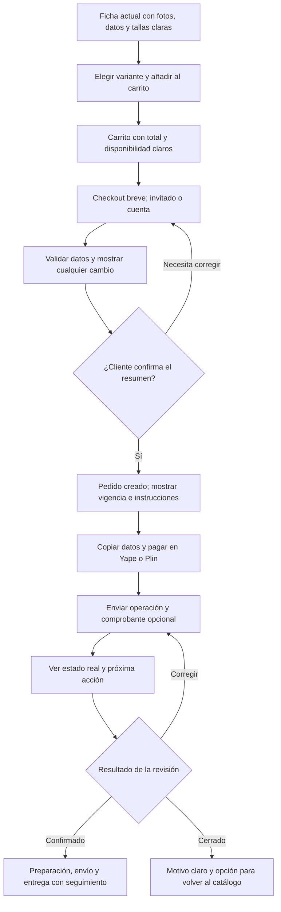
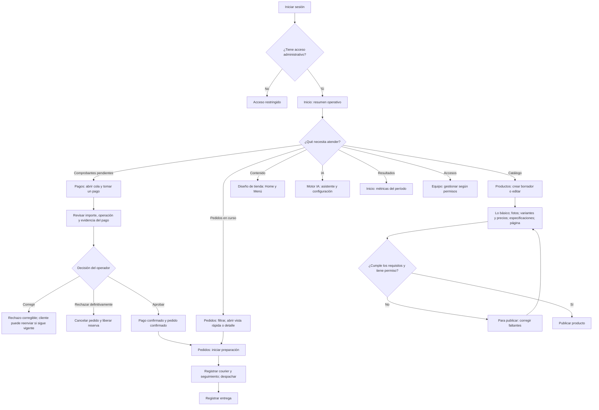
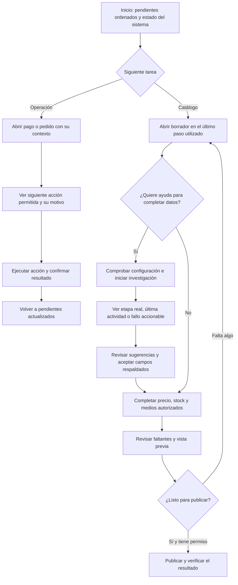
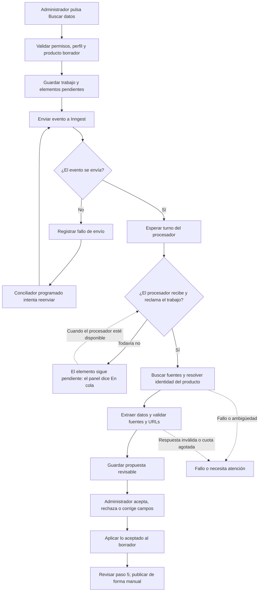

# Gamer Perú: flujos del cliente y del administrador

Fecha: 22 de octubre de 2026. Referencia del código: `f8a5ea2`, rama `feat/cloudflare-workers`.

Este documento describe el recorrido implementado y propone mejoras para discutir antes de
desarrollarlas. Se revisó el código; no se accedió a la tienda ni a la base de producción.
Los diagramas no certifican que los servicios externos estén funcionando en este momento.

Los bloques `mermaid` se pueden ver como diagramas en la vista previa compatible de Markdown y en
GitHub. Los rombos son decisiones; las flechas indican el siguiente paso.

## 1. Cliente: flujo actual de compra

### Cómo leerlo

- **Carrito no equivale a compra:** el servidor vuelve a comprobar precios y disponibilidad.
- **Pedido registrado no equivale a pago confirmado:** Yape/Plin se verifica manualmente.
- El código de operación es obligatorio; la imagen del comprobante es opcional en el formulario
  actual. Los errores de carga permiten reintentar o continuar solo con el código.
- Un cliente con cuenta puede consultar sus pedidos desde `/cuenta/pedidos` y abrir el detalle.
  Un invitado consulta la confirmación con el acceso de su sesión; conocer el número de pedido no
  da acceso por sí solo.
- La preparación y el despacho requieren pago confirmado. La entrega se registra desde la
  operación; no se presupone una integración automática con el courier.
- Si una cuenta necesita completar su perfil, el checkout la deriva a ese paso.

### Mejoras propuestas para el cliente

Todas se pueden desarrollar con el proyecto actual, sin contratar otro servicio.

| Prioridad | Mejora                             | Cambio concreto                                                                                       | Cómo comprobar que ayuda                                                    |
| --------- | ---------------------------------- | ----------------------------------------------------------------------------------------------------- | --------------------------------------------------------------------------- |
| Alta      | Explicar los pasos de compra       | Mostrar «Datos → Revisar pedido → Pagar → Verificación» con el estado actual                          | El cliente distingue cuándo registró el pedido y cuándo terminó de pagar    |
| Alta      | Recuperar datos tras un error      | Conservar datos no sensibles del formulario por sesión, sin guardar comprobantes ni secretos          | Un error de red no obliga a escribir toda la dirección otra vez             |
| Alta      | Explicar los cambios de total      | Señalar qué precio, cantidad o envío cambió antes de pedir nueva confirmación                         | El total nunca cambia silenciosamente                                       |
| Alta      | Facilitar el pago manual           | Botones para copiar monto, destinatario y número de pedido, con confirmación visual                   | Se puede completar el pago desde el teléfono sin transcribir cada dato      |
| Alta      | Mostrar vigencia real              | Si existe una reserva vigente, enseñar su vencimiento leído del servidor                              | El contador coincide con el estado real y no promete stock tras vencer      |
| Media     | Actualizar el estado del pedido    | Consultar el estado mientras la pestaña está visible; aumentar el intervalo si no cambia              | «Pago en revisión» cambia tras la aprobación sin recargar manualmente       |
| Media     | Comparar tallas con datos          | Presentar dimensiones y peso respaldados; recomendar rangos de mano solo si existen fuentes oficiales | Se puede comparar Mini y otras tallas sin recomendaciones inventadas        |
| Media     | Retirar distracciones del checkout | Ocultar el campo de cupón mientras no haya códigos activos                                            | No aparece una función que actualmente solo responde que no está disponible |
| Media     | Continuidad para invitados         | Diseñar una recuperación de acceso con un enlace temporal seguro y el canal ya disponible             | El invitado puede volver a su pedido sin exponerlo a terceros               |

La recuperación de acceso es una propuesta, no una función ya disponible. Si requiere enviar
mensajes, hay que verificar la configuración y cuota del canal existente antes de implementarla.

### Recorrido del cliente después de esas mejoras

Se conserva el diseño público aprobado y la animación de añadir al carrito. Las mejoras se
concentran en claridad, recuperación y seguimiento.

## 2. Administrador: flujo actual desde Inicio

### Qué representa cada recorrido

| Área             | Ruta                          | Uso actual                                                       |
| ---------------- | ----------------------------- | ---------------------------------------------------------------- |
| Inicio           | `/admin`                      | Trabajo pendiente y accesos rápidos según permisos               |
| Métricas         | `/admin?vista=metricas`       | Resultados del período seleccionado                              |
| Pagos            | `/admin/pagos`                | Tomar una revisión, aprobar o rechazar con las reglas del pedido |
| Pedidos          | `/admin/orders`               | Filtrar, revisar, preparar, despachar y registrar entrega        |
| Productos        | `/admin/products`             | Crear borradores, completar los cinco pasos y publicar           |
| Historia         | `/admin/products/[id]/story`  | Editar y publicar la historia mediante su propio flujo           |
| Asistente IA     | `/admin/products/ai-import`   | Consultar investigaciones y revisar propuestas                   |
| Configuración IA | `/admin/settings/ai`          | Configurar proveedor, modelo y perfiles de investigación         |
| Diseño de tienda | `/admin/home` y `/admin/menu` | Administrar portada y navegación                                 |

Las opciones y las acciones dependen del rol. Abrir un pedido no habilita su preparación si
todavía no está pagado. Un reembolso registrado en el sistema tampoco ejecuta una transferencia
bancaria: la devolución de dinero se realiza por el canal correspondiente.

### Mejoras propuestas para el administrador

| Prioridad | Mejora                            | Cambio concreto                                                                                     | Cómo comprobar que ayuda                                                     |
| --------- | --------------------------------- | --------------------------------------------------------------------------------------------------- | ---------------------------------------------------------------------------- |
| Alta      | Inicio con siguiente acción       | Ordenar pendientes por antigüedad e impacto, con enlaces al filtro correspondiente                  | Se puede identificar qué atender primero sin recorrer cada sección           |
| Alta      | Cola IA comprensible              | Diferenciar guardado, envío fallido, espera y ejecución; mostrar última actividad                   | Un trabajo detenido deja de parecer una búsqueda que sigue avanzando         |
| Alta      | Configuración IA guiada           | Reunir proveedor, perfil y comprobación de disponibilidad en un recorrido corto                     | La interfaz indica qué falta sin confundir proveedor con perfil              |
| Alta      | Recuperación controlada           | Permitir reintentar un envío fallido del trabajo existente, sin crear otro                          | Pulsar dos veces no duplica la investigación                                 |
| Alta      | Acciones claras en pedidos        | Mostrar la siguiente acción permitida y el motivo cuando está bloqueada                             | No se intenta despachar un pedido sin pago confirmado                        |
| Media     | Conservar el trabajo del catálogo | Guardar el paso actual y avisar de cambios sin guardar al salir                                     | Se vuelve al punto de edición sin perder contenido                           |
| Media     | Resumen de lo que falta           | En cada paso, distinguir obligatorio para publicar, opcional y oculto por estar vacío               | Un paso completo no hace creer que todos sus bloques aparecerán en la tienda |
| Media     | Inventario utilizable             | Crear pantalla de existencias y movimientos sobre los servicios existentes                          | El operador puede localizar stock bajo y entender por qué cambió             |
| Media     | Consistencia entre pestañas       | Avisar de una versión nueva antes de guardar y ofrecer recargar sin pisar cambios                   | Dos operadores no sobrescriben cambios silenciosamente                       |
| Media     | Menos trabajo por petición        | Revisar acciones restantes que invalidan rutas inmediatamente; usar la estrategia de caché acordada | Las operaciones no provocan regeneraciones innecesarias en Workers           |

La pantalla de inventario es una ampliación pendiente, no una sección actualmente disponible.
La configuración guiada debe respetar los permisos y conservar perfiles personalizados.

### Recorrido del administrador después de esas mejoras

## 3. Autocompletado: dónde puede quedarse en cola

La aplicación separa crear el trabajo de ejecutarlo. Cloudflare Workers AI es el proveedor que
genera datos; **Inngest es quien coordina la ejecución en segundo plano**. Habilitar el proveedor
no demuestra que el evento de ejecución esté llegando al procesador.

### Qué está confirmado y qué falta comprobar

- **Confirmado en el código:** hay envío de eventos, conciliación de envíos fallidos y recuperación
  de trabajos abandonados. La función de investigación limita la concurrencia a uno; otro trabajo
  activo puede hacer esperar al siguiente.
- **Confirmado en la interfaz:** «En cola» se muestra por el estado pendiente del elemento. No
  distingue por sí solo entre fallo de envío, espera de turno y procesador que no está recibiendo
  eventos.
- **No confirmado:** por qué está detenido el trabajo observado. No se revisaron sus registros en
  producción, el estado del evento ni la sincronización de Inngest.
- **Dependencia importante:** los conciliadores también requieren que el sistema de ejecución en
  segundo plano funcione; no corrigen por sí solos una integración desconectada.

### Comprobación propuesta para ese caso

1. Identificar el trabajo ya creado desde el Asistente IA; conservar su identificador.
2. Revisar si el envío figura pendiente, fallido o enviado, y si tiene una ejecución asociada en
   Inngest. Esto es una comprobación pendiente del entorno, no realizada para este documento.
3. Si no hay ejecución, comprobar la aplicación sincronizada, el registro de `/api/inngest` y los
   errores de envío. No mostrar claves en el panel ni copiarlas a registros.
4. Si hay ejecución, comprobar si espera a otro trabajo o si falló antes de comenzar la búsqueda.
5. Reintentar de forma controlada el trabajo existente cuando su estado lo permita; no crear
   repetidamente productos o investigaciones nuevas para intentar desbloquearlo.

La mejora de interfaz debe mostrar, por ejemplo, «No se pudo enviar el trabajo» o «Esperando turno;
última actividad hace…». Una espera larga debe ofrecer diagnóstico y una acción segura. No debe
ejecutarse toda la investigación dentro de la acción del botón para ocultar la cola.

La IA propone datos respaldados y el revisor decide qué aplicar. Precio, stock y publicación
siguen siendo decisiones humanas. Los enlaces de imágenes encontrados son referencias: no
equivalen a imágenes descargadas, autorizadas ni publicadas automáticamente.

## 4. Orden recomendado de mejoras sin nuevas suscripciones

| Orden | Pieza                             | Motivo                                                   | Criterio de cierre                                                         |
| ----- | --------------------------------- | -------------------------------------------------------- | -------------------------------------------------------------------------- |
| 1     | Diagnóstico de la cola IA         | El bloqueo observado impide aprovechar el autocompletado | Un trabajo termina o muestra un motivo concreto y una recuperación segura  |
| 2     | Configuración IA guiada           | Reduce la confusión entre conexión y perfil              | Desde el editor se entiende qué falta y dónde completarlo                  |
| 3     | Claridad de pago y próxima acción | Reduce consultas y errores de interpretación             | Cliente y operador distinguen registrado, enviado, verificado y despachado |
| 4     | Recuperación del checkout         | Evita repetir datos por errores de red                   | Se recuperan los datos permitidos y el servidor vuelve a validar el total  |
| 5     | Prioridades en Inicio             | Reduce navegación manual                                 | El administrador entra directamente al pendiente correcto                  |
| 6     | Inventario e indicadores básicos  | Ayuda a operar con información real                      | Se ven movimientos, stock bajo y tiempos de atención sin duplicar ventas   |

«Sin nuevas suscripciones» significa usar ingeniería y la infraestructura que ya tiene el
proyecto. Las consultas, el almacenamiento, las búsquedas y la IA siguen consumiendo recursos:
hay que respetar las cuotas disponibles, limitar reintentos y detenerse al agotarlas. Ninguna
propuesta depende de comprar un servicio, promete IA ilimitada ni plantea crear cuentas para
eludir cuotas.

Los indicadores iniciales pueden calcularse con pedidos, pagos e investigaciones existentes:
tiempo de revisión, antigüedad de pendientes y tasa de fallo IA. Medir abandono de carrito o
conversión completa requiere instrumentar eventos adicionales; no se debe presentar como una
métrica ya disponible.

## 5. Referencias del código revisado

| Tema                                        | Fuente                                                                         |
| ------------------------------------------- | ------------------------------------------------------------------------------ |
| Invitados, validación y creación del pedido | [Servicio de checkout](../../src/lib/checkout/service.ts)                      |
| Formulario de compra                        | [Checkout del cliente](../../src/components/checkout/checkout-page-client.tsx) |
| Comprobante y pago en revisión              | [Pago manual](../../src/components/checkout/manual-payment-card.tsx)           |
| Aprobación y rechazo del pago               | [Servicio de verificación](../../src/lib/payments/verification-service.ts)     |
| Preparación, despacho y entrega             | [Servicio de fulfillment](../../src/lib/fulfillment/service.ts)                |
| Etapas visibles para el cliente             | [Línea de tiempo](../../src/lib/account/order-timeline.ts)                     |
| Secciones del administrador                 | [Navegación del admin](../../src/lib/admin/navigation.ts)                      |
| Inicio y métricas                           | [Inicio del administrador](<../../src/app/admin/(protected)/page.tsx>)         |
| Estado visible del autocompletado           | [Barra del editor](../../src/components/admin/products/autofill-bar.tsx)       |
| Envío y conciliación de investigaciones     | [Despacho IA](../../src/lib/ai/research/dispatch-service.ts)                   |
| Procesamiento en segundo plano              | [Función de investigación](../../src/lib/inngest/functions/ai-research-job.ts) |
| Pendientes generales del proyecto           | [Roadmap](../roadmap/ROADMAP.md)                                               |
