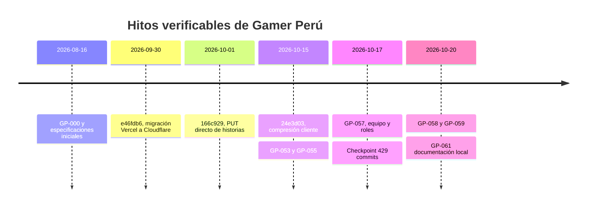
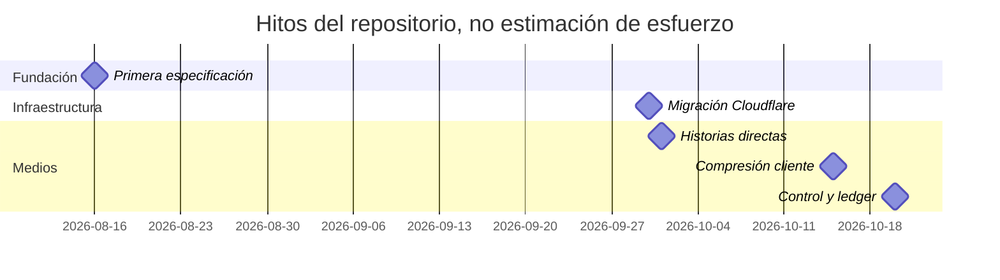

# 02 · Historia del proyecto

El primer commit es `276ceb0` del 2026-08-16 (GP-000). `git rev-list --count HEAD` cuenta **432 commits** hasta `29ce758` (2026-10-20), antes del commit documental GP-061. El checkpoint `48eafd2` del 2026-10-17 tenía **429 commits**. Las fechas y títulos se contrastan con git y closures; cerrar un GP no certifica despliegue.

| Etapa          | Entregas                                                                          |
| -------------- | --------------------------------------------------------------------------------- |
| Documentación  | GP-000–004: definición, referencias limitadas, diseño, tecnología y dominio       |
| Fundación      | GP-005–010: repositorio, estándares, app, sistema visual, navegación y home       |
| Catálogo       | GP-011–014: categorías/marcas, búsqueda, filtros y PDP                            |
| Identidad      | GP-015–016: autenticación y cuenta                                                |
| Comercio       | GP-017–021: carrito, checkout, pagos manuales, pedidos e inventario               |
| Admin          | GP-022–028: fundación, dashboard, catálogo, IA, historias, pedidos y verificación |
| Consolidación  | GP-029–052: mejoras transversales; ver registro de entregas                       |
| Admin y medios | GP-053 home, GP-055 galería directa, GP-056 destinos de menú y GP-057 equipo      |
| Hotfix         | GP-058 control HTTP; GP-059 ledger, presupuesto, firmas y cancelación             |
| Documentación  | GP-061: este paquete; GP-060 excluido                                             |

El gantt muestra hitos de un día; no inventa duración ni dedicación de cada fase.

## La saga del Error 1102

- `e46fdb6` (30/09) migra a Cloudflare. Cambian restricciones de CPU y conexiones respecto a Node/Vercel; persiste el coste de Next/RSC.
- `166c929` (01/10) introduce subida directa de historias para retirar el binario del servidor.
- `24e3d03` (15/10) comprime en navegador; GP-053 comparte el flujo y hace administrable la home.
- GP-055 migra galería y retira normalización/staging del Worker.
- GP-058 sustituye Server Actions de subida por Route Handlers JSON, firma aws4fetch singleton, XHR, progreso, cancelación y reintentos limitados. Invalida el tag solo para PUBLISHED.
- GP-059 reemplaza HMAC por ledger UUID, reserva presupuesto, valida headers y completa idempotentemente. Corrige el cierre de pools ajenos en Node dev.

Lecciones: retirar el archivo del Worker no acredita CPU de toda la ruta; invalidación y dependencias también cuentan. Pruebas locales no equivalen a tail de producción. El gate original de bundle <3 MB era erróneo: la base aprobada es 5869,50 KiB gzip; warnings previos se documentan como BASELINE. No se silencia tooling rebajando seguridad ni se contrata otro plan sin evidencia.

## Registro de entregas

Las especificaciones y closures de los GPs cumplidos se eliminaron del repositorio y quedan en el historial de git. Lo que falta está en [el roadmap](../roadmap/ROADMAP.md).
