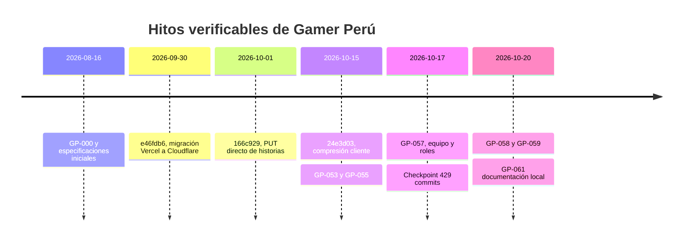
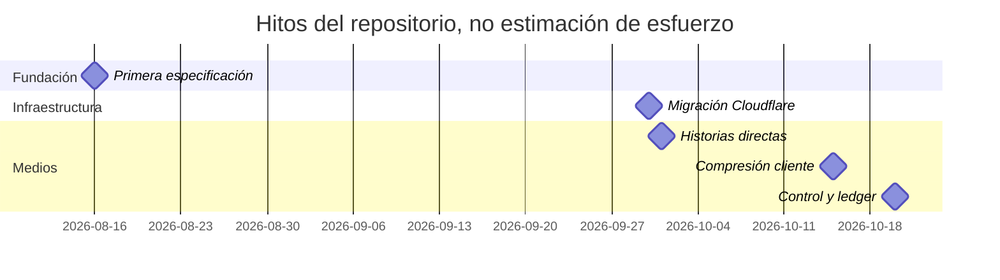

# 02 · Historia del proyecto

El primer commit es `276ceb0` del 2026-08-16 (GP-000). `git rev-list --count HEAD` cuenta **432 commits** hasta `29ce758` (2026-10-20), antes del commit documental GP-061. El checkpoint `48eafd2` del 2026-10-17 tenía **429 commits**. Las fechas y títulos se contrastan con git y closures; cerrar un GP no certifica despliegue.

| Etapa          | Entregas                                                                          |
| -------------- | --------------------------------------------------------------------------------- |
| Documentación  | GP-000–004: definición, referencias limitadas, diseño, tecnología y dominio       |
| Fundación      | GP-005–010: repositorio, estándares, app, sistema visual, navegación y home       |
| Catálogo       | GP-011–014: categorías/marcas, búsqueda, filtros y PDP                            |
| Identidad      | GP-015–016: autenticación y cuenta                                                |
| Comercio       | GP-017–021: carrito, checkout, pagos manuales, pedidos e inventario               |
| Admin          | GP-022–028: fundación, dashboard, catálogo, IA, historias, pedidos y verificación |
| Consolidación  | GP-029–052: mejoras transversales; ver registro de entregas                       |
| Admin y medios | GP-053 home, GP-055 galería directa, GP-056 destinos de menú y GP-057 equipo      |
| Hotfix         | GP-058 control HTTP; GP-059 ledger, presupuesto, firmas y cancelación             |
| Documentación  | GP-061: este paquete; GP-060 excluido                                             |

El gantt muestra hitos de un día; no inventa duración ni dedicación de cada fase.

## La saga del Error 1102

- `e46fdb6` (30/09) migra a Cloudflare. Cambian restricciones de CPU y conexiones respecto a Node/Vercel; persiste el coste de Next/RSC.
- `166c929` (01/10) introduce subida directa de historias para retirar el binario del servidor.
- `24e3d03` (15/10) comprime en navegador; GP-053 comparte el flujo y hace administrable la home.
- [GP-055](../roadmap/GP-055-CLOSURE.md) migra galería y retira normalización/staging del Worker.
- [GP-058](../roadmap/GP-058-CLOSURE.md) sustituye Server Actions de subida por Route Handlers JSON, firma aws4fetch singleton, XHR, progreso, cancelación y reintentos limitados. Invalida el tag solo para PUBLISHED.
- [GP-059](../roadmap/GP-059-CLOSURE.md) reemplaza HMAC por ledger UUID, reserva presupuesto, valida headers y completa idempotentemente. Corrige el cierre de pools ajenos en Node dev.

Lecciones: retirar el archivo del Worker no acredita CPU de toda la ruta; invalidación y dependencias también cuentan. Pruebas locales no equivalen a tail de producción. El gate original de bundle <3 MB era erróneo: la base aprobada es 5869,50 KiB gzip; warnings previos se documentan como BASELINE. No se silencia tooling rebajando seguridad ni se contrata otro plan sin evidencia.

## Registro de entregas

Consultar cada closure para estado y pendientes.

- [GP-000 --- Product Definition & Source of Truth](../roadmap/GP-000.md) · [closure](../roadmap/GP-000-CLOSURE.md)
- [GP-001 --- WLMOUSE Visual & UX Reference](../roadmap/GP-001.md) · [closure](../roadmap/GP-001-CLOSURE.md)
- [GP-002 --- Gamer Perú Design Language](../roadmap/GP-002.md) · [closure](../roadmap/GP-002-CLOSURE.md)
- [GP-003 --- Technology Architecture Decision](../roadmap/GP-003.md) · [closure](../roadmap/GP-003-CLOSURE.md)
- [GP-004 --- Commerce Domain Model](../roadmap/GP-004.md) · [closure](../roadmap/GP-004-CLOSURE.md)
- [GP-005 --- Repository Bootstrap](../roadmap/GP-005.md) · [closure](../roadmap/GP-005-CLOSURE.md)
- [GP-006 --- Engineering Standards](../roadmap/GP-006.md) · [closure](../roadmap/GP-006-CLOSURE.md)
- [GP-007 --- Application Foundation](../roadmap/GP-007.md) · [closure](../roadmap/GP-007-CLOSURE.md)
- [GP-008 --- Design System](../roadmap/GP-008.md) · [closure](../roadmap/GP-008-CLOSURE.md)
- [GP-009 --- Global Navigation](../roadmap/GP-009.md) · [closure](../roadmap/GP-009-CLOSURE.md)
- [GP-010 --- Homepage](../roadmap/GP-010.md) · [closure](../roadmap/GP-010-CLOSURE.md)
- [GP-011 --- Category & Brand Pages](../roadmap/GP-011.md) · [closure](../roadmap/GP-011-CLOSURE.md)
- [GP-012 --- Search](../roadmap/GP-012.md) · [closure](../roadmap/GP-012-CLOSURE.md)
- [GP-013 --- Filters & Sorting](../roadmap/GP-013.md) · [closure](../roadmap/GP-013-CLOSURE.md)
- [GP-014 --- Product Detail System](../roadmap/GP-014.md) · [closure](../roadmap/GP-014-CLOSURE.md)
- [GP-015 --- Authentication](../roadmap/GP-015.md) · [closure](../roadmap/GP-015-CLOSURE.md)
- [GP-016 --- Customer Account](../roadmap/GP-016.md) · [closure](../roadmap/GP-016-CLOSURE.md)
- [GP-017 --- Cart](../roadmap/GP-017.md) · [closure](../roadmap/GP-017-CLOSURE.md)
- [GP-018 --- Checkout](../roadmap/GP-018.md) · [closure](../roadmap/GP-018-CLOSURE.md)
- [GP-019 --- Manual Yape/Plin Payments](../roadmap/GP-019.md) · [closure](../roadmap/GP-019-CLOSURE.md)
- [GP-020 --- Order Management Domain](../roadmap/GP-020.md) · [closure](../roadmap/GP-020-CLOSURE.md)
- [GP-021 --- Inventory](../roadmap/GP-021.md) · [closure](../roadmap/GP-021-CLOSURE.md)
- [GP-022 --- Admin Foundation](../roadmap/GP-022.md) · [closure](../roadmap/GP-022-CLOSURE.md)
- [GP-023 --- Admin Dashboard](../roadmap/GP-023.md) · [closure](../roadmap/GP-023-CLOSURE.md)
- [GP-024 --- Admin Product Manager](../roadmap/GP-024.md) · [closure](../roadmap/GP-024-CLOSURE.md)
- [GP-025 --- AI Product Research & Import](../roadmap/GP-025.md) · [closure](../roadmap/GP-025-CLOSURE.md)
- [GP-026 --- Product Story Builder](../roadmap/GP-026.md) · [closure](../roadmap/GP-026-CLOSURE.md)
- [GP-027 --- Orders Admin](../roadmap/GP-027.md) · [closure](../roadmap/GP-027-CLOSURE.md)
- [GP-028 --- Payment Verification Admin](../roadmap/GP-028.md) · [closure](../roadmap/GP-028-CLOSURE.md)
- [GP-029 --- Inventory Admin](../roadmap/GP-029.md)
- [GP-030 --- Customers Admin](../roadmap/GP-030.md)
- [GP-031 --- Referral Engine](../roadmap/GP-031.md)
- [GP-032 --- Affiliate Program](../roadmap/GP-032.md)
- [GP-033 --- Affiliate Dashboard](../roadmap/GP-033.md)
- [GP-034 --- Commission Engine](../roadmap/GP-034.md)
- [GP-035 --- AI Customer Assistant](../roadmap/GP-035.md)
- [GP-036 --- Technical SEO Foundation](../roadmap/GP-036.md)
- [GP-037 --- Product SEO Engine](../roadmap/GP-037.md)
- [GP-038 --- Category & Brand SEO](../roadmap/GP-038.md)
- [GP-039 --- SEO Content Architecture](../roadmap/GP-039.md)
- [GP-040 --- Commerce Analytics](../roadmap/GP-040.md)
- [GP-041 --- Business Analytics Dashboard](../roadmap/GP-041.md)
- [GP-042 --- EC OS Integration Contract](../roadmap/GP-042.md)
- [GP-043 --- Security Hardening](../roadmap/GP-043.md)
- [GP-044 --- Performance Hardening](../roadmap/GP-044.md)
- [GP-045 --- Accessibility Hardening](../roadmap/GP-045.md)
- [GP-046 --- Responsive QA](../roadmap/GP-046.md)
- [GP-047 --- SEO Audit](../roadmap/GP-047.md)
- [GP-048 --- Commerce QA](../roadmap/GP-048.md)
- [GP-049 --- Production Readiness](../roadmap/GP-049.md)
- [GP-050 --- Production Deployment](../roadmap/GP-050.md)
- [GP-051 --- Search Engine Launch](../roadmap/GP-051.md)
- [GP-052 --- Gamer Perú v1 Launch](../roadmap/GP-052.md)
- [GP-053 --- Administrable Homepage](../roadmap/GP-053.md)
- [GP-054 --- Actionable Admin Dashboard](../roadmap/GP-054.md) · [closure](../roadmap/GP-054-CLOSURE.md)
- [GP-055 --- Product Gallery Direct Upload](../roadmap/GP-055.md) · [closure](../roadmap/GP-055-CLOSURE.md)
- [GP-056 --- Mega-Menu Destinations](../roadmap/GP-056.md) · [closure](../roadmap/GP-056-CLOSURE.md)
- [GP-057 --- Admin Team and Role Management](../roadmap/GP-057.md) · [closure](../roadmap/GP-057-CLOSURE.md)
- [GP-058 — Hotfix del plano de control de subida](../roadmap/GP-058.md) · [closure](../roadmap/GP-058-CLOSURE.md)
- [GP-059 — Registro, presupuesto y validación de subidas](../roadmap/GP-059.md) · [closure](../roadmap/GP-059-CLOSURE.md)
