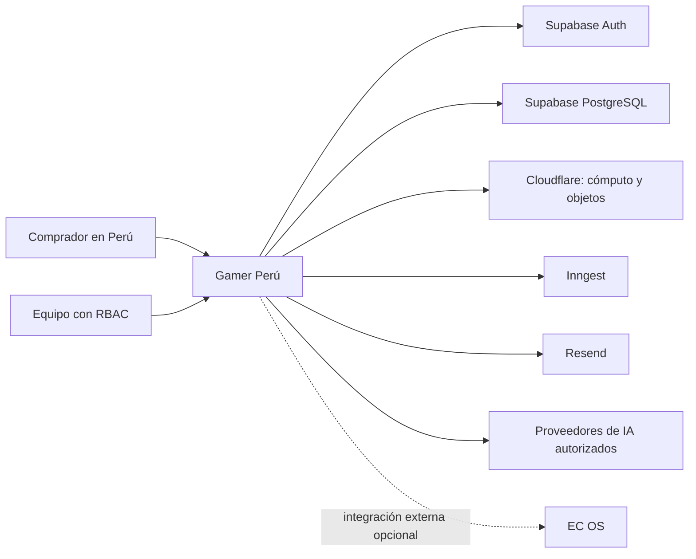
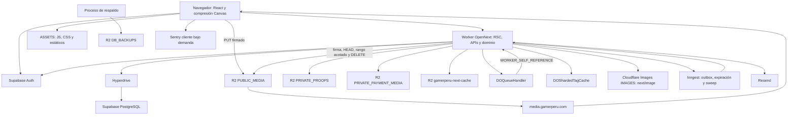
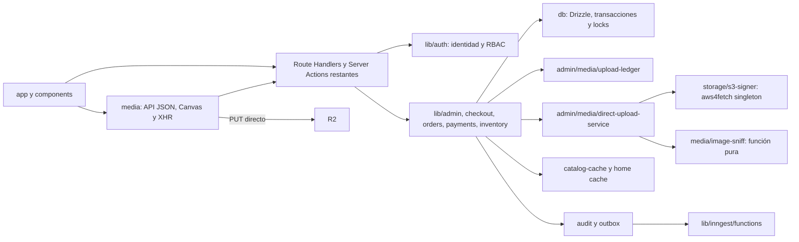
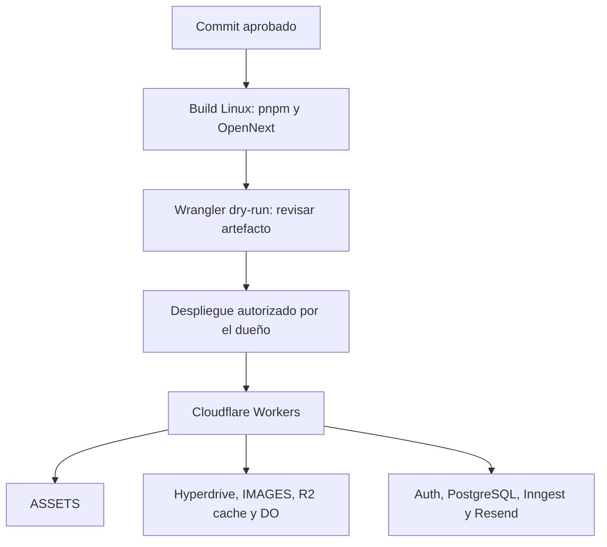

# 03 · Arquitectura actual

Monolito modular Next.js 16 / React 19 / TypeScript, con OpenNext en Cloudflare Workers. La topología se contrasta con `wrangler.jsonc`, `open-next.config.ts`, `src/db/index.ts` y `src/lib/storage/`. [ADR-011](../decisions/ADR-011-cloudflare-workers-hosting.md) conserva su estado PROPOSED; no se reetiqueta aquí como aprobación de producción. [ADR-014](../decisions/ADR-014-media-upload-control-plane.md) describe el plano de control actual.

## C4 · Nivel 1: contexto

EC OS no es requisito para navegar, comprar ni operar. Las flechas describen dependencias lógicas del código; no certifican credenciales activas ni tráfico de producción.

## C4 · Nivel 2: contenedores

Los cuatro buckets lógicos de negocio se resuelven por configuración S3; solo `NEXT_INC_CACHE_R2_BUCKET` está vinculado directamente como binding R2 de OpenNext. Las pruebas locales usan loopback. El bucket retirado de staging no forma parte de este diseño.

**GP-060 no se implementó.** La subida nueva no envía el archivo por Worker; `next/image` todavía puede usar Worker/IMAGES. La normalización de galería ocurre en el navegador, con salida hasta 2400 px y 4 MiB. El servidor comprueba metadatos y hasta 4096 bytes del objeto.

## C4 · Nivel 3: componentes

`upload-route-guard` verifica método, JSON, origen, sesión y permiso. `upload-route-handlers` comparte dispatch entre rutas. `r2-buckets` evita cargar el SDK para resolver nombres. El ledger mantiene reservas y estados bajo bloqueo. Los servicios adjuntan assets y auditan en la misma transacción. Completar un producto PUBLISHED invalida el tag del catálogo; DRAFT no provoca esa invalidación.

## Despliegue y límites

El contexto de diseño del repositorio usa los límites consignados en ADR-011: 10 ms de CPU, 50 subrequests y 100 000 peticiones/día para Free. Antes de cambiar de plan, el dueño debe verificar las condiciones vigentes del proveedor. El gate del dueño compara bundle con **5869,50 KiB gzip**, con justificación sobre +20 KiB; no aplica el antiguo objetivo de 3 MB.

Reducir procesamiento de archivos y regeneraciones no demuestra que toda ruta Next/RSC cumpla el límite de CPU en producción. Se necesita Observability y tail tras el deploy. Los clientes PostgreSQL de Workers son por petición; el pool Node de desarrollo pertenece a su módulo. Los errores de servidor Workers se observan en Cloudflare; no se presupone Sentry servidor activo.
