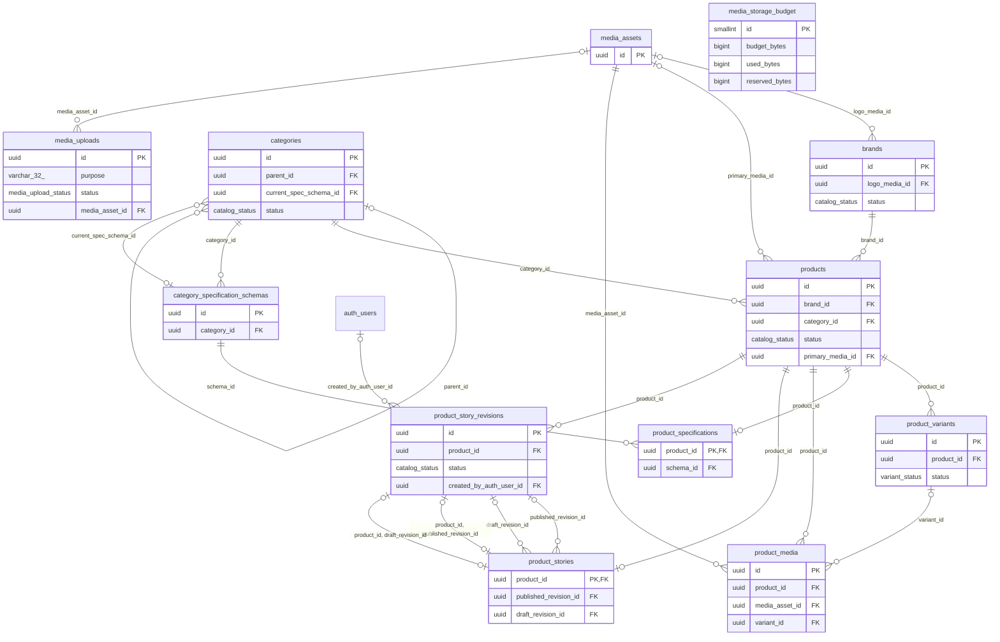
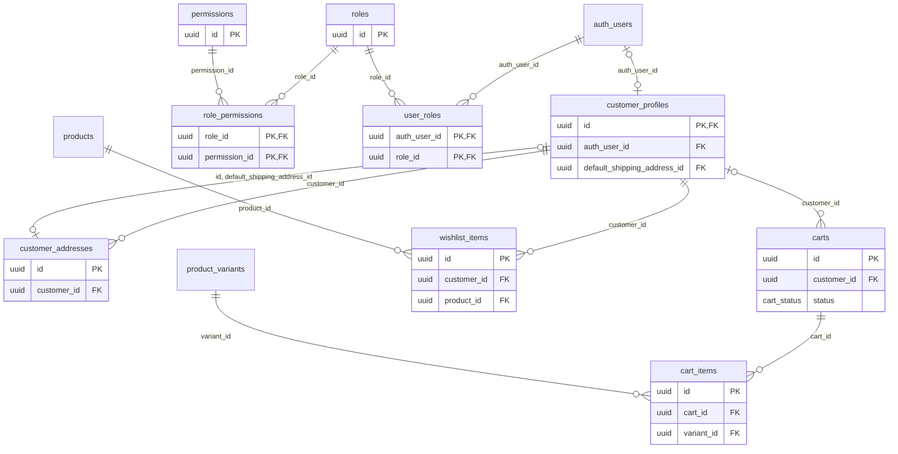
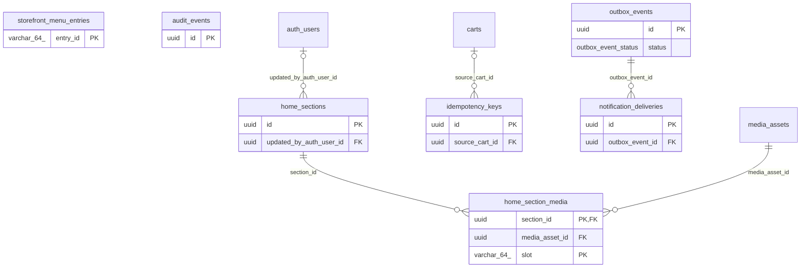
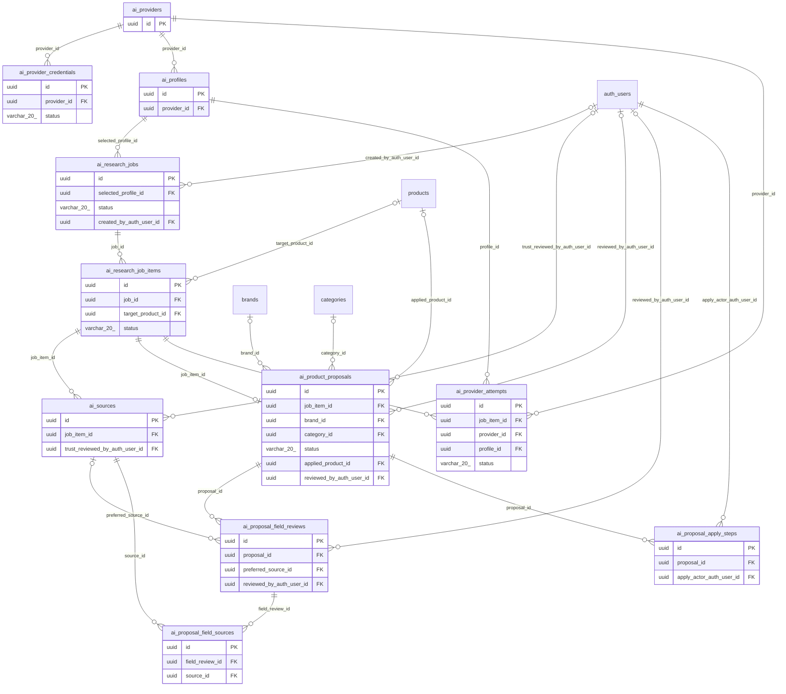

# 04 · Modelo de datos real

Inventario contrastado con `src/db/schema/**` y snapshot Drizzle `0022_snapshot.json`: **59 tablas públicas**. `auth.users` es externo, gestionado por Supabase Auth. No se dibujan FK inventadas: actor/subject/variant del ledger son identificadores de dominio sin FK declarada; su enlace SQL es `media_asset_id → media_assets.id` (ON DELETE SET NULL).

Los ER muestran PK/FK y campos de estado; el diccionario incluye todas las columnas. Un UUID no implica FK. Para checks, índices, unicidad y políticas completas consultar SQL y [modelo canónico](../architecture/COMMERCE_DOMAIN_MODEL.md).

## Invariantes de medios

`media_uploads` tiene 17 columnas, UUIDv7 de aplicación, object_key único, tamaño positivo y estados PENDING/READY/ABORTED/EXPIRED/REJECTED. Índices `(status, expires_at)` y `(actor_auth_user_id, created_at)`. `media_storage_budget` tiene cinco columnas y solo admite id=1, con budget/used/reserved no negativos. Presupuesto inicial 8589934592 bytes; uso inicial SUM de PUBLIC_MEDIA registrados. Reserva mediante UPDATE condicional; complete FOR UPDATE. Ambas tablas tienen RLS y REVOKE de roles API.

## Catálogo y medios

## Identidad y preferencias

## Pedidos, pagos e inventario

```mermaid
erDiagram
  orders {
    uuid id PK
    uuid customer_id FK
    order_status status
  }
  order_items {
    uuid id PK
    uuid order_id FK
    uuid variant_id FK
  }
  order_address_snapshots {
    uuid id PK
    uuid order_id FK
  }
  order_pricing_snapshots {
    uuid id PK
    uuid order_id FK
  }
  order_notes {
    uuid id PK
    uuid order_id FK
    uuid author_auth_user_id FK
  }
  shipping_methods {
    uuid id PK
  }
  shipments {
    uuid id PK
    uuid order_id FK
    uuid shipping_method_id FK
    shipment_status status
  }
  payment_method_configurations {
    uuid id PK
    varchar_50_ code FK
    uuid current_instruction_version_id FK
  }
  payment_instruction_versions {
    uuid id PK
    varchar_50_ payment_method_code FK
    uuid qr_media_id FK
  }
  payments {
    uuid id PK
    uuid order_id FK
    varchar_50_ payment_method_code FK
    uuid instruction_version_id FK
    payment_status status
    uuid verification_claimed_by_auth_user_id FK
  }
  guest_payment_sessions {
    uuid id PK
  }
  guest_payment_access_grants {
    uuid id PK
    uuid payment_id FK
    uuid session_id FK
  }
  payment_proof_upload_intents {
    uuid id PK
    uuid payment_id FK
    varchar_20_ status
  }
  payment_submissions {
    uuid id PK
    uuid payment_id FK
    uuid proof_media_id FK
  }
  payment_verifications {
    uuid id PK
    uuid payment_id FK
    uuid submission_id FK
    uuid verifier_auth_user_id FK
  }
  refunds {
    uuid id PK
    uuid order_id FK
    uuid payment_id FK
    uuid actor_auth_user_id FK
  }
  inventory_locations {
    uuid id PK
  }
  inventory_items {
    uuid id PK
    uuid variant_id FK
    uuid location_id FK
  }
  inventory_reservations {
    uuid id PK
    uuid inventory_item_id FK
    uuid order_id FK
    uuid order_item_id FK
    inventory_reservation_status status
  }
  inventory_ledger_entries {
    uuid id PK
    uuid inventory_item_id FK
  }
  customer_profiles |o--o{ orders : "customer_id"
  orders ||--o{ order_items : "order_id"
  product_variants ||--o{ order_items : "variant_id"
  orders ||--o| order_address_snapshots : "order_id"
  orders ||--o| order_pricing_snapshots : "order_id"
  orders ||--o{ order_notes : "order_id"
  auth_users |o--o{ order_notes : "author_auth_user_id"
  orders ||--o{ shipments : "order_id"
  shipping_methods ||--o{ shipments : "shipping_method_id"
  payment_instruction_versions |o--o| payment_method_configurations : "current_instruction_version_id, code"
  payment_method_configurations ||--o{ payment_instruction_versions : "payment_method_code"
  media_assets |o--o{ payment_instruction_versions : "qr_media_id"
  orders ||--o| payments : "order_id"
  payment_method_configurations ||--o{ payments : "payment_method_code"
  payment_instruction_versions ||--o{ payments : "instruction_version_id, payment_method_code"
  auth_users |o--o{ payments : "verification_claimed_by_auth_user_id"
  payments ||--o| guest_payment_access_grants : "payment_id"
  guest_payment_sessions ||--o{ guest_payment_access_grants : "session_id"
  payments ||--o{ payment_proof_upload_intents : "payment_id"
  payments ||--o{ payment_submissions : "payment_id"
  media_assets |o--o| payment_submissions : "proof_media_id"
  payments ||--o{ payment_verifications : "payment_id"
  payment_submissions ||--o| payment_verifications : "submission_id"
  auth_users |o--o{ payment_verifications : "verifier_auth_user_id"
  orders ||--o{ refunds : "order_id"
  payments ||--o{ refunds : "payment_id"
  auth_users |o--o{ refunds : "actor_auth_user_id"
  product_variants ||--o{ inventory_items : "variant_id"
  inventory_locations ||--o{ inventory_items : "location_id"
  inventory_items ||--o{ inventory_reservations : "inventory_item_id"
  orders ||--o{ inventory_reservations : "order_id"
  order_items ||--o{ inventory_reservations : "order_item_id"
  inventory_items ||--o{ inventory_ledger_entries : "inventory_item_id"
```

## Contenido y operación

## Investigación IA

## Diccionario de columnas

Tipos y nulabilidad provienen del snapshot. NN = NOT NULL. Se incluyen PK compuestas por columna participante.

### `media_assets`

| Columna           | Tipo                       | Restricción |
| ----------------- | -------------------------- | ----------- |
| `id`              | `uuid`                     | PK, NN      |
| `object_key`      | `varchar(500)`             | NN          |
| `security_class`  | `security_class`           | NN          |
| `media_type`      | `media_type`               | NN          |
| `mime_type`       | `varchar(100)`             | NN          |
| `file_size_bytes` | `integer`                  | NN          |
| `width`           | `integer`                  | nullable    |
| `height`          | `integer`                  | nullable    |
| `alt_text`        | `varchar(255)`             | nullable    |
| `checksum_sha256` | `varchar(64)`              | nullable    |
| `created_at`      | `timestamp with time zone` | NN          |

### `brands`

| Columna         | Tipo                       | Restricción |
| --------------- | -------------------------- | ----------- |
| `id`            | `uuid`                     | PK, NN      |
| `name`          | `varchar(100)`             | NN          |
| `slug`          | `varchar(100)`             | NN          |
| `description`   | `text`                     | nullable    |
| `website_url`   | `varchar(255)`             | nullable    |
| `logo_media_id` | `uuid`                     | FK          |
| `status`        | `catalog_status`           | NN          |
| `created_at`    | `timestamp with time zone` | NN          |
| `updated_at`    | `timestamp with time zone` | NN          |

### `categories`

| Columna                  | Tipo                       | Restricción |
| ------------------------ | -------------------------- | ----------- |
| `id`                     | `uuid`                     | PK, NN      |
| `name`                   | `varchar(100)`             | NN          |
| `slug`                   | `varchar(100)`             | NN          |
| `parent_id`              | `uuid`                     | FK          |
| `current_spec_schema_id` | `uuid`                     | FK          |
| `description`            | `text`                     | nullable    |
| `display_order`          | `integer`                  | NN          |
| `status`                 | `catalog_status`           | NN          |
| `created_at`             | `timestamp with time zone` | NN          |
| `updated_at`             | `timestamp with time zone` | NN          |

### `products`

| Columna            | Tipo                       | Restricción |
| ------------------ | -------------------------- | ----------- |
| `id`               | `uuid`                     | PK, NN      |
| `brand_id`         | `uuid`                     | FK, NN      |
| `category_id`      | `uuid`                     | FK, NN      |
| `name`             | `varchar(200)`             | NN          |
| `slug`             | `varchar(200)`             | NN          |
| `subtitle`         | `varchar(255)`             | nullable    |
| `description`      | `text`                     | nullable    |
| `status`           | `catalog_status`           | NN          |
| `is_featured`      | `boolean`                  | NN          |
| `primary_media_id` | `uuid`                     | FK          |
| `created_at`       | `timestamp with time zone` | NN          |
| `updated_at`       | `timestamp with time zone` | NN          |

### `product_variants`

| Columna                  | Tipo                       | Restricción |
| ------------------------ | -------------------------- | ----------- |
| `id`                     | `uuid`                     | PK, NN      |
| `product_id`             | `uuid`                     | FK, NN      |
| `sku`                    | `varchar(50)`              | NN          |
| `title`                  | `varchar(150)`             | NN          |
| `price_cents`            | `integer`                  | NN          |
| `compare_at_price_cents` | `integer`                  | nullable    |
| `cost_cents`             | `integer`                  | nullable    |
| `weight_grams`           | `integer`                  | nullable    |
| `attributes`             | `jsonb`                    | NN          |
| `status`                 | `variant_status`           | NN          |
| `display_order`          | `integer`                  | NN          |
| `created_at`             | `timestamp with time zone` | NN          |
| `updated_at`             | `timestamp with time zone` | NN          |

### `category_specification_schemas`

| Columna             | Tipo                       | Restricción |
| ------------------- | -------------------------- | ----------- |
| `id`                | `uuid`                     | PK, NN      |
| `category_id`       | `uuid`                     | FK, NN      |
| `schema_version`    | `integer`                  | NN          |
| `field_definitions` | `jsonb`                    | NN          |
| `is_active`         | `boolean`                  | NN          |
| `created_at`        | `timestamp with time zone` | NN          |

### `product_specifications`

| Columna          | Tipo                       | Restricción |
| ---------------- | -------------------------- | ----------- |
| `product_id`     | `uuid`                     | PK, FK, NN  |
| `schema_id`      | `uuid`                     | FK, NN      |
| `schema_version` | `integer`                  | NN          |
| `spec_values`    | `jsonb`                    | NN          |
| `updated_at`     | `timestamp with time zone` | NN          |

### `product_media`

| Columna          | Tipo                       | Restricción |
| ---------------- | -------------------------- | ----------- |
| `id`             | `uuid`                     | PK, NN      |
| `product_id`     | `uuid`                     | FK, NN      |
| `media_asset_id` | `uuid`                     | FK, NN      |
| `variant_id`     | `uuid`                     | FK          |
| `display_order`  | `integer`                  | NN          |
| `placement`      | `product_media_placement`  | NN          |
| `created_at`     | `timestamp with time zone` | NN          |

### `product_stories`

| Columna                 | Tipo                       | Restricción |
| ----------------------- | -------------------------- | ----------- |
| `product_id`            | `uuid`                     | PK, FK, NN  |
| `published_revision_id` | `uuid`                     | FK          |
| `draft_revision_id`     | `uuid`                     | FK          |
| `updated_at`            | `timestamp with time zone` | NN          |

### `product_story_revisions`

| Columna                   | Tipo                       | Restricción |
| ------------------------- | -------------------------- | ----------- |
| `id`                      | `uuid`                     | PK, NN      |
| `product_id`              | `uuid`                     | FK, NN      |
| `revision_number`         | `integer`                  | NN          |
| `status`                  | `catalog_status`           | NN          |
| `blocks`                  | `jsonb`                    | NN          |
| `published_at`            | `timestamp with time zone` | nullable    |
| `created_by_auth_user_id` | `uuid`                     | FK          |
| `created_at`              | `timestamp with time zone` | NN          |

### `customer_addresses`

| Columna           | Tipo                       | Restricción |
| ----------------- | -------------------------- | ----------- |
| `id`              | `uuid`                     | PK, NN      |
| `customer_id`     | `uuid`                     | FK, NN      |
| `recipient_name`  | `varchar(150)`             | NN          |
| `phone`           | `varchar(20)`              | NN          |
| `street_address`  | `varchar(255)`             | NN          |
| `apartment_suite` | `varchar(100)`             | nullable    |
| `department`      | `varchar(100)`             | NN          |
| `province`        | `varchar(100)`             | NN          |
| `district`        | `varchar(100)`             | NN          |
| `postal_code`     | `varchar(20)`              | nullable    |
| `reference_notes` | `text`                     | nullable    |
| `created_at`      | `timestamp with time zone` | NN          |
| `updated_at`      | `timestamp with time zone` | NN          |

### `customer_profiles`

| Columna                       | Tipo                       | Restricción |
| ----------------------------- | -------------------------- | ----------- |
| `id`                          | `uuid`                     | PK, FK, NN  |
| `auth_user_id`                | `uuid`                     | FK          |
| `first_name`                  | `varchar(100)`             | NN          |
| `last_name`                   | `varchar(100)`             | NN          |
| `phone`                       | `varchar(20)`              | nullable    |
| `document_type`               | `document_type`            | nullable    |
| `document_number`             | `varchar(20)`              | nullable    |
| `default_shipping_address_id` | `uuid`                     | FK          |
| `created_at`                  | `timestamp with time zone` | NN          |
| `updated_at`                  | `timestamp with time zone` | NN          |

### `roles`

| Columna       | Tipo          | Restricción |
| ------------- | ------------- | ----------- |
| `id`          | `uuid`        | PK, NN      |
| `name`        | `varchar(50)` | NN          |
| `description` | `text`        | nullable    |

### `permissions`

| Columna | Tipo           | Restricción |
| ------- | -------------- | ----------- |
| `id`    | `uuid`         | PK, NN      |
| `name`  | `varchar(100)` | NN          |

### `role_permissions`

| Columna         | Tipo   | Restricción |
| --------------- | ------ | ----------- |
| `role_id`       | `uuid` | PK, FK, NN  |
| `permission_id` | `uuid` | PK, FK, NN  |

### `user_roles`

| Columna        | Tipo   | Restricción |
| -------------- | ------ | ----------- |
| `auth_user_id` | `uuid` | PK, FK, NN  |
| `role_id`      | `uuid` | PK, FK, NN  |

### `cart_items`

| Columna      | Tipo                       | Restricción |
| ------------ | -------------------------- | ----------- |
| `id`         | `uuid`                     | PK, NN      |
| `cart_id`    | `uuid`                     | FK, NN      |
| `variant_id` | `uuid`                     | FK, NN      |
| `quantity`   | `integer`                  | NN          |
| `created_at` | `timestamp with time zone` | NN          |
| `updated_at` | `timestamp with time zone` | NN          |

### `carts`

| Columna         | Tipo                       | Restricción |
| --------------- | -------------------------- | ----------- |
| `id`            | `uuid`                     | PK, NN      |
| `customer_id`   | `uuid`                     | FK          |
| `session_token` | `varchar(255)`             | nullable    |
| `status`        | `cart_status`              | NN          |
| `currency`      | `varchar(3)`               | NN          |
| `expires_at`    | `timestamp with time zone` | NN          |
| `created_at`    | `timestamp with time zone` | NN          |
| `updated_at`    | `timestamp with time zone` | NN          |

### `wishlist_items`

| Columna       | Tipo                       | Restricción |
| ------------- | -------------------------- | ----------- |
| `id`          | `uuid`                     | PK, NN      |
| `customer_id` | `uuid`                     | FK, NN      |
| `product_id`  | `uuid`                     | FK, NN      |
| `created_at`  | `timestamp with time zone` | NN          |

### `orders`

| Columna          | Tipo                       | Restricción |
| ---------------- | -------------------------- | ----------- |
| `id`             | `uuid`                     | PK, NN      |
| `order_number`   | `varchar(30)`              | NN          |
| `customer_id`    | `uuid`                     | FK          |
| `customer_email` | `varchar(255)`             | NN          |
| `customer_phone` | `varchar(20)`              | NN          |
| `status`         | `order_status`             | NN          |
| `subtotal_cents` | `integer`                  | NN          |
| `discount_cents` | `integer`                  | NN          |
| `shipping_cents` | `integer`                  | NN          |
| `total_cents`    | `integer`                  | NN          |
| `currency`       | `varchar(3)`               | NN          |
| `customer_notes` | `text`                     | nullable    |
| `cancelled_at`   | `timestamp with time zone` | nullable    |
| `cancel_reason`  | `varchar(255)`             | nullable    |
| `created_at`     | `timestamp with time zone` | NN          |
| `updated_at`     | `timestamp with time zone` | NN          |

### `order_items`

| Columna                     | Tipo                       | Restricción |
| --------------------------- | -------------------------- | ----------- |
| `id`                        | `uuid`                     | PK, NN      |
| `order_id`                  | `uuid`                     | FK, NN      |
| `variant_id`                | `uuid`                     | FK, NN      |
| `sku_snapshot`              | `varchar(50)`              | NN          |
| `product_name_snapshot`     | `varchar(200)`             | NN          |
| `variant_title_snapshot`    | `varchar(150)`             | NN          |
| `unit_price_cents_snapshot` | `integer`                  | NN          |
| `quantity`                  | `integer`                  | NN          |
| `line_total_cents`          | `integer`                  | NN          |
| `created_at`                | `timestamp with time zone` | NN          |

### `order_address_snapshots`

| Columna           | Tipo                       | Restricción |
| ----------------- | -------------------------- | ----------- |
| `id`              | `uuid`                     | PK, NN      |
| `order_id`        | `uuid`                     | FK, NN      |
| `recipient_name`  | `varchar(150)`             | NN          |
| `phone`           | `varchar(20)`              | NN          |
| `street_address`  | `varchar(255)`             | NN          |
| `apartment_suite` | `varchar(100)`             | nullable    |
| `department`      | `varchar(100)`             | NN          |
| `province`        | `varchar(100)`             | NN          |
| `district`        | `varchar(100)`             | NN          |
| `postal_code`     | `varchar(20)`              | nullable    |
| `reference_notes` | `text`                     | nullable    |
| `created_at`      | `timestamp with time zone` | NN          |

### `order_pricing_snapshots`

| Columna          | Tipo                       | Restricción |
| ---------------- | -------------------------- | ----------- |
| `id`             | `uuid`                     | PK, NN      |
| `order_id`       | `uuid`                     | FK, NN      |
| `subtotal_cents` | `integer`                  | NN          |
| `discount_cents` | `integer`                  | NN          |
| `shipping_cents` | `integer`                  | NN          |
| `total_cents`    | `integer`                  | NN          |
| `currency`       | `varchar(3)`               | NN          |
| `created_at`     | `timestamp with time zone` | NN          |

### `order_notes`

| Columna                | Tipo                       | Restricción |
| ---------------------- | -------------------------- | ----------- |
| `id`                   | `uuid`                     | PK, NN      |
| `order_id`             | `uuid`                     | FK, NN      |
| `author_auth_user_id`  | `uuid`                     | FK          |
| `body`                 | `text`                     | NN          |
| `created_at`           | `timestamp with time zone` | NN          |
| `mutation_request_id`  | `uuid`                     | NN          |
| `intent_fingerprint`   | `char(64)`                 | NN          |
| `actor_binding_digest` | `char(64)`                 | NN          |

### `shipping_methods`

| Columna              | Tipo                       | Restricción |
| -------------------- | -------------------------- | ----------- |
| `id`                 | `uuid`                     | PK, NN      |
| `name`               | `varchar(100)`             | NN          |
| `code`               | `varchar(50)`              | NN          |
| `base_price_cents`   | `integer`                  | NN          |
| `estimated_days_min` | `integer`                  | nullable    |
| `estimated_days_max` | `integer`                  | nullable    |
| `is_active`          | `boolean`                  | NN          |
| `created_at`         | `timestamp with time zone` | NN          |

### `shipments`

| Columna              | Tipo                       | Restricción |
| -------------------- | -------------------------- | ----------- |
| `id`                 | `uuid`                     | PK, NN      |
| `order_id`           | `uuid`                     | FK, NN      |
| `shipping_method_id` | `uuid`                     | FK, NN      |
| `status`             | `shipment_status`          | NN          |
| `courier_name`       | `varchar(100)`             | nullable    |
| `tracking_number`    | `varchar(100)`             | nullable    |
| `tracking_url`       | `varchar(500)`             | nullable    |
| `shipped_at`         | `timestamp with time zone` | nullable    |
| `delivered_at`       | `timestamp with time zone` | nullable    |
| `notes`              | `text`                     | nullable    |
| `created_at`         | `timestamp with time zone` | NN          |
| `updated_at`         | `timestamp with time zone` | NN          |

### `payment_method_configurations`

| Columna                          | Tipo                       | Restricción |
| -------------------------------- | -------------------------- | ----------- |
| `id`                             | `uuid`                     | PK, NN      |
| `code`                           | `varchar(50)`              | FK, NN      |
| `name`                           | `varchar(100)`             | NN          |
| `method_type`                    | `payment_method_type`      | NN          |
| `current_instruction_version_id` | `uuid`                     | FK          |
| `is_active`                      | `boolean`                  | NN          |
| `display_order`                  | `integer`                  | NN          |
| `created_at`                     | `timestamp with time zone` | NN          |
| `updated_at`                     | `timestamp with time zone` | NN          |

### `payment_instruction_versions`

| Columna               | Tipo                       | Restricción |
| --------------------- | -------------------------- | ----------- |
| `id`                  | `uuid`                     | PK, NN      |
| `payment_method_code` | `varchar(50)`              | FK, NN      |
| `version_number`      | `integer`                  | NN          |
| `recipient_name`      | `varchar(150)`             | NN          |
| `account_identifier`  | `varchar(50)`              | NN          |
| `qr_media_id`         | `uuid`                     | FK          |
| `instruction_text`    | `text`                     | NN          |
| `is_active`           | `boolean`                  | NN          |
| `created_at`          | `timestamp with time zone` | NN          |

### `payments`

| Columna                                | Tipo                       | Restricción |
| -------------------------------------- | -------------------------- | ----------- |
| `id`                                   | `uuid`                     | PK, NN      |
| `order_id`                             | `uuid`                     | FK, NN      |
| `payment_method_code`                  | `varchar(50)`              | FK, NN      |
| `instruction_version_id`               | `uuid`                     | FK, NN      |
| `amount_cents`                         | `integer`                  | NN          |
| `refunded_amount_cents`                | `integer`                  | NN          |
| `currency`                             | `varchar(3)`               | NN          |
| `status`                               | `payment_status`           | NN          |
| `resubmission_grace_expires_at`        | `timestamp with time zone` | nullable    |
| `verification_claimed_by_auth_user_id` | `uuid`                     | FK          |
| `verification_claimed_at`              | `timestamp with time zone` | nullable    |
| `created_at`                           | `timestamp with time zone` | NN          |
| `updated_at`                           | `timestamp with time zone` | NN          |

### `guest_payment_sessions`

| Columna        | Tipo                       | Restricción |
| -------------- | -------------------------- | ----------- |
| `id`           | `uuid`                     | PK, NN      |
| `token_digest` | `varchar(64)`              | NN          |
| `expires_at`   | `timestamp with time zone` | NN          |
| `created_at`   | `timestamp with time zone` | NN          |
| `updated_at`   | `timestamp with time zone` | NN          |

### `guest_payment_access_grants`

| Columna      | Tipo                       | Restricción |
| ------------ | -------------------------- | ----------- |
| `id`         | `uuid`                     | PK, NN      |
| `payment_id` | `uuid`                     | FK, NN      |
| `session_id` | `uuid`                     | FK, NN      |
| `expires_at` | `timestamp with time zone` | NN          |
| `created_at` | `timestamp with time zone` | NN          |

### `payment_proof_upload_intents`

| Columna                    | Tipo                       | Restricción |
| -------------------------- | -------------------------- | ----------- |
| `id`                       | `uuid`                     | PK, NN      |
| `payment_id`               | `uuid`                     | FK, NN      |
| `authority_binding_digest` | `varchar(64)`              | NN          |
| `staging_object_key`       | `varchar(500)`             | NN          |
| `declared_mime_type`       | `varchar(100)`             | NN          |
| `declared_size_bytes`      | `integer`                  | NN          |
| `status`                   | `varchar(20)`              | NN          |
| `expires_at`               | `timestamp with time zone` | NN          |
| `created_at`               | `timestamp with time zone` | NN          |
| `finalized_at`             | `timestamp with time zone` | nullable    |

### `payment_submissions`

| Columna          | Tipo                       | Restricción |
| ---------------- | -------------------------- | ----------- |
| `id`             | `uuid`                     | PK, NN      |
| `payment_id`     | `uuid`                     | FK, NN      |
| `attempt_number` | `integer`                  | NN          |
| `operation_code` | `varchar(50)`              | NN          |
| `proof_media_id` | `uuid`                     | FK          |
| `customer_notes` | `text`                     | nullable    |
| `is_late`        | `boolean`                  | NN          |
| `submitted_at`   | `timestamp with time zone` | NN          |
| `ip_address`     | `varchar(45)`              | nullable    |
| `created_at`     | `timestamp with time zone` | NN          |

### `refunds`

| Columna              | Tipo                       | Restricción |
| -------------------- | -------------------------- | ----------- |
| `id`                 | `uuid`                     | PK, NN      |
| `order_id`           | `uuid`                     | FK, NN      |
| `payment_id`         | `uuid`                     | FK, NN      |
| `amount_cents`       | `integer`                  | NN          |
| `reason`             | `varchar(255)`             | NN          |
| `external_reference` | `varchar(100)`             | nullable    |
| `actor_auth_user_id` | `uuid`                     | FK          |
| `created_at`         | `timestamp with time zone` | NN          |

### `payment_verifications`

| Columna                 | Tipo                            | Restricción |
| ----------------------- | ------------------------------- | ----------- |
| `id`                    | `uuid`                          | PK, NN      |
| `payment_id`            | `uuid`                          | FK, NN      |
| `submission_id`         | `uuid`                          | FK, NN      |
| `verifier_auth_user_id` | `uuid`                          | FK          |
| `decision`              | `payment_verification_decision` | NN          |
| `rejection_reason`      | `varchar(255)`                  | nullable    |
| `verification_notes`    | `text`                          | nullable    |
| `verified_at`           | `timestamp with time zone`      | NN          |

### `idempotency_keys`

| Columna                    | Tipo                         | Restricción |
| -------------------------- | ---------------------------- | ----------- |
| `id`                       | `uuid`                       | PK, NN      |
| `idempotency_key`          | `varchar(255)`               | NN          |
| `operation_type`           | `idempotency_operation_type` | NN          |
| `authority_binding_digest` | `varchar(64)`                | NN          |
| `source_cart_id`           | `uuid`                       | FK          |
| `request_fingerprint`      | `varchar(64)`                | NN          |
| `target_aggregate_id`      | `varchar(255)`               | nullable    |
| `response_payload`         | `jsonb`                      | nullable    |
| `created_at`               | `timestamp with time zone`   | NN          |
| `expires_at`               | `timestamp with time zone`   | NN          |

### `inventory_locations`

| Columna      | Tipo                       | Restricción |
| ------------ | -------------------------- | ----------- |
| `id`         | `uuid`                     | PK, NN      |
| `name`       | `varchar(100)`             | NN          |
| `code`       | `varchar(50)`              | NN          |
| `is_active`  | `boolean`                  | NN          |
| `created_at` | `timestamp with time zone` | NN          |

### `inventory_items`

| Columna              | Tipo                       | Restricción |
| -------------------- | -------------------------- | ----------- |
| `id`                 | `uuid`                     | PK, NN      |
| `variant_id`         | `uuid`                     | FK, NN      |
| `location_id`        | `uuid`                     | FK, NN      |
| `quantity_on_hand`   | `integer`                  | NN          |
| `quantity_reserved`  | `integer`                  | NN          |
| `quantity_allocated` | `integer`                  | NN          |
| `reorder_point`      | `integer`                  | NN          |
| `updated_at`         | `timestamp with time zone` | NN          |

### `inventory_reservations`

| Columna             | Tipo                           | Restricción |
| ------------------- | ------------------------------ | ----------- |
| `id`                | `uuid`                         | PK, NN      |
| `inventory_item_id` | `uuid`                         | FK, NN      |
| `order_id`          | `uuid`                         | FK, NN      |
| `order_item_id`     | `uuid`                         | FK, NN      |
| `quantity`          | `integer`                      | NN          |
| `status`            | `inventory_reservation_status` | NN          |
| `expires_at`        | `timestamp with time zone`     | NN          |
| `created_at`        | `timestamp with time zone`     | NN          |
| `updated_at`        | `timestamp with time zone`     | NN          |

### `inventory_ledger_entries`

| Columna                    | Tipo                       | Restricción |
| -------------------------- | -------------------------- | ----------- |
| `id`                       | `uuid`                     | PK, NN      |
| `inventory_item_id`        | `uuid`                     | FK, NN      |
| `movement_type`            | `inventory_movement_type`  | NN          |
| `on_hand_delta`            | `integer`                  | NN          |
| `reserved_delta`           | `integer`                  | NN          |
| `allocated_delta`          | `integer`                  | NN          |
| `quantity_on_hand_after`   | `integer`                  | NN          |
| `quantity_reserved_after`  | `integer`                  | NN          |
| `quantity_allocated_after` | `integer`                  | NN          |
| `reference_type`           | `inventory_reference_type` | NN          |
| `reference_id`             | `varchar(255)`             | NN          |
| `actor_id`                 | `varchar(255)`             | NN          |
| `notes`                    | `text`                     | nullable    |
| `created_at`               | `timestamp with time zone` | NN          |

### `outbox_events`

| Columna           | Tipo                       | Restricción |
| ----------------- | -------------------------- | ----------- |
| `id`              | `uuid`                     | PK, NN      |
| `event_name`      | `varchar(100)`             | NN          |
| `event_version`   | `integer`                  | NN          |
| `aggregate_type`  | `varchar(50)`              | NN          |
| `aggregate_id`    | `varchar(255)`             | NN          |
| `payload`         | `jsonb`                    | NN          |
| `status`          | `outbox_event_status`      | NN          |
| `retry_count`     | `integer`                  | NN          |
| `next_attempt_at` | `timestamp with time zone` | NN          |
| `created_at`      | `timestamp with time zone` | NN          |
| `delivered_at`    | `timestamp with time zone` | nullable    |
| `last_error`      | `text`                     | nullable    |

### `notification_deliveries`

| Columna               | Tipo                       | Restricción |
| --------------------- | -------------------------- | ----------- |
| `id`                  | `uuid`                     | PK, NN      |
| `outbox_event_id`     | `uuid`                     | FK, NN      |
| `template`            | `varchar(64)`              | NN          |
| `channel`             | `varchar(16)`              | NN          |
| `recipient`           | `varchar(255)`             | NN          |
| `provider`            | `varchar(32)`              | NN          |
| `provider_message_id` | `varchar(255)`             | nullable    |
| `sent_at`             | `timestamp with time zone` | NN          |

### `audit_events`

| Columna       | Tipo                       | Restricción |
| ------------- | -------------------------- | ----------- |
| `id`          | `uuid`                     | PK, NN      |
| `timestamp`   | `timestamp with time zone` | NN          |
| `actor_type`  | `audit_actor_type`         | NN          |
| `actor_id`    | `varchar(255)`             | NN          |
| `action`      | `varchar(100)`             | NN          |
| `target_type` | `varchar(50)`              | NN          |
| `target_id`   | `varchar(255)`             | NN          |
| `metadata`    | `jsonb`                    | nullable    |
| `ip_address`  | `varchar(45)`              | nullable    |
| `request_id`  | `varchar(255)`             | nullable    |

### `storefront_menu_entries`

| Columna         | Tipo                       | Restricción |
| --------------- | -------------------------- | ----------- |
| `entry_id`      | `varchar(64)`              | PK, NN      |
| `is_visible`    | `boolean`                  | NN          |
| `display_order` | `integer`                  | NN          |
| `updated_at`    | `timestamp with time zone` | NN          |

### `home_section_media`

| Columna          | Tipo          | Restricción |
| ---------------- | ------------- | ----------- |
| `section_id`     | `uuid`        | PK, FK, NN  |
| `media_asset_id` | `uuid`        | FK, NN      |
| `slot`           | `varchar(64)` | PK, NN      |

### `home_sections`

| Columna                   | Tipo                       | Restricción |
| ------------------------- | -------------------------- | ----------- |
| `id`                      | `uuid`                     | PK, NN      |
| `section_type`            | `home_section_type`        | NN          |
| `display_order`           | `integer`                  | NN          |
| `is_visible`              | `boolean`                  | NN          |
| `content`                 | `jsonb`                    | NN          |
| `content_schema_version`  | `smallint`                 | NN          |
| `version`                 | `integer`                  | NN          |
| `updated_by_auth_user_id` | `uuid`                     | FK          |
| `created_at`              | `timestamp with time zone` | NN          |
| `updated_at`              | `timestamp with time zone` | NN          |

### `ai_providers`

| Columna        | Tipo                       | Restricción |
| -------------- | -------------------------- | ----------- |
| `id`           | `uuid`                     | PK, NN      |
| `provider_key` | `varchar(50)`              | NN          |
| `display_name` | `varchar(100)`             | NN          |
| `is_enabled`   | `boolean`                  | NN          |
| `is_default`   | `boolean`                  | NN          |
| `settings`     | `jsonb`                    | NN          |
| `created_at`   | `timestamp with time zone` | NN          |
| `updated_at`   | `timestamp with time zone` | NN          |

### `ai_provider_credentials`

| Columna              | Tipo                       | Restricción |
| -------------------- | -------------------------- | ----------- |
| `id`                 | `uuid`                     | PK, NN      |
| `provider_id`        | `uuid`                     | FK, NN      |
| `key_version`        | `integer`                  | NN          |
| `ciphertext`         | `text`                     | NN          |
| `iv`                 | `varchar(64)`              | NN          |
| `auth_tag`           | `varchar(64)`              | NN          |
| `masked_key`         | `varchar(50)`              | NN          |
| `status`             | `varchar(20)`              | NN          |
| `last_health_status` | `varchar(30)`              | nullable    |
| `last_tested_at`     | `timestamp with time zone` | nullable    |
| `created_at`         | `timestamp with time zone` | NN          |
| `updated_at`         | `timestamp with time zone` | NN          |

### `ai_profiles`

| Columna       | Tipo                       | Restricción |
| ------------- | -------------------------- | ----------- |
| `id`          | `uuid`                     | PK, NN      |
| `profile_key` | `varchar(50)`              | NN          |
| `provider_id` | `uuid`                     | FK, NN      |
| `model_id`    | `varchar(100)`             | NN          |
| `temperature` | `numeric(3, 2)`            | NN          |
| `max_tokens`  | `integer`                  | NN          |
| `is_enabled`  | `boolean`                  | NN          |
| `created_at`  | `timestamp with time zone` | NN          |
| `updated_at`  | `timestamp with time zone` | NN          |

### `ai_research_jobs`

| Columna                   | Tipo                       | Restricción |
| ------------------------- | -------------------------- | ----------- |
| `id`                      | `uuid`                     | PK, NN      |
| `mutation_request_digest` | `varchar(64)`              | NN          |
| `request_fingerprint`     | `varchar(64)`              | NN          |
| `selected_profile_id`     | `uuid`                     | FK, NN      |
| `profile_snapshot`        | `jsonb`                    | NN          |
| `job_type`                | `varchar(20)`              | NN          |
| `status`                  | `varchar(20)`              | NN          |
| `dispatch_status`         | `varchar(20)`              | NN          |
| `inngest_event_id`        | `varchar(128)`             | NN          |
| `total_items`             | `integer`                  | NN          |
| `completed_items`         | `integer`                  | NN          |
| `failed_items`            | `integer`                  | NN          |
| `created_by_auth_user_id` | `uuid`                     | FK          |
| `created_at`              | `timestamp with time zone` | NN          |
| `updated_at`              | `timestamp with time zone` | NN          |

### `ai_research_job_items`

| Columna                           | Tipo                       | Restricción |
| --------------------------------- | -------------------------- | ----------- |
| `id`                              | `uuid`                     | PK, NN      |
| `job_id`                          | `uuid`                     | FK, NN      |
| `item_index`                      | `integer`                  | NN          |
| `input_query`                     | `text`                     | NN          |
| `mode`                            | `varchar(20)`              | NN          |
| `target_product_id`               | `uuid`                     | FK          |
| `target_product_version_snapshot` | `timestamp with time zone` | nullable    |
| `identity_status`                 | `varchar(30)`              | NN          |
| `status`                          | `varchar(20)`              | NN          |
| `processing_lease_token`          | `uuid`                     | nullable    |
| `processing_lease_expires_at`     | `timestamp with time zone` | nullable    |
| `last_heartbeat_at`               | `timestamp with time zone` | nullable    |
| `error_code`                      | `varchar(50)`              | nullable    |
| `error_message`                   | `text`                     | nullable    |
| `created_at`                      | `timestamp with time zone` | NN          |
| `updated_at`                      | `timestamp with time zone` | NN          |

### `ai_sources`

| Columna                          | Tipo                       | Restricción |
| -------------------------------- | -------------------------- | ----------- |
| `id`                             | `uuid`                     | PK, NN      |
| `job_item_id`                    | `uuid`                     | FK, NN      |
| `original_url`                   | `text`                     | nullable    |
| `resolved_url`                   | `text`                     | nullable    |
| `provider_citation_id`           | `varchar(128)`             | nullable    |
| `source_name`                    | `varchar(150)`             | NN          |
| `retrieval_method`               | `varchar(50)`              | NN          |
| `trust_tier`                     | `varchar(40)`              | NN          |
| `trust_basis`                    | `varchar(30)`              | NN          |
| `trust_reviewed_by_auth_user_id` | `uuid`                     | FK          |
| `trust_reviewed_at`              | `timestamp with time zone` | nullable    |
| `fetched_at`                     | `timestamp with time zone` | NN          |
| `content_sha256`                 | `varchar(64)`              | nullable    |
| `fetch_status`                   | `varchar(20)`              | NN          |
| `snippet`                        | `text`                     | nullable    |
| `created_at`                     | `timestamp with time zone` | NN          |

### `ai_product_proposals`

| Columna                    | Tipo                       | Restricción |
| -------------------------- | -------------------------- | ----------- |
| `id`                       | `uuid`                     | PK, NN      |
| `job_item_id`              | `uuid`                     | FK, NN      |
| `brand_id`                 | `uuid`                     | FK          |
| `category_id`              | `uuid`                     | FK          |
| `proposed_name`            | `varchar(200)`             | NN          |
| `proposed_slug`            | `varchar(200)`             | NN          |
| `proposed_subtitle`        | `varchar(255)`             | nullable    |
| `proposed_description`     | `text`                     | nullable    |
| `proposed_specifications`  | `jsonb`                    | NN          |
| `unmapped_specifications`  | `jsonb`                    | NN          |
| `proposed_variants`        | `jsonb`                    | NN          |
| `proposed_seo_draft`       | `jsonb`                    | NN          |
| `media_candidates`         | `jsonb`                    | NN          |
| `status`                   | `varchar(20)`              | NN          |
| `applied_product_id`       | `uuid`                     | FK          |
| `reviewed_by_auth_user_id` | `uuid`                     | FK          |
| `reviewed_at`              | `timestamp with time zone` | nullable    |
| `applied_at`               | `timestamp with time zone` | nullable    |
| `created_at`               | `timestamp with time zone` | NN          |
| `updated_at`               | `timestamp with time zone` | NN          |

### `ai_proposal_field_reviews`

| Columna                    | Tipo                       | Restricción |
| -------------------------- | -------------------------- | ----------- |
| `id`                       | `uuid`                     | PK, NN      |
| `proposal_id`              | `uuid`                     | FK, NN      |
| `field_path`               | `varchar(100)`             | NN          |
| `proposed_value`           | `jsonb`                    | NN          |
| `selected_value`           | `jsonb`                    | nullable    |
| `decision`                 | `varchar(20)`              | NN          |
| `verification_state`       | `varchar(30)`              | NN          |
| `preferred_source_id`      | `uuid`                     | FK          |
| `conflict_details`         | `jsonb`                    | nullable    |
| `reviewed_by_auth_user_id` | `uuid`                     | FK          |
| `reviewed_at`              | `timestamp with time zone` | nullable    |
| `created_at`               | `timestamp with time zone` | NN          |
| `updated_at`               | `timestamp with time zone` | NN          |

### `ai_proposal_field_sources`

| Columna           | Tipo                       | Restricción |
| ----------------- | -------------------------- | ----------- |
| `id`              | `uuid`                     | PK, NN      |
| `field_review_id` | `uuid`                     | FK, NN      |
| `source_id`       | `uuid`                     | FK, NN      |
| `relationship`    | `varchar(20)`              | NN          |
| `source_value`    | `jsonb`                    | nullable    |
| `created_at`      | `timestamp with time zone` | NN          |

### `ai_proposal_apply_steps`

| Columna                    | Tipo                       | Restricción |
| -------------------------- | -------------------------- | ----------- |
| `id`                       | `uuid`                     | PK, NN      |
| `proposal_id`              | `uuid`                     | FK, NN      |
| `apply_operation_id`       | `uuid`                     | NN          |
| `apply_actor_auth_user_id` | `uuid`                     | FK, NN      |
| `step_key`                 | `varchar(50)`              | NN          |
| `step_ordinal`             | `integer`                  | NN          |
| `mutation_request_id`      | `varchar(128)`             | NN          |
| `request_fingerprint`      | `varchar(64)`              | NN          |
| `request_payload`          | `jsonb`                    | NN          |
| `step_status`              | `varchar(20)`              | NN          |
| `target_id`                | `uuid`                     | nullable    |
| `error_message`            | `text`                     | nullable    |
| `created_at`               | `timestamp with time zone` | NN          |
| `updated_at`               | `timestamp with time zone` | NN          |

### `ai_provider_attempts`

| Columna                      | Tipo                       | Restricción |
| ---------------------------- | -------------------------- | ----------- |
| `id`                         | `uuid`                     | PK, NN      |
| `job_item_id`                | `uuid`                     | FK, NN      |
| `provider_id`                | `uuid`                     | FK, NN      |
| `model_id`                   | `varchar(100)`             | NN          |
| `profile_id`                 | `uuid`                     | FK, NN      |
| `profile_key`                | `varchar(50)`              | NN          |
| `temperature`                | `numeric(3, 2)`            | NN          |
| `max_tokens`                 | `integer`                  | NN          |
| `operation_type`             | `varchar(50)`              | NN          |
| `attempt_ordinal`            | `integer`                  | NN          |
| `request_digest`             | `varchar(64)`              | NN          |
| `provider_request_id`        | `varchar(128)`             | nullable    |
| `started_at`                 | `timestamp with time zone` | NN          |
| `completed_at`               | `timestamp with time zone` | nullable    |
| `status`                     | `varchar(20)`              | NN          |
| `error_code`                 | `varchar(50)`              | nullable    |
| `error_message`              | `text`                     | nullable    |
| `input_tokens`               | `integer`                  | NN          |
| `output_tokens`              | `integer`                  | NN          |
| `total_tokens`               | `integer`                  | NN          |
| `cost_micros`                | `bigint`                   | nullable    |
| `currency`                   | `varchar(3)`               | nullable    |
| `cost_source`                | `varchar(20)`              | NN          |
| `pricing_version`            | `varchar(50)`              | nullable    |
| `pricing_effective_at`       | `timestamp with time zone` | nullable    |
| `provider_billing_reference` | `varchar(128)`             | nullable    |
| `created_at`                 | `timestamp with time zone` | NN          |

### `media_storage_budget`

| Columna          | Tipo                       | Restricción |
| ---------------- | -------------------------- | ----------- |
| `id`             | `smallint`                 | PK, NN      |
| `budget_bytes`   | `bigint`                   | NN          |
| `used_bytes`     | `bigint`                   | NN          |
| `reserved_bytes` | `bigint`                   | NN          |
| `updated_at`     | `timestamp with time zone` | NN          |

### `media_uploads`

| Columna               | Tipo                       | Restricción |
| --------------------- | -------------------------- | ----------- |
| `id`                  | `uuid`                     | PK, NN      |
| `actor_auth_user_id`  | `uuid`                     | NN          |
| `purpose`             | `varchar(32)`              | NN          |
| `subject_id`          | `uuid`                     | nullable    |
| `variant_id`          | `uuid`                     | nullable    |
| `object_key`          | `varchar(500)`             | NN          |
| `mime_type`           | `varchar(100)`             | NN          |
| `declared_size_bytes` | `integer`                  | NN          |
| `status`              | `media_upload_status`      | NN          |
| `media_asset_id`      | `uuid`                     | FK          |
| `width`               | `integer`                  | nullable    |
| `height`              | `integer`                  | nullable    |
| `failure_code`        | `varchar(64)`              | nullable    |
| `created_at`          | `timestamp with time zone` | NN          |
| `expires_at`          | `timestamp with time zone` | NN          |
| `completed_at`        | `timestamp with time zone` | nullable    |
