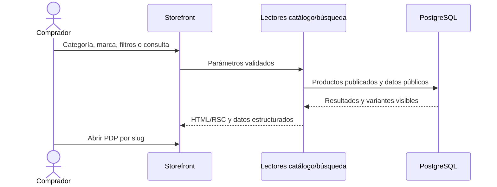
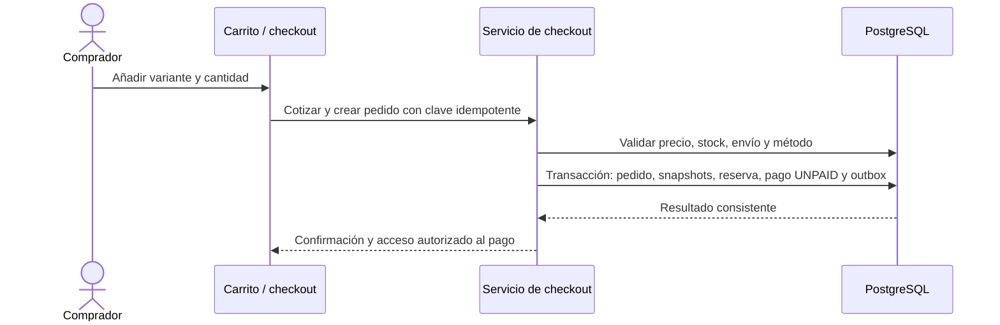
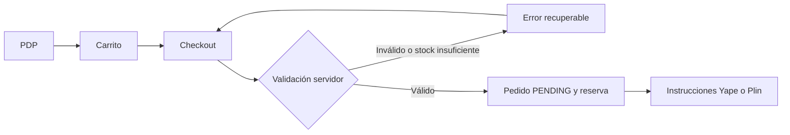
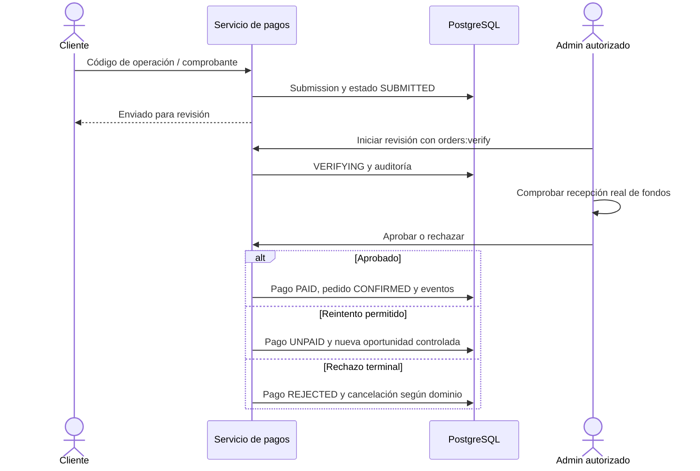
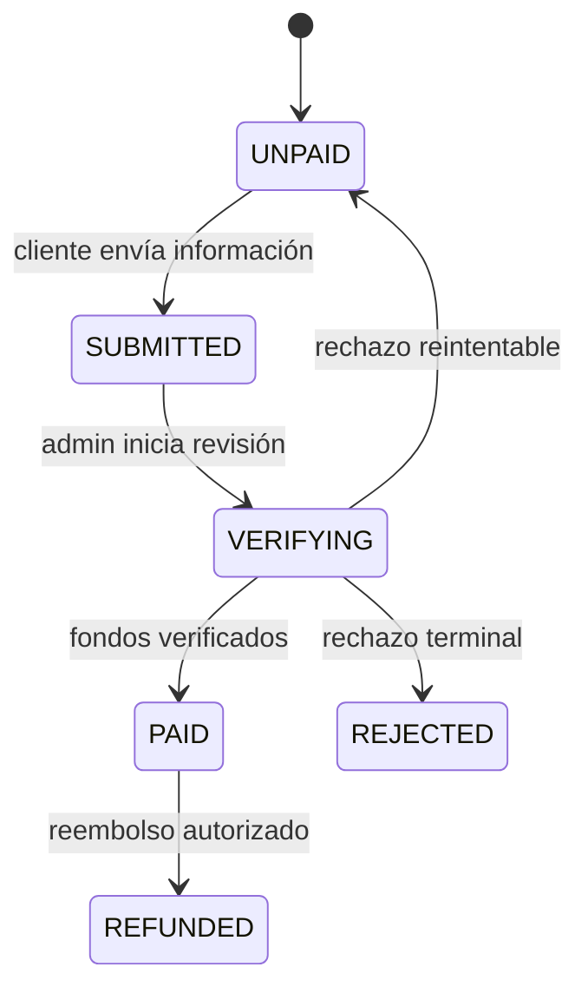
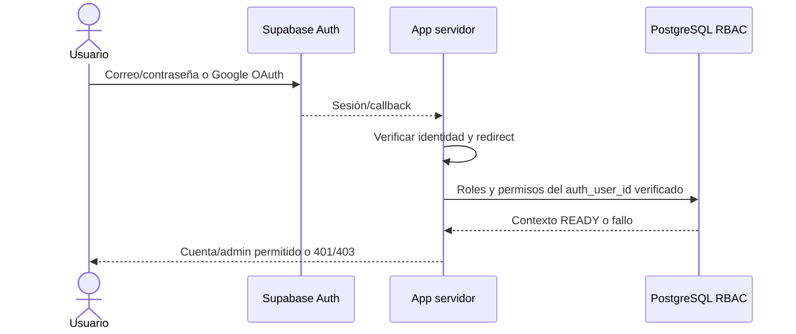
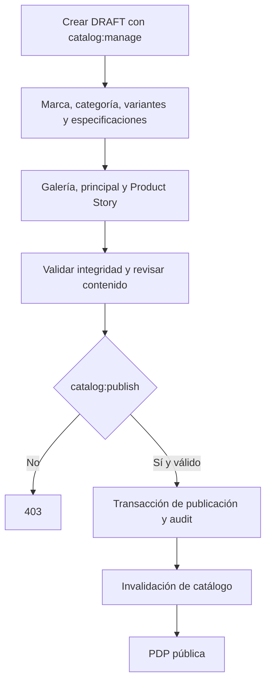
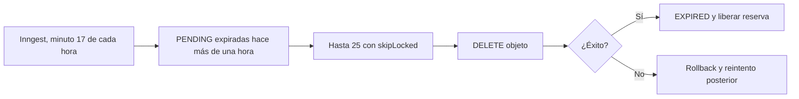
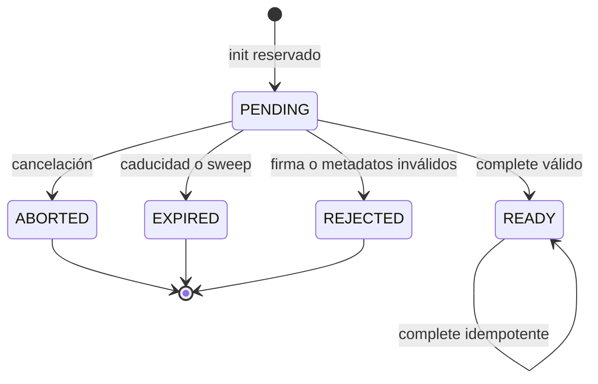
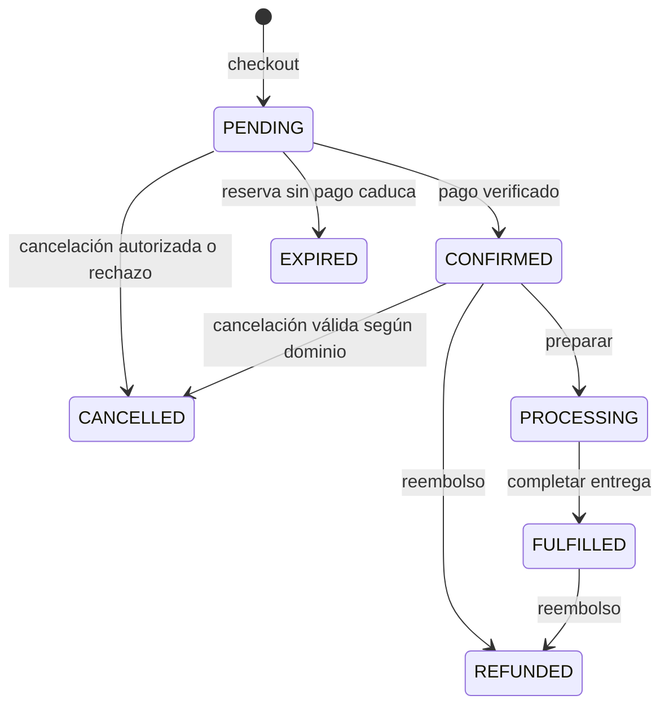

# 05 · Flujos críticos

Los diagramas resumen el código actual; las pruebas y los pendientes están en [07](07-calidad-y-pruebas.md). Un estado enviado por el navegador no sustituye las transacciones del dominio.

## Navegación y búsqueda



Los lectores de catálogo usan caché por tag; la búsqueda aplica sus reglas de consulta. La URL conserva filtros compartibles. La PDP muestra variantes, disponibilidad y contenido estructurado; no se exponen borradores ni campos privados.

## Carrito y checkout





Los importes monetarios se conservan en centavos y los snapshots evitan que una edición posterior del catálogo cambie un pedido existente. La misma petición idempotente no debe crear dos pedidos.

## Pago manual: enviado no equivale a pagado





## Identidad, OAuth y permisos



Cada mutación privilegiada vuelve a comprobar autorización en servidor. No basta con haber cargado una página del admin. Equipo e invitaciones requieren `staff:manage`; no se permite autoelevar un rol enviado por el cliente.

## Crear y publicar un producto



La investigación IA genera propuestas revisables. Publicar sigue siendo una operación explícita con permiso. Editar medios de DRAFT no invalida el storefront; completar medios de PUBLISHED invalida datos por tag sin `revalidatePath`.

## Subida: init, PUT, complete, abort y sweep

```mermaid
sequenceDiagram
  actor A as Operador
  participant B as Navegador
  participant H as Route Handlers
  participant DB as Ledger / presupuesto
  participant R2 as R2
  A->>B: Seleccionar imagen hasta 20 MiB
  B->>B: Orientar, reencodificar y limitar galería a 2400 px / 4 MiB
  B->>H: POST init JSON
  H->>H: Origen, sesión, permiso y Zod
  H->>DB: Reservar presupuesto + PENDING, transacción
  H-->>B: UUID, URL firmada, headers y expiresAt
  B->>R2: PUT directo por XHR, progreso y reintentos limitados
  R2-->>B: Resultado HTTP
  alt PUT correcto
    B->>H: POST complete UUID
    H->>R2: HEAD + GET bytes 0..4095
    H->>H: Validar firma, tamaño, tipo y dimensiones
    H->>DB: FOR UPDATE, READY, asset/referencia/audit y reserva a uso
    H-->>B: Resultado idempotente
    B->>B: Refresh una vez al final del lote
  else Cancelación o fallo
    B->>H: POST abort; pagehide intenta beacon
    H->>DB: Bloquear PENDING
    H->>R2: DELETE
    H->>DB: ABORTED y liberar reserva
  end
```

Si la firma no coincide, el servicio borra el objeto y marca REJECTED con 422. Las dimensiones persistidas provienen del header, no de las declaradas por el navegador. READY repetido no crea otro asset ni vuelve a consumir presupuesto. Un fallo de DELETE conserva reserva/estado mediante rollback.





## Estados del pedido



Los estados provienen de `orders/enums.ts` y `payments/enums.ts`. El diagrama resume el camino principal; los servicios controlan precondiciones, transiciones y reembolsos parciales. El pago y el pedido son agregados distintos: un formulario de comprobante no los confirma por sí mismo.
