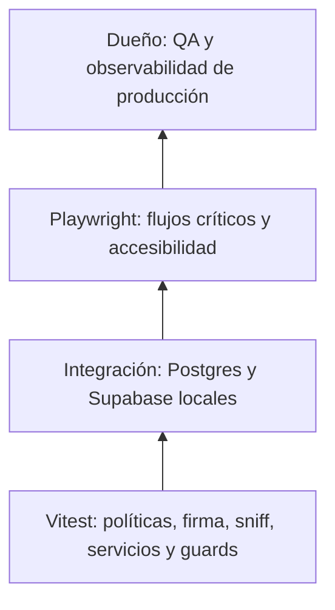

# 07 · Calidad y pruebas

La pirámide combina funciones puras y servicios simulados, integración local real y recorridos de navegador. Una captura no equivale a una prueba funcional ni desarrollo local a una medida de CPU.

## Comandos

| Comando                                                                                | Propósito / condición                                         |
| -------------------------------------------------------------------------------------- | ------------------------------------------------------------- |
| `pnpm check`                                                                           | Formato, TypeScript, ESLint, Vitest y build Next              |
| `pnpm test:e2e`                                                                        | Navegador general con puerto libre                            |
| `pnpm test:admin:live`                                                                 | Integración con DB 127.0.0.1:54322/postgres                   |
| `pnpm test:admin:e2e`                                                                  | Admin local, Supabase 127.0.0.1:54321 y semilla               |
| `pnpm exec vitest run tests/unit/image-sniff.test.ts tests/unit/upload-ledger.test.ts` | Focalizadas de ledger y cabeceras                             |
| `pnpm ignored-builds`                                                                  | Revisar scripts de dependencias, sin habilitarlos globalmente |
| `pnpm cf:build`                                                                        | OpenNext en Linux/WSL; no despliega                           |
| `pnpm exec wrangler deploy --dry-run`                                                  | Medir artefacto sin despliegue                                |
| `pnpm docs:screenshots`                                                                | Capturas locales; requisitos en [09](09-capturas.md)          |

Las suites live/semillas exigen guardas locales fail-closed. No cargar `.env.local` si apunta a producción. Para usar 3001, configurar tanto baseURL como comando/URL de webServer. No detener servicios ajenos para liberar 3000.

## Evidencia de aplicación: GP-059

| Gate                                        | Resultado                                                           |
| ------------------------------------------- | ------------------------------------------------------------------- |
| check                                       | 1922 pruebas / 168 archivos; formato, tipos, lint y build aprobados |
| Focalizadas tras compartir handlers/buckets | 60/60                                                               |
| Playwright general en 3001                  | 161/161                                                             |
| Admin live local                            | 272/272, 14 archivos                                                |
| Admin E2E focalizadas                       | 4/4, incluida cancelación y devolución del presupuesto              |
| Linux cf:build + dry-run                    | 5864,57 KiB gzip                                                    |
| Bundle original → final                     | 5869,50 → 5864,57; −4,93 KiB                                        |
| Entrada GP-059 → salida                     | 5860,17 → 5864,57; +4,40 KiB                                        |

El closure de GP-059 (en el historial de git) precisa alcance y secuencia. El dueño aceptó también la medición intermedia +4,68 KiB. No se continúa optimizando Next/OpenNext. En GP-061 el gate autorizado se limita a formato, lint del script nuevo y una ejecución de capturas; no se repiten cf:build ni E2E y se hereda este estado de aplicación.

## Definition of Done y cobertura

| Dimensión     | Evidencia                                                      | Pendiente / límite                                         |
| ------------- | -------------------------------------------------------------- | ---------------------------------------------------------- |
| Funcional     | Concurrencia, idempotencia, firma, rechazo y cancelación local | QA completo de formatos, dos pestañas, sesión/URL caducada |
| Seguridad     | Origen, auth, permisos, UUID, RLS/revokes y rango              | CORS y configuración reales por el dueño                   |
| Accesibilidad | Progreso semántico, aria-live y cancelar con teclado           | Revisión visual AA y responsive 360/768/1280               |
| Diseño        | Capturas 1440×900 y 390×844 con fixtures                       | No sustituyen auditoría de contraste ni todos los estados  |
| Rendimiento   | Bundle Linux                                                   | LCP y CPU real después de cinco fotos, publicar y PDP      |
| SEO           | SSR, metadata y rutas cubiertas por suites existentes          | Indexación y métricas reales después del deploy            |
| Operación     | SQL local y sweep limitado probado                             | Migración y cron alojados por el dueño                     |

Cero warnings aplica al código nuevo/modificado. BASELINE: jsdom `scrollTo` 7→7, OpenNext experimental 1→1; categorías previas de NO_COLOR/FORCE_COLOR, hidratación/DO del emulador e imágenes localhost. No se admite aumentar número/tipo ni se relaja seguridad. Los cierres de stream del dev server se documentan como incidencia de desarrollo, sin atribuirlos a CPU de producción.

Referencias: [estándares](../engineering/ENGINEERING_STANDARDS.md), [plantilla](../templates/CLOSURE_REPORT_TEMPLATE.md), [pendientes](../roadmap/ROADMAP.md).
