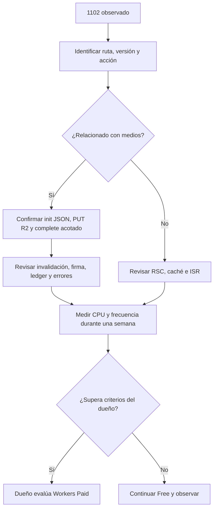

# 08 · Operación

Este paquete no ejecuta despliegues, push ni peticiones de producción. Los pasos siguientes son instrucciones para el dueño con autorización y entorno revisado. Runbooks: [Workers deploy](../development/CLOUDFLARE_WORKERS_DEPLOY.md), [R2](../development/CLOUDFLARE_R2_PRODUCTION_SETUP.md).

## Preparación y despliegue

1. Revisar commit y closures. Comprobar secretos/bindings sin imprimir valores.
2. Respaldar PostgreSQL. Aplicar `0022_media_uploads.sql` por el procedimiento autorizado antes del código que la requiere. Fue generada por Drizzle, con REVOKE y semilla contable añadidos deliberadamente.
3. Confirmar buckets, Hyperdrive, ASSETS, IMAGES, cache R2 y DO.
4. Construir en Linux con lockfile; revisar dry-run y bundle contra la base.
5. El dueño despliega por Workers Builds o el procedimiento del runbook.
6. Hacer QA real: editor, cinco fotos, publicar, PDP, pago manual y logs; registrar resultados en closures.

Windows no sustituye la medición Linux. Un dry-run no es un deploy y una migración local no acredita hosting.

## Rollback

Conservar la versión Workers previa y respaldo de DB. El dueño puede restaurar esa versión mediante rollback de Cloudflare y verificar rutas críticas. El esquema nuevo es aditivo, pero las autorizaciones HMAC antiguas no se confirman como UUID; no reutilizar subidas en vuelo entre versiones. No borrar tablas ni improvisar SQL inverso: la recuperación de datos necesita revisión. Los objetos R2 quedan fuera de la transacción PostgreSQL.

## Observabilidad y runbook 1102

El dueño usa `wrangler tail` y Observability después del deploy. Registrar ventana, versión, acción, rutas, invocaciones, exceededCpu y latencia. Probar editor, cinco fotos, publicar y PDP. Un resultado local aprobado no demuestra consumo <10 ms en producción.

No reintroducir proxy de archivos ni invalidación global para ocultar síntomas. Distinguir CORS, permisos y caducidad antes de atribuirlos a CPU. No ampliar CSP/CORS para silenciar tooling.

## Presupuesto y limpieza

`media_storage_budget.id=1` inicia con 8 GiB (8589934592 bytes), uso SUM de assets PUBLIC_MEDIA y reserva cero. Init reserva; complete mueve reserva a uso una vez. Es contabilidad del dominio, no inventario independiente de R2. No editar contadores sin reconciliación revisada.

Inngest `media-uploads-sweep`, cron `17 * * * *`, procesa máximo cien PENDING cuya expiración pasó hace una hora. Usa skipLocked, elimina antes de liberar y revierte si DELETE falla. El dueño debe comprobar sincronización de función/cron alojados. Beacon es de mejor esfuerzo.

El contador de huérfanos busca PUBLIC_MEDIA mayores de treinta días sin referencias de galería/historia/home ni principal de producto. Solo informa; no borra assets listos.

## Pendientes del dueño

- Aplicar migración con respaldo y revisar RLS/revokes.
- Retirar HMAC de medios y variable de staging; revisar antes de borrar el bucket antiguo.
- Verificar dominio CDN, CORS de PUT y Cache-Control immutable.
- Comprobar orientación, ausencia de EXIF, transparencia y dimensiones reales.
- Medir CPU/LCP, confirmar cron y anotar evidencia en GP-058/059.
