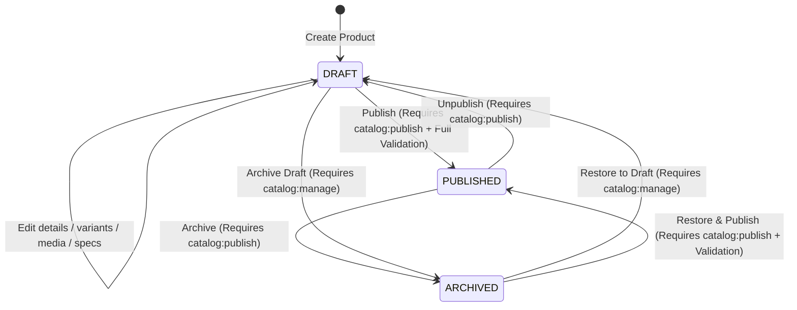

# GP-024 — Admin Product Manager Contract, Domain Reconciliation & Implementation Plan (CHK0-BR1)

## Status

**IN DISCOVERY / CONTRACT PENDING EXTERNAL APPROVAL (CHK0-BR1)**

---

## 1. Executive Summary & Starting Lineage

This document establishes the canonical contract, domain reconciliation, operational boundaries, and implementation plan for **GP-024 (Admin Product Manager)**, incorporating all external review findings and architectural remediations from CHK0-BR1.

GP-024 implements administrative catalog authoring for Gamer Perú, providing authorized staff with the ability to create, edit, duplicate, archive, and publish hardware products, variants, SKUs, integer prices, media galleries, technical specifications, and SEO metadata.

### Baseline Lineage Verification

- **Repository**: `latamcreativa/GamerPeru`
- **Branch**: `main`
- **Starting HEAD SHA**: `ecd42b60278843ddbd57aa7d185b03cc8a1de39a`
- **Parent Commit**: `c72025bc6bc8fa768a506cf53472bbaf75d17895` (GP-023 Formal Closure)
- **GP-023 Status**: `CLOSED / EXTERNALLY APPROVED / FROZEN`
- **Migration 0012 Git Blob**: `e80c30ae9d0f86e14486b0fd5c782eb9ec3f7119` (Frozen)
- **Migration 0013 Status**: Non-existent (Migration sequence strictly preserved through 0012)
- **Infrastructure Status**: Hosted Supabase and Cloudflare R2 remain 100% untouched.

---

## 2. Canonical Scope & Explicit Boundaries

### In Scope (GP-024)

1. **Product Authoring**: Creation, updating, drafting, archiving, and duplicating of conceptual hardware models (`products`).
2. **Variant & SKU Management**: Authoring and configuring concrete sellable items (`product_variants`), SKUs, integer prices in Soles cents (`PEN`), compare-at prices, cost prices, physical weights, and swatch attributes.
3. **Media Management**: Attaching, ordering, designating primary images, linking variant-specific images, and alt text authoring backed by Cloudflare R2 public storage (`media_assets`, `product_media`), conforming to ADR-004.
4. **Category Specifications**: Linking and validating dynamic hardware technical specifications against versioned category schemas (`product_specifications`, `category_specification_schemas`) using the authoritative `Category.current_spec_schema_id` pointer.
5. **SEO & Metadata**: Authoring/deriving product slugs, meta descriptions, OpenGraph tags, and Schema.org structured data inputs.
6. **Status Lifecycle**: Managing state transitions between `DRAFT`, `PUBLISHED`, and `ARCHIVED` with fail-closed publish validation.
7. **RBAC & Auditing**: Authoritative server-side permission enforcement (`catalog:manage` for authoring, `catalog:publish` for publishing/unpublishing/archiving published products) and immutable audit trail generation (`audit_events`).
8. **Admin UX**: Product list, search, filter, pagination, creation flow, and comprehensive product editor.

### Explicitly Out of Scope

1. **Product Story Builder (GP-026)**: Visual block-based editorial story authoring (`product_stories`, `product_story_revisions`, 13 modular visual block types) is strictly OUT OF SCOPE. GP-024 preserves existing story links by reference but does NOT provide story editing surfaces.
2. **AI Product Research & Import (GP-025)**: LLM-assisted product research, specification scraping, and batch product-name importing are strictly OUT OF SCOPE. Ordinary manual authoring only.
3. **Brand & Category Taxonomy CRUD**: Administrative CRUD for creating/editing Brand and Category records is strictly OUT OF SCOPE. Product authoring selects from existing reference brands and categories (resolved via Option A bootstrap).
4. **Collection Merchandising**: Collections and ProductCollections are not part of GP-024 (and do not exist in the physical schema).
5. **Direct Warehouse Stock Manipulation**: Adjusting physical warehouse stock balances or ledger movements belongs to GP-029 (Inventory Admin). GP-024 configures catalog sellability, variant pricing, and attributes; it does not author inventory adjustments.

---

## 3. Dependency Validation & Historical Documentation Drift Audit

GP-024 declares dependencies on **GP-004** (Commerce Domain Model) and **GP-022** (Admin Foundation), and follows the closed **GP-023** (Admin Dashboard).

### Dependency Status Verification

1. **GP-004 (Commerce Domain Model)**:
   - Status: `CLOSED / EXTERNALLY APPROVED`
   - Canonical Evidence: [`docs/roadmap/GP-004-CLOSURE.md`](./GP-004-CLOSURE.md), [`docs/architecture/COMMERCE_DOMAIN_MODEL.md`](../architecture/COMMERCE_DOMAIN_MODEL.md).
   - Domain Model established 11 bounded contexts and 58 physical entity blueprints.

2. **GP-022 (Admin Foundation)**:
   - Status: `CLOSED / EXTERNALLY APPROVED`
   - Canonical Evidence: [`docs/roadmap/GP-022-CLOSURE.md`](./GP-022-CLOSURE.md) (Formal Closure Checkpoint `0ee964936127fd4a7e602af09527c3e87175aaf5`).
   - Delivered: Protected Admin Shell layout, server-side RBAC guard (`requireAdminAccess`, `requirePermission`), `inventory:manage` permission (migration 0012), and E2E security test suites.
   - **Historical Documentation Drift Note**: While `docs/roadmap/GP-022.md` still textually displays `Status: PLANNED`, this is confirmed as historical documentation drift only. `docs/roadmap/GP-022-CLOSURE.md` is the authoritative closure record. `docs/roadmap/GP-022.md` is NOT modified and GP-022 is NOT reopened.

3. **GP-023 (Admin Dashboard)**:
   - Status: `CLOSED / EXTERNALLY APPROVED / FROZEN`
   - Canonical Evidence: [`docs/roadmap/GP-023-CLOSURE.md`](./GP-023-CLOSURE.md) (Commit `c72025bc6bc8fa768a506cf53472bbaf75d17895`).
   - Delivered: Real-time read-only operational metric aggregates across 5 domains. GP-023 metrics and shell navigation conventions remain completely frozen and untouched.

---

## 4. Physical Schema Truth — Product Entity Contract

Based on the physical Drizzle schema at [`src/db/schema/catalog/products.ts`](../../src/db/schema/catalog/products.ts), the authoritative fields for `products` are:

| Field / Column     | Database Type    | TypeScript Type                        | Required / Optional | Default            | Physical Database Constraints & Indexes             | Application Validation Contract           | Storefront & SEO Impact                                           |
| :----------------- | :--------------- | :------------------------------------- | :------------------ | :----------------- | :-------------------------------------------------- | :---------------------------------------- | :---------------------------------------------------------------- |
| `id`               | `uuid`           | `string`                               | Required            | `generateUuidV7()` | Primary Key, B-Tree                                 | Immutable                                 | Internal aggregate identity                                       |
| `brand_id`         | `uuid`           | `string`                               | Required            | None               | FK $\to$ `brands.id` (`ON DELETE RESTRICT`)         | Valid existing published brand            | Changes brand badge, PDP title, brand breadcrumb                  |
| `category_id`      | `uuid`           | `string`                               | Required            | None               | FK $\to$ `categories.id` (`ON DELETE RESTRICT`)     | Valid existing published category         | Changes category page, facets, spec schema compatibility          |
| `name`             | `varchar(200)`   | `string`                               | Required            | None               | Gin trigram index `products_name_trgm_idx`          | Trimmed non-empty string, $\le 200$ chars | Primary PDP H1, listing title, `<title>` metadata                 |
| `slug`             | `varchar(200)`   | `string`                               | Required            | None               | `UNIQUE`, check `^[a-z0-9]+(?:-[a-z0-9]+)*$`        | Valid physical regex, globally unique     | Canonical URL `/productos/[slug]`. Changing breaks existing URLs! |
| `subtitle`         | `varchar(255)`   | `string \| null`                       | Optional            | `null`             | Gin trigram index `products_subtitle_trgm_idx`      | Optional trimmed string, $\le 255$ chars  | PDP subtitle, 1st priority for SEO meta description               |
| `description`      | `text`           | `string \| null`                       | Optional            | `null`             | None                                                | Optional string                           | PDP editorial markdown, 2nd priority for SEO meta description     |
| `status`           | `catalog_status` | `"DRAFT" \| "PUBLISHED" \| "ARCHIVED"` | Required            | `"DRAFT"`          | Enum `catalog_status`, index `(status, isFeatured)` | Transition gated (Section 6)              | Public visibility. Only `PUBLISHED` appears on storefront         |
| `is_featured`      | `boolean`        | `boolean`                              | Required            | `false`            | Index `(status, isFeatured)`                        | Boolean                                   | Determines homepage / showcase hero prominence                    |
| `primary_media_id` | `uuid`           | `string \| null`                       | Optional            | `null`             | FK $\to$ `media_assets.id` (`ON DELETE SET NULL`)   | Same-product global media (Section 9)     | Primary thumbnail, PDP hero fallback, OpenGraph social image      |
| `created_at`       | `timestamptz`    | `Date`                                 | Required            | `NOW()`            | B-Tree in pagination indexes                        | Immutable (system managed)                | Sorting by creation date                                          |
| `updated_at`       | `timestamptz`    | `Date`                                 | Required            | `NOW()`            | `$onUpdateFn(() => new Date())`                     | Used for optimistic concurrency check     | Concurrency conflict detection                                    |

### Clarification on Physical vs Application Validation

- The physical schema enforces `name: varchar(200) NOT NULL`. It does NOT enforce a minimum length. The application validation contract requires a trimmed non-empty string ($\le 200$ characters). (Invented restrictions such as `name.length >= 3` are removed).
- Zero pricing fields exist on `products`. Pricing belongs strictly to `product_variants`.
- Zero separate `seo_title` or `seo_description` columns exist. PDP SEO derives metadata dynamically.
- Zero `deleted_at` column exists; soft-deletion is represented strictly by `status = 'ARCHIVED'`.

---

## 5. Physical Schema Truth — ProductVariant & SKU Contract

Based on the physical Drizzle schema at [`src/db/schema/catalog/product-variants.ts`](../../src/db/schema/catalog/product-variants.ts), the authoritative fields for `product_variants` are:

| Field / Column           | Database Type    | TypeScript Type                        | Required / Optional | Default            | Physical Database Constraints & Checks       | Application Validation Contract                           | Commerce & Storefront Impact                             |
| :----------------------- | :--------------- | :------------------------------------- | :------------------ | :----------------- | :------------------------------------------- | :-------------------------------------------------------- | :------------------------------------------------------- |
| `id`                     | `uuid`           | `string`                               | Required            | `generateUuidV7()` | Primary Key                                  | Immutable                                                 | Referenced by cart items, order items, inventory items   |
| `product_id`             | `uuid`           | `string`                               | Required            | None               | FK $\to$ `products.id` (`ON DELETE CASCADE`) | Immutable                                                 | Parent product family                                    |
| `sku`                    | `varchar(50)`    | `string`                               | Required            | None               | `UNIQUE` index `product_variants_sku_idx`    | Trimmed non-empty string, $\le 50$ chars, globally unique | Machine inventory identifier, order snapshot identifier  |
| `title`                  | `varchar(150)`   | `string`                               | Required            | None               | `NOT NULL`                                   | Trimmed non-empty string, $\le 150$ chars                 | Swatch title (e.g. "Negro / Omron Optical")              |
| `price_cents`            | `integer`        | `number`                               | Required            | None               | Check `price_cents > 0`                      | Integer Soles minor units $> 0$, $\le 2147483647$         | Authoritative selling price in Peruvian Soles (`PEN`)    |
| `compare_at_price_cents` | `integer`        | `number \| null`                       | Optional            | `null`             | Check `IS NULL OR >= 0`                      | Integer Soles minor units $\ge 0$                         | Strikethrough original price                             |
| `cost_cents`             | `integer`        | `number \| null`                       | Optional            | `null`             | Check `IS NULL OR >= 0`                      | Integer Soles minor units $\ge 0$                         | Wholesale cost for internal margin tracking (staff only) |
| `weight_grams`           | `integer`        | `number \| null`                       | Optional            | `null`             | Check `IS NULL OR > 0`                       | Integer grams $> 0$                                       | Physical product weight for shipping/specs               |
| `attributes`             | `jsonb`          | `Record<string, string>`               | Required            | `{}`               | `NOT NULL`, default `{}`                     | Plain JSON object of key-value string swatches            | Color, switch, layout attributes                         |
| `status`                 | `variant_status` | `"ACTIVE" \| "INACTIVE" \| "ARCHIVED"` | Required            | `"ACTIVE"`         | Enum `variant_status`                        | Enum value                                                | Sellability condition. Must be `ACTIVE` to buy           |
| `display_order`          | `integer`        | `number`                               | Required            | `0`                | Check `display_order >= 0`                   | Integer $\ge 0$                                           | Determines order in PDP variant selector                 |
| `created_at`             | `timestamptz`    | `Date`                                 | Required            | `NOW()`            | B-Tree                                       | Immutable (system managed)                                | Audit & ordering                                         |
| `updated_at`             | `timestamptz`    | `Date`                                 | Required            | `NOW()`            | `$onUpdateFn`                                | Concurrency check                                         | Optimistic concurrency check                             |

### Physical Schema Reality vs Application Validation

1. **SKU Format**:
   - The physical database enforces `sku varchar(50) NOT NULL UNIQUE`.
   - The physical schema does NOT enforce uppercase-only, alphanumeric-only, or hyphen-only constraints.
   - **Application Validation Contract**: A trimmed non-empty string of maximum 50 characters, verified globally unique. The application will NOT silently uppercase or rewrite a SKU unless explicitly entered by the user. No restrictive character regex will be invented without canonical evidence.
2. **Variant Title**:
   - The physical schema enforces `title varchar(150) NOT NULL`.
   - The physical schema does NOT enforce a minimum non-empty length beyond `NOT NULL`.
   - **Application Validation Contract**: Trimmed non-empty string, maximum 150 characters.
3. **Variant Attributes**:
   - The physical schema enforces `attributes jsonb NOT NULL default {}`.
   - The physical schema does NOT contain a PostgreSQL `jsonb_typeof(...) = 'object'` check.
   - **Application Validation Contract**: Server-side Zod validation verifies that `attributes` is a plain JavaScript object with string keys and string values (`Record<string, string>`).

### Storefront Sellability Invariant

The project-wide canonical invariant established in GP-004 and GP-023 is strictly preserved:
$$\text{Sellable SKU} \iff (\text{Product.status} = \text{'PUBLISHED'} \land \text{ProductVariant.status} = \text{'ACTIVE'})$$

### Resolved Contract Decision: SKU Immutability Post-Commerce Rule

> [!IMPORTANT]
> **EXTERNALLY RESOLVED CONTRACT DECISION: SKU Immutability Rule**
>
> A `ProductVariant.sku` MAY be modified only while BOTH conditions are true:
>
> 1. **ZERO `inventory_items` rows** exist for that variant.
> 2. **ZERO `order_items` rows** exist for that variant.
>
> **Once either an inventory item or an order item exists:**
>
> - The SKU is **PERMANENTLY IMMUTABLE** in GP-024.
> - **Rationale**: `inventory_items.variant_id` uses `ON DELETE RESTRICT` and forms physical warehouse bin identity; `order_items.variant_id` uses `ON DELETE RESTRICT` and preserves immutable purchase facts (`sku_snapshot`). Because `inventory_ledger_entries` references `inventory_items` with `ON DELETE RESTRICT`, stock ledger records cannot exist without an `inventory_items` row.
> - **Admin UI Behavior**: The SKU input is disabled with a lock icon and an explicit notice: _"Este SKU está vinculado a registros de inventario o pedidos históricos y no puede modificarse. Para cambiar el SKU comercial, desactiva esta variante y crea una nueva."_
> - Historical `sku_snapshot` in `order_items` is never mutated.

---

## 6. Product Status Lifecycle & Hard Delete Prohibition

The physical enum is `catalog_status`: `"DRAFT"`, `"PUBLISHED"`, `"ARCHIVED"`.



### Hard Deletion is Strictly Forbidden in GP-024

- GP-024 contains **ZERO hard deletion** of `products` or `product_variants`.
- GP-024 has no `catalog:delete` or `catalog:purge` permission.
- Authorization is never bypassed via a hardcoded `SUPER_ADMIN` role branch.
- **"D" in CRUD maps strictly to ARCHIVE** (`status -> ARCHIVED`).
- If physical database purges are ever required for test data, privacy compliance, or administrative maintenance, they must be governed by a future, separately authorized maintenance contract/gate.

### Lifecycle Transition Rules

1. **Initial Creation**: Enters `status = 'DRAFT'`. Zero products may be created directly in `PUBLISHED` state.
2. **Draft Editing**: While in `DRAFT`, fields may be edited freely without blocking publish validation.
3. **Publish Transition (`DRAFT -> PUBLISHED` or `ARCHIVED -> PUBLISHED`)**:
   - Strictly requires `catalog:publish`.
   - Executes the fail-closed Publish Readiness Validator (Section 8). If any hard blocker fails, the transaction aborts.
4. **Unpublish Transition (`PUBLISHED -> DRAFT`)**:
   - Strictly requires `catalog:publish`.
   - Product immediately disappears from public storefront, search results, category pages, and PDP routes.
   - Active carts with variants from this product will fail checkout availability validation.
5. **Archive Transition (`PUBLISHED -> ARCHIVED` or `DRAFT -> ARCHIVED`)**:
   - `PUBLISHED -> ARCHIVED` requires `catalog:publish`.
   - `DRAFT -> ARCHIVED` requires `catalog:manage`.
6. **Restore Transition (`ARCHIVED -> DRAFT`)**:
   - Requires `catalog:manage`. Reopens the archived product for editing in draft status.

---

## 7. Category Specifications Contract & Value Validation

Hardware attributes are structured dynamically per category using PostgreSQL `JSONB` in `product_specifications`, validated against versioned schemas in `category_specification_schemas`.

### Canonical Schema Selection via Category Pointer

The physical `categories` table contains the column:
$$\text{categories.current\_spec\_schema\_id}$$

This column is the single source of truth for the category's active specification schema.

**Canonical Admin Selection Workflow**:

1. Read `Product.category_id`.
2. Read `Category.current_spec_schema_id`.
3. If `current_spec_schema_id IS NULL`: The category currently has no authoritative specification schema. Technical specifications are not applicable and are not a publish blocker.
4. If `current_spec_schema_id IS NOT NULL`: Fetch exactly that `CategorySpecificationSchema` record by ID.
5. Fail closed unless all integrity conditions are met:
   - `schema.id == category.current_spec_schema_id`
   - `schema.category_id == category.id`
   - `schema.is_active == true`
   - `schema.schema_version > 0`
   - `schema.field_definitions` passes `validateSpecificationFieldDefinitions(...)` (`src/lib/discovery-filters/schema-validation.ts`).
6. If the pointer is missing, inactive, mismatched, or invalid, the system halts with:
   $$\text{SPECIFICATION\_SCHEMA\_INTEGRITY\_ERROR}$$
   The system will never silently discover or fall back to an arbitrary active schema.

### Application-Level Specification Value Validator

`validateSpecificationFieldDefinitions(...)` validates category schema field definitions, **NOT** product specification values. GP-024 defines a new application-level helper:
$$\text{validateProductSpecificationValues(validatedFieldDefinitions, rawSpecValues)}$$

**Required Validation Behavior**:

1. `rawSpecValues` must be a plain JSON object (`Record<string, unknown>`).
2. **Strict Key Allowlist**: Every persisted key must match a declared `field.key` in the validated `fieldDefinitions`. Any unknown key causes immediate validation **REJECTION**.
3. **Typed Non-Null Value Validation**: For each present non-null value:
   - **`dataType: "enum"`**: Must be a string matching one declared `options[].value`.
   - **`dataType: "number"`**: Must be a finite number. If `min` is defined, $\text{value} \ge \text{min}$. If `max` is defined, $\text{value} \le \text{max}$. If `step` is defined, $(\text{value} - \text{min}) \pmod{\text{step}} = 0$ within floating tolerance.
   - **`dataType: "boolean"`**: Must be boolean.
   - **`dataType: "string"`**: Must be a string.
4. **Null / Unset Semantics**:
   - `null` or `undefined` is treated as unset/missing.
   - `null` is never treated as a valid typed value satisfying a field.
   - Unset keys are normalized out before persisting to `product_specifications.spec_values`.
5. **No Invented "Required" Fields**:
   - In the current schema, `SpecificationFieldDefinition` has **NO `required` property**.
   - GP-024 v1 cannot truthfully enforce "all required fields".
   - If `Category.current_spec_schema_id` is non-null: `ProductSpecifications` must reference that current schema, and every _present_ value must pass type validation. Missing specification keys are permitted.
6. **Transactional Category Change Reconciliation**:
   - When `product.category_id` is changed, the specification link must be reconciled in the same transaction:
   - Resolve the new `Category.current_spec_schema_id`.
   - If `NULL`: Delete the existing `ProductSpecifications` record.
   - If non-null: Replace `ProductSpecifications` with a record referencing the new schema and empty `spec_values = {}`, unless new values were validated against that new schema in the same request.
   - **Invariant**: Old-category `spec_values` are never retained under a new Category.

---

## 8. Corrected Publish Readiness Validator Contract

Before a product can transition to `PUBLISHED`, the system executes the Publish Readiness Validator.

### Hard Blockers (Must all pass; failure rejects transition)

1. **Product Name**: Trimmed non-empty string $\le 200$ characters.
2. **Product Slug**: Valid physical regex (`^[a-z0-9]+(?:-[a-z0-9]+)*$`) and globally unique.
3. **Brand Verification**: Referenced Brand exists and has `status = 'PUBLISHED'`.
4. **Category Verification**: Referenced Category exists and has `status = 'PUBLISHED'`.
5. **Sellable Variants**:
   - At least **ONE** `ProductVariant` with `status = 'ACTIVE'`.
   - Each active variant must have:
     - Trimmed non-empty `sku` $\le 50$ chars, globally unique.
     - `price_cents > 0`.
     - Valid `attributes` object conforming to GP-024 validation.
6. **Specification Integrity**:
   - If `Category.current_spec_schema_id IS NOT NULL`:
     - `product_specifications` must exist.
     - Must reference `schema_id == Category.current_spec_schema_id`.
     - Must match `schema_version == currentSchema.schema_version`.
     - All present values in `spec_values` must pass `validateProductSpecificationValues`.
   - If `Category.current_spec_schema_id IS NULL`:
     - Specifications do not block publishing.
7. **Media Integrity**:
   - At least **ONE** valid `PUBLIC_MEDIA` image belonging to the Product must exist (`products.primary_media_id` or `product_media` global image).
   - Must satisfy all media relational integrity checks (Section 9).

### Soft Quality Warnings (Informational; do NOT block publish)

- Missing `subtitle`.
- Short `description` ($< 50$ chars).
- No `compare_at_price_cents`.
- Missing `weight_grams` on variants.
- Zero active Available To Sell (ATS) stock (product displays as "Agotado" on storefront, which is a legitimate commerce state).

---

## 9. Media Relational Integrity Contract

The physical `product_media` table defines independent foreign keys:

- `productId` $\to$ `products.id`
- `variantId` $\to$ `product_variants.id`

However, the physical schema lacks a composite foreign key guaranteeing that `product_variants.product_id == product_media.product_id`.

### Canonical Application-Enforced Invariants

1. **Variant Ownership Invariant**:
   - For every `product_media` row where `variant_id IS NOT NULL`:
   - The server mutation loads the referenced `ProductVariant`.
   - It strictly requires:
     $$\text{variant.product\_id} == \text{product\_media.product\_id}$$
   - If mismatched, the transaction aborts with:
     $$\text{MEDIA\_VARIANT\_PRODUCT\_MISMATCH}$$
   - Client-reported variant ownership claims are never accepted without server-side verification.
2. **Primary Media Invariant**:
   - `products.primary_media_id` may only be set by GP-024 if:
     1. The `MediaAsset` exists.
     2. `security_class == 'PUBLIC_MEDIA'`.
     3. `media_type == 'IMAGE'`.
     4. MIME type is an allowed catalog image MIME (`image/webp`, `image/jpeg`, `image/png`, `image/avif`).
     5. The asset is attached to the same Product through `product_media` with `variant_id IS NULL` (global image).
   - A Product's primary image may never point to an unattached or unrelated product's asset.

---

## 10. Duplicate Product — Variant Media Remapping

When staff duplicates a product, media relationships must be remapped safely:

1. **Variant Mapping**:
   - As variants are cloned, an in-memory mapping is established:
     $$\text{sourceVariantId} \implies \text{newVariantId}$$
2. **Product Media Remapping**:
   - **Global media (`variant_id IS NULL`)**:
     Created with `new product_media.variant_id = NULL`.
   - **Variant-specific media (`variant_id = sourceVariantId`)**:
     Created with `new product_media.variant_id = mapped newVariantId`.
   - **Invariant**: The duplicate product **NEVER** inherits a reference to a source variant ID.
   - If any variant-specific media row cannot be mapped to a cloned variant, the duplicate transaction aborts.
3. **Primary Media Reference**:
   - `products.primary_media_id` is set to the same `MediaAsset.id` by reference, provided the asset was cloned as global media for the new Product.
4. **Never Duplicated**:
   - `inventory_items` and `inventory_ledger`: Duplicate has 0 stock.
   - `order_items`: Zero historical orders.
   - `product_stories`: Out of scope; duplicate has no story attached.
   - Status is always reset to `DRAFT` and `is_featured = false`.

---

## 11. Shared Media & Alt Text Semantics

- **Asset-Level Metadata**: In the physical schema, `alt_text` resides on `media_assets.alt_text`. It is **NOT** stored per `product_media` join row.
- **Shared Reference Impact**: When a `MediaAsset` is reused across multiple products (e.g. via product duplication or shared brand imagery), all referencing products share the exact same `alt_text`.
- **Contract Rule**:
  - Editing alt text in the Admin gallery updates the underlying `media_assets.alt_text`.
  - The Admin UI must explicitly disclose when an asset is referenced by multiple entities: _"Este texto alternativo se actualiza en todas las referencias donde se utilice esta imagen."_
  - GP-024 will not introduce a schema change for per-link alt text. Per-link alt text is deferred as a future schema enhancement if needed.

---

## 12. Public Media Pipeline & ADR-004 Alignment

In strict adherence to accepted **ADR-004**:

### Canonical Storage Identity

- **Incoming Image Formats**: `image/jpeg`, `image/png`, `image/webp`, `image/avif`.
- **Maximum Incoming Size**: 10 MiB (enforced as a GP-024 application limit, not a database constraint).
- **Transformation to Canonical Format**:
  - Before a `MediaAsset` becomes canonical, the uploaded image must be converted to **actual WebP bytes**.
  - Merely renaming a file extension to `.webp` while keeping JPEG/PNG bytes is strictly forbidden.
- **Canonical Content-Hashed Object Key**:
  $$\text{products/}\{brandSlug\}/\{productSlug\}/\{sha256\}.\text{webp}$$
  Where `{sha256}` is the lowercase hexadecimal SHA-256 hash of the final WebP bytes.
- **Temporary Upload Separation**:
  - Temporary uploads from browser pre-signed PUTs are stored under a dedicated temporary prefix:
    $$\text{temp/uploads/}\{actorId\}/\{intentId\}.\text{tmp}$$
  - Temporary objects are **NOT** registered as `media_assets`.
  - Temporary objects have bounded lifecycle cleanup semantics.

---

## 13. Media Upload Intent & Finalization Security

The browser runtime is treated as untrusted presentation.

### Upload Lifecycle

1. **Server-Generated Upload Intent**:
   - Staff with `catalog:manage` requests an upload intent via a Server Action.
   - The server binds:
     - `actorId` (from verified JWT claims)
     - `productId` (target product)
     - `intentId` (UUIDv7)
     - `tempObjectKey` (under `temp/uploads/...`)
     - Allowed MIME types and size limit (10 MiB)
     - Short expiration (10 minutes)
   - Server returns the presigned R2 PUT URL. The browser cannot choose arbitrary keys.
2. **Direct Browser Upload**:
   - Browser uploads raw binary directly to R2 using the presigned PUT URL.
3. **Server-Side Finalization Verification**:
   - Browser invokes `finalizeMediaUpload({ intentId })`.
   - Server verifies:
     A. Intent is authentic, unexpired, and belongs to the current staff actor and target Product.
     B. Performs `HEAD` against R2 to confirm the temporary object exists.
     C. Confirms `Content-Length <= 10 MiB`.
     D. Validates actual image bytes to reject MIME spoofing.
     E. Normalizes image bytes to canonical WebP format.
     F. Computes SHA-256 hash of final WebP bytes.
     G. Constructs canonical key: `products/{brandSlug}/{productSlug}/{sha256}.webp`.
     H. Copies/puts final WebP bytes to the canonical key in R2 and deletes the temporary object.
     I. Registers `media_assets` and attaches `product_media` in a PostgreSQL transaction.
   - Client-reported `fileSize`, `mimeType`, `width`, `height`, or `checksum` are **never trusted** without server verification.

---

## 14. Media Failure & Orphan Cleanup

Because PostgreSQL and Cloudflare R2 do not participate in a two-phase commit, compensating failure logic is enforced:

1. **Temporary Upload Failure**:
   - If the browser fails to upload or finalization is never called, temporary objects expire via R2 lifecycle rules or best-effort deletion.
2. **Canonical Object Written but Database Transaction Fails**:
   - If final WebP bytes are written to R2 but the PostgreSQL transaction fails, the server performs best-effort cleanup of the canonical object **only if** no other `media_assets` record references that key.
3. **Attachment Removal & Reference-Aware Deletion**:
   - Removing an image from a Product deletes the `product_media` row.
   - The underlying `MediaAsset` and R2 object are **NOT** deleted immediately if any reference remains:
     - `products.primary_media_id`
     - `brands.logo_media_id`
     - Other `product_media.media_asset_id` rows
   - (Note: Product Story blocks store JSON payloads rather than DB foreign keys; do not assume automatic relational protection).
4. **Default Safety Rule**:
   - Prefer orphan retention over accidental deletion of an object that may still be referenced.
   - Physical R2 deletion is performed only after a reference-aware orphan audit. Zero R2 operations are executed in CHK0-BR1.

---

## 15. Corrected Admin Product List Aggregation

### Query Fan-Out Elimination

In the original CHK0 draft, joining `product_variants` and `inventory_items` directly created a Cartesian fan-out whenever variants had inventory across multiple locations.

### Canonical Query Architecture

The query pre-aggregates variants and inventory using CTEs / subqueries to guarantee mathematical correctness:

```sql
WITH variant_summary AS (
  SELECT
    pv.product_id,
    COUNT(pv.id) AS total_variants,
    COUNT(CASE WHEN pv.status = 'ACTIVE' THEN 1 END) AS active_variants,
    MIN(CASE WHEN pv.status = 'ACTIVE' THEN pv.price_cents END) AS min_active_price_cents,
    MAX(CASE WHEN pv.status = 'ACTIVE' THEN pv.price_cents END) AS max_active_price_cents
  FROM product_variants pv
  GROUP BY pv.product_id
),
active_inventory_summary AS (
  SELECT
    pv.product_id,
    COALESCE(SUM(ii.quantity_on_hand - ii.quantity_reserved - ii.quantity_allocated), 0) AS active_variant_ats
  FROM product_variants pv
  INNER JOIN inventory_items ii ON pv.id = ii.variant_id
  WHERE pv.status = 'ACTIVE'
  GROUP BY pv.product_id
)
SELECT
  p.id,
  p.name,
  p.slug,
  p.status,
  p.is_featured,
  p.updated_at,
  b.name AS brand_name,
  c.name AS category_name,
  ma.object_key AS primary_media_key,
  ma.alt_text AS primary_media_alt,
  COALESCE(vs.total_variants, 0) AS total_variants,
  COALESCE(vs.active_variants, 0) AS active_variants,
  vs.min_active_price_cents,
  vs.max_active_price_cents,
  COALESCE(ais.active_variant_ats, 0) AS active_variant_ats
FROM products p
INNER JOIN brands b ON p.brand_id = b.id
INNER JOIN categories c ON p.category_id = c.id
LEFT JOIN media_assets ma ON p.primary_media_id = ma.id
LEFT JOIN variant_summary vs ON p.id = vs.product_id
LEFT JOIN active_inventory_summary ais ON p.id = ais.product_id
WHERE ($1::text IS NULL OR p.status = $1)
  AND ($2::uuid IS NULL OR p.brand_id = $2)
  AND ($3::uuid IS NULL OR p.category_id = $3)
  AND ($4::text IS NULL OR p.name ILIKE '%' || $4 || '%' OR p.slug ILIKE '%' || $4 || '%')
ORDER BY p.updated_at DESC, p.id DESC
LIMIT $5 OFFSET $6;
```

### Aggregate Metrics Definitions

1. **`totalVariants`**: Total distinct `product_variants` belonging to the Product.
2. **`activeVariants`**: Distinct `product_variants` with `status = 'ACTIVE'`.
3. **Commercial Price Range (`min_active_price_cents` / `max_active_price_cents`)**:
   - Derived **strictly from ACTIVE variants**.
   - If `active_variants = 0`, commercial price range displays as `"No disponible"` / `null`, **NOT `S/ 0.00`**.
4. **`activeVariantAts`**:
   - Available To Sell stock aggregated across `inventory_items` belonging **strictly to ACTIVE variants**.
   - Explicitly distinguished from GP-023 global physical inventory (which includes stock of inactive/archived variants).
5. **Deterministic Pagination**:
   - Enforces composite ordering: `ORDER BY p.updated_at DESC, p.id DESC`.

---

## 16. Idempotency & Replay Contract

### Replay Architecture

1. **UUIDv7 is Not an Idempotency Mechanism**:
   - Generating a random or timestamped UUIDv7 does not prevent double-submit duplication.
   - Client-side button disabling is a UX affordance only, not authoritative replay protection.
2. **Existing Idempotency Table**:
   - The PostgreSQL `idempotency_keys` table uses an enum (`idempotency_operation_type`) that does not include catalog operations.
   - That enum is **NOT** altered in GP-024 to preserve `SCHEMA_CHANGE_REQUIRED: NO`.
3. **GP-024 Application-Level Replay Architecture**:
   - **`mutationRequestId`**: Every replay-sensitive Admin submission generates a high-entropy `mutationRequestId` (UUID) in the browser, reused on network retry.
   - **Advisory Lock Serialization**: Server computes a deterministic 64-bit integer hash from `(actorId, operationType, mutationRequestId)` and acquires a PostgreSQL transaction advisory lock:
     ```sql
     SELECT pg_advisory_xact_lock($1);
     ```
   - **Create Product**: Slug uniqueness is authoritative. If the same `mutationRequestId` retries, the server identifies the existing product and returns it. If a different operation collides on the same slug, it returns `SLUG_CONFLICT`.
   - **Duplicate Product**: Target duplicate slug and suffix are derived deterministically from:
     $$\text{hash}(sourceProductId, actorId, mutationRequestId)$$
     Retrying the same request returns the existing duplicate rather than generating `-copy-1`, `-copy-2`, etc.
   - **Create Variant**: SKU uniqueness is authoritative. Retrying the same mutation returns the existing variant.
   - **Media Finalization**: Canonical content-hash `objectKey` provides stable identity. Reuses existing `MediaAsset` and avoids duplicate `product_media` joins.
   - **Publish / Archive**: If already at target status, returns idempotent NO-OP without appending duplicate audit events.
   - **Audit Trail**: Metadata records `mutation_request_digest` (SHA-256 of requestId), never raw auth tokens.

---

## 17. Resolved Reference Data Boundary (Option A)

> [!IMPORTANT]
> **EXTERNALLY RESOLVED: OPTION A ADOPTED (NOT A MIGRATION)**
>
> 1. **Option A is Confirmed**:
>    - GP-024 does **NOT** implement Brand CRUD or Category CRUD.
>    - GP-024 Product authoring selects existing `PUBLISHED` Brands and Categories via search/select dropdowns.
> 2. **Not a Drizzle Migration**:
>    - This reference data provisioning is **NOT** a Drizzle migration.
>    - Zero migration files (`0013`) are created.
> 3. **Guarded Bootstrap Command**:
>    - Future implementation provides an idempotent bootstrap script (`scripts/bootstrap-catalog-reference-data.mjs`) guarded for local development and authorized production execution.
>    - Uses natural keys (`slug`) for idempotency (`ON CONFLICT (slug) DO UPDATE`).
> 4. **Brand Manifest is Business Data**:
>    - Brand names (WLMouse, Pulsar, Lamzu, Wooting, Endgame Gear, Artisan) are example candidates, not immutable architectural constants. The actual manifest is a version-controlled business data file.
> 5. **Category & Specification Schema Alignment**:
>    - Bootstrap establishes:
>      1. `categories` row
>      2. `category_specification_schemas` row
>      3. `categories.current_spec_schema_id` pointing to that schema.

---

## 18. RBAC Permission & Navigation Alignment

All actions use canonical permissions from [`src/lib/auth/rbac.ts`](../../src/lib/auth/rbac.ts):

- `catalog:manage`
- `catalog:publish`
- `catalog:ai_research` (owned by GP-025, excluded from GP-024)

### Normalized Authorization Matrix

- **Navigation Entry (`/admin/productos`)**: Requires `catalog:manage`.
- **Product Editor Entry (`/admin/productos/[id]`)**: Requires `catalog:manage`.
- **Ordinary Authoring Mutations**: Requires `catalog:manage` (draft editing, variants, specs, media, SEO, duplicate, archive draft, restore).
- **Publishing Actions**: Requires `catalog:publish` (publish draft, unpublish published product, archive published product).
- Because canonical `ADMIN_CATALOG` possesses both `catalog:manage` and `catalog:publish`, role ergonomics remain seamless without hardcoded role bypasses.

---

## 19. AuditEvent Contract

Privileged catalog mutations append immutable records to `audit_events` within the same transaction:

- `actorType`: `'ADMIN'`
- `actorId`: `authContext.authUserId`
- `action`: Canonical action string
- `targetType`: `'product'`, `'product_variant'`, `'product_media'`, `'product_specifications'`
- `targetId`: String representation of entity UUID
- `metadata`: Sanitized JSON diffs (never raw binaries, tokens, or unredacted secrets)
- `ipAddress`: Client IP from request headers
- `requestId`: Correlation / request ID

Canonical actions: `catalog:product:create`, `catalog:product:update`, `catalog:product:publish`, `catalog:product:unpublish`, `catalog:product:archive`, `catalog:product:restore`, `catalog:product:duplicate`, `catalog:variant:create`, `catalog:variant:update`, `catalog:media:attach`, `catalog:media:remove`, `catalog:specs:update`.

---

## 20. Migration Readiness Analysis

$$\mathbf{SCHEMA\_CHANGE\_REQUIRED: NO}$$

**Full Justification**:

- Physical `products`, `product_variants`, `media_assets`, `product_media`, `category_specification_schemas`, and `product_specifications` tables already exist in migrations 0000-0012.
- `Category.current_spec_schema_id` already exists.
- SKU immutability is enforced at the application/service layer using existing FK relationships.
- Specification value validation is an application-level helper.
- Media upload safety and WebP transformation use application/storage logic.
- Idempotency uses application-level advisory locking and request digests.
- Reference taxonomy bootstrap is executed via a separate operational script, not a Drizzle migration.

### Deferred Index Candidate

- `CREATE INDEX products_admin_list_idx ON products (status, updated_at DESC);`
- **Classification**: `PERFORMANCE CANDIDATE / NOT AUTHORIZED / NON-BLOCKING`. Zero migrations will be created.

---

## 21. Quality Gates & Freeze Verifications

1. **Migration 0012 Frozen**: Exact blob `e80c30ae9d0f86e14486b0fd5c782eb9ec3f7119`.
2. **Zero Migration 0013**: Verified.
3. **GP-023 Frozen**: Dashboard metrics and UI remain untouched.
4. **GP-025 Not Begun**: AI Product Research remains untouched.
5. **GP-026 Not Begun**: Product Story Builder remains untouched.
6. **Hosted Supabase & Cloudflare R2**: 100% Untouched.

---

## 22. Implementation Test Plan Matrix

| Test Category             | Surface                                                 | Scope / Scenarios                                                                                                                                                                                                                                                                                                                                                |
| :------------------------ | :------------------------------------------------------ | :--------------------------------------------------------------------------------------------------------------------------------------------------------------------------------------------------------------------------------------------------------------------------------------------------------------------------------------------------------------- |
| **Unit Tests**            | `tests/unit/admin-catalog-*.test.ts`                    | - Money parsing: `parsePenInputToCents` edge cases.<br>- Value validator: `validateProductSpecificationValues` (type safety, enum checks, range checks, unknown key rejection, null normalization).<br>- Publish readiness: hard blockers vs soft warnings.<br>- Slug regex validation.<br>- Advisory lock key generation.                                       |
| **RBAC Integration**      | `tests/unit/admin-catalog-rbac.test.ts`                 | - `CUSTOMER` / `ADMIN_ORDERS` denied access.<br>- `ADMIN_CATALOG` permitted to create, edit, duplicate.<br>- `catalog:publish` strictly required to publish, unpublish, or archive published product.                                                                                                                                                            |
| **Live DB Integration**   | `tests/admin-integration/admin-product-manager.test.ts` | - Atomic creation of product + variant.<br>- SKU immutability enforcement when inventory/orders exist.<br>- Media ownership verification (`MEDIA_VARIANT_PRODUCT_MISMATCH`).<br>- Duplicate product with variant media remapping.<br>- Category change specification clearing.<br>- Product list query pre-aggregation (zero fan-out across multiple locations). |
| **Admin Playwright E2E**  | `tests/e2e/admin-product-manager.spec.ts`               | - Complete product authoring flow: New Product $\to$ Variants $\to$ Media $\to$ Specs $\to$ Publish.<br>- Duplicate flow in UI.<br>- Archive / restore in UI.<br>- Form error validation & focus management.<br>- Automated Axe accessibility audit (0 violations).<br>- Responsive layout checks across mobile and desktop.                                     |
| **Storefront Regression** | `tests/e2e/catalog-storefront-regression.spec.ts`       | - Published product appears on PDP and listings.<br>- Archived product returns 404.<br>- Inactive variant is not selectable/purchasable.                                                                                                                                                                                                                         |

---

## 23. Conclusion & Gate Readiness

All 26 remediation requirements from CHK0-BR1 review have been resolved. The contract is 100% grounded in the physical database schema, ADR-004 storage architecture, and project security invariants. Zero unresolved decisions remain.
