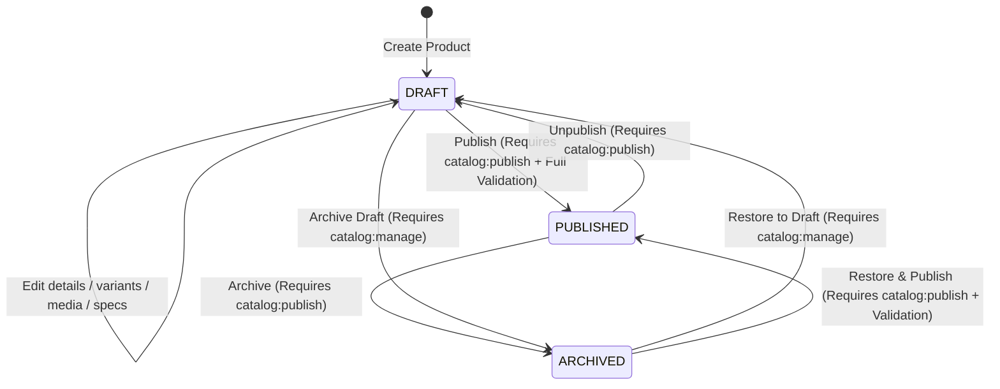

# GP-024 — Admin Product Manager Contract, Domain Reconciliation & Implementation Plan (CHK0-BR2)

## Status

**IN DISCOVERY / CONTRACT PENDING EXTERNAL APPROVAL (CHK0-BR2)**

---

## 1. Executive Summary & Starting Lineage

This document establishes the canonical contract, domain reconciliation, operational boundaries, and implementation plan for **GP-024 (Admin Product Manager)**, incorporating all external review findings and architectural remediations from CHK0, CHK0-BR1, and CHK0-BR2.

GP-024 implements administrative catalog authoring for Gamer Perú, providing authorized staff with the ability to create, edit, duplicate, archive, and publish hardware products, variants, SKUs, exact integer prices in Soles (`PEN`), media galleries, technical specifications, and SEO metadata.

### Baseline Lineage Verification

- **Repository**: `latamcreativa/GamerPeru`
- **Branch**: `main`
- **Starting HEAD SHA**: `df10390e59ae60ba74371b5ac554e6afd5512f77`
- **Parent Commit**: `ecd42b60278843ddbd57aa7d185b03cc8a1de39a`
- **GP-023 Status**: `CLOSED / EXTERNALLY APPROVED / FROZEN`
- **Migration 0012 Git Blob**: `e80c30ae9d0f86e14486b0fd5c782eb9ec3f7119` (Frozen)
- **Migration 0013 Status**: Non-existent (Migration sequence strictly preserved through 0012)
- **Hosted Supabase Status**: No repository/CI evidence of hosted mutation; Antigravity execution reports no hosted access.
- **Cloudflare R2 Status**: No repository/CI evidence of R2 mutation; Antigravity execution reports no R2 access.

---

## 2. Canonical Scope & Explicit Boundaries

### In Scope (GP-024)

1. **Product Authoring**: Creation, updating, drafting, archiving, and duplicating of conceptual hardware models (`products`).
2. **Variant & SKU Management**: Authoring and configuring concrete sellable items (`product_variants`), SKUs, integer prices in Soles cents (`PEN`), compare-at prices, cost prices, physical weights, and swatch attributes.
3. **Exact Monetary Lifecycle**: Integer minor-unit arithmetic in Peruvian Soles (`PEN`), exact decimal string parsing (`parsePenInputToCents`), zero floating-point scaling, and exact display formatting (`formatCentsToPen`).
4. **Media Management & Staging Pipeline**: Stateless server-signed upload intents, private R2 staging bucket (`R2_CATALOG_STAGING_BUCKET`), server-side WebP normalization, SHA-256 content-hashed canonical keys in public media storage (`R2_PUBLIC_MEDIA_BUCKET`), and relational integrity enforcement (`media_assets`, `product_media`), strictly conforming to ADR-004.
5. **Category Specifications**: Linking and validating dynamic hardware technical specifications against versioned category schemas (`product_specifications`, `category_specification_schemas`) using the authoritative `Category.current_spec_schema_id` pointer, with deterministic decimal rational step validation.
6. **SEO & Metadata**: Authoring/deriving product slugs, meta descriptions, OpenGraph tags, and Schema.org structured data inputs.
7. **Status Lifecycle**: Managing state transitions between `DRAFT`, `PUBLISHED`, and `ARCHIVED` with fail-closed publish validation.
8. **RBAC & Auditing**: Authoritative server-side permission enforcement (`catalog:manage` for authoring, `catalog:publish` for publishing/unpublishing/archiving published products) and durable replay tracking via `audit_events`.
9. **Admin UX**: Product list with multi-location fan-out pre-aggregation, search, filter, deterministic pagination, creation flow, and comprehensive multi-tab product editor.

### Explicitly Out of Scope

1. **Product Story Builder (GP-026)**: Visual block-based editorial story authoring (`product_stories`, `product_story_revisions`, 13 modular visual block types) is strictly OUT OF SCOPE. GP-024 preserves existing story links by reference but does NOT provide story editing surfaces.
2. **AI Product Research & Import (GP-025)**: LLM-assisted product research, specification scraping, and batch product-name importing are strictly OUT OF SCOPE. Ordinary manual authoring only.
3. **Brand & Category Taxonomy CRUD**: Administrative CRUD for creating/editing Brand and Category records is strictly OUT OF SCOPE. Product authoring selects from existing reference brands and categories (resolved via Option A bootstrap).
4. **Collection Merchandising**: Collections and ProductCollections are not part of GP-024 (and do not exist in the physical schema).
5. **Direct Warehouse Stock Manipulation**: Adjusting physical warehouse stock balances or ledger movements belongs to GP-029 (Inventory Admin). GP-024 configures catalog sellability, variant pricing, and attributes; it does not author inventory adjustments.

---

## 3. Dependency Validation & Historical Documentation Drift Audit

GP-024 declares dependencies on **GP-004** (Commerce Domain Model) and **GP-022** (Admin Foundation), and follows the closed **GP-023** (Admin Dashboard).

### Dependency Status Verification

1. **GP-004 (Commerce Domain Model)**:
   - Status: `CLOSED / EXTERNALLY APPROVED`
   - Canonical Evidence: [`docs/roadmap/GP-004-CLOSURE.md`](./GP-004-CLOSURE.md), [`docs/architecture/COMMERCE_DOMAIN_MODEL.md`](../architecture/COMMERCE_DOMAIN_MODEL.md).
   - Domain Model established 11 bounded contexts and 58 physical entity blueprints.

2. **GP-022 (Admin Foundation)**:
   - Status: `CLOSED / EXTERNALLY APPROVED`
   - Canonical Evidence: [`docs/roadmap/GP-022-CLOSURE.md`](./GP-022-CLOSURE.md) (Formal Closure Checkpoint `0ee964936127fd4a7e602af09527c3e87175aaf5`).
   - Delivered: Protected Admin Shell layout, server-side RBAC guard (`requireAdminAccess`, `requirePermission`), `inventory:manage` permission (migration 0012), and E2E security test suites.
   - **Historical Documentation Drift Note**: While `docs/roadmap/GP-022.md` still textually displays `Status: PLANNED`, this is confirmed as historical documentation drift only. `docs/roadmap/GP-022-CLOSURE.md` is the authoritative closure record. `docs/roadmap/GP-022.md` is NOT modified and GP-022 is NOT reopened.

3. **GP-023 (Admin Dashboard)**:
   - Status: `CLOSED / EXTERNALLY APPROVED / FROZEN`
   - Canonical Evidence: [`docs/roadmap/GP-023-CLOSURE.md`](./GP-023-CLOSURE.md) (Commit `c72025bc6bc8fa768a506cf53472bbaf75d17895`).
   - Delivered: Real-time read-only operational metric aggregates across 5 domains. GP-023 metrics and shell navigation conventions remain completely frozen and untouched.

---

## 4. Physical Schema Truth — Product Entity Contract

Based on the physical Drizzle schema at [`src/db/schema/catalog/products.ts`](../../src/db/schema/catalog/products.ts), the authoritative fields for `products` are:

| Field / Column     | Database Type    | TypeScript Type                        | Required / Optional | Default            | Physical Database Constraints & Indexes             | Application Validation Contract           | Storefront & SEO Impact                                           |
| :----------------- | :--------------- | :------------------------------------- | :------------------ | :----------------- | :-------------------------------------------------- | :---------------------------------------- | :---------------------------------------------------------------- |
| `id`               | `uuid`           | `string`                               | Required            | `generateUuidV7()` | Primary Key, B-Tree                                 | Immutable                                 | Internal aggregate identity                                       |
| `brand_id`         | `uuid`           | `string`                               | Required            | None               | FK $\to$ `brands.id` (`ON DELETE RESTRICT`)         | Valid existing published brand            | Changes brand badge, PDP title, brand breadcrumb                  |
| `category_id`      | `uuid`           | `string`                               | Required            | None               | FK $\to$ `categories.id` (`ON DELETE RESTRICT`)     | Valid existing published category         | Changes category page, facets, spec schema compatibility          |
| `name`             | `varchar(200)`   | `string`                               | Required            | None               | Gin trigram index `products_name_trgm_idx`          | Trimmed non-empty string, $\le 200$ chars | Primary PDP H1, listing title, `<title>` metadata                 |
| `slug`             | `varchar(200)`   | `string`                               | Required            | None               | `UNIQUE`, check `^[a-z0-9]+(?:-[a-z0-9]+)*$`        | Valid physical regex, globally unique     | Canonical URL `/productos/[slug]`. Changing breaks existing URLs! |
| `subtitle`         | `varchar(255)`   | `string \| null`                       | Optional            | `null`             | Gin trigram index `products_subtitle_trgm_idx`      | Optional trimmed string, $\le 255$ chars  | PDP subtitle, 1st priority for SEO meta description               |
| `description`      | `text`           | `string \| null`                       | Optional            | `null`             | None                                                | Optional string                           | PDP editorial markdown, 2nd priority for SEO meta description     |
| `status`           | `catalog_status` | `"DRAFT" \| "PUBLISHED" \| "ARCHIVED"` | Required            | `"DRAFT"`          | Enum `catalog_status`, index `(status, isFeatured)` | Transition gated (Section 8)              | Public visibility. Only `PUBLISHED` appears on storefront         |
| `is_featured`      | `boolean`        | `boolean`                              | Required            | `false`            | Index `(status, isFeatured)`                        | Boolean                                   | Determines homepage / showcase hero prominence                    |
| `primary_media_id` | `uuid`           | `string \| null`                       | Optional            | `null`             | FK $\to$ `media_assets.id` (`ON DELETE SET NULL`)   | Same-product global media (Section 11)    | Primary thumbnail, PDP hero fallback, OpenGraph social image      |
| `created_at`       | `timestamptz`    | `Date`                                 | Required            | `NOW()`            | B-Tree in pagination indexes                        | Immutable (system managed)                | Sorting by creation date                                          |
| `updated_at`       | `timestamptz`    | `Date`                                 | Required            | `NOW()`            | `$onUpdateFn(() => new Date())`                     | Used for optimistic concurrency check     | Concurrency conflict detection                                    |

### Clarification on Physical vs Application Validation

- The physical schema enforces `name: varchar(200) NOT NULL`. It does NOT enforce a minimum length in SQL. The application validation contract requires a trimmed non-empty string ($\le 200$ characters). (Invented restrictions such as `name.length >= 3` are removed).
- Zero pricing fields exist on `products`. Pricing belongs strictly to `product_variants`.
- Zero separate `seo_title` or `seo_description` columns exist. PDP SEO derives metadata dynamically.
- Zero `deleted_at` column exists; soft-deletion is represented strictly by `status = 'ARCHIVED'`.

---

## 5. Physical Schema Truth — ProductVariant & SKU Contract

Based on the physical Drizzle schema at [`src/db/schema/catalog/product-variants.ts`](../../src/db/schema/catalog/product-variants.ts), the authoritative fields for `product_variants` are:

| Field / Column           | Database Type    | TypeScript Type                        | Required / Optional | Default            | Physical Database Constraints & Checks       | Application Validation Contract                           | Commerce & Storefront Impact                             |
| :----------------------- | :--------------- | :------------------------------------- | :------------------ | :----------------- | :------------------------------------------- | :-------------------------------------------------------- | :------------------------------------------------------- |
| `id`                     | `uuid`           | `string`                               | Required            | `generateUuidV7()` | Primary Key                                  | Immutable                                                 | Referenced by cart items, order items, inventory items   |
| `product_id`             | `uuid`           | `string`                               | Required            | None               | FK $\to$ `products.id` (`ON DELETE CASCADE`) | Immutable                                                 | Parent product family                                    |
| `sku`                    | `varchar(50)`    | `string`                               | Required            | None               | `UNIQUE` index `product_variants_sku_idx`    | Trimmed non-empty string, $\le 50$ chars, globally unique | Machine inventory identifier, order snapshot identifier  |
| `title`                  | `varchar(150)`   | `string`                               | Required            | None               | `NOT NULL`                                   | Trimmed non-empty string, $\le 150$ chars                 | Swatch title (e.g. "Negro / Omron Optical")              |
| `price_cents`            | `integer`        | `number`                               | Required            | None               | Check `price_cents > 0`                      | Integer Soles minor units $> 0$, $\le 2147483647$         | Authoritative selling price in Peruvian Soles (`PEN`)    |
| `compare_at_price_cents` | `integer`        | `number \| null`                       | Optional            | `null`             | Check `IS NULL OR >= 0`                      | Integer Soles minor units $\ge 0$, $\le 2147483647$       | Strikethrough original price                             |
| `cost_cents`             | `integer`        | `number \| null`                       | Optional            | `null`             | Check `IS NULL OR >= 0`                      | Integer Soles minor units $\ge 0$, $\le 2147483647$       | Wholesale cost for internal margin tracking (staff only) |
| `weight_grams`           | `integer`        | `number \| null`                       | Optional            | `null`             | Check `IS NULL OR > 0`                       | Integer grams $> 0$                                       | Physical product weight for shipping/specs               |
| `attributes`             | `jsonb`          | `Record<string, string>`               | Required            | `{}`               | `NOT NULL`, default `{}`                     | Plain JSON object of key-value string swatches            | Color, switch, layout attributes                         |
| `status`                 | `variant_status` | `"ACTIVE" \| "INACTIVE" \| "ARCHIVED"` | Required            | `"ACTIVE"`         | Enum `variant_status`                        | Enum value                                                | Sellability condition. Must be `ACTIVE` to buy           |
| `display_order`          | `integer`        | `number`                               | Required            | `0`                | Check `display_order >= 0`                   | Integer $\ge 0$                                           | Determines order in PDP variant selector                 |
| `created_at`             | `timestamptz`    | `Date`                                 | Required            | `NOW()`            | B-Tree                                       | Immutable (system managed)                                | Audit & ordering                                         |
| `updated_at`             | `timestamptz`    | `Date`                                 | Required            | `NOW()`            | `$onUpdateFn`                                | Concurrency check                                         | Optimistic concurrency check                             |

### Physical Schema Reality vs Application Validation

1. **SKU Format**:
   - The physical database enforces `sku varchar(50) NOT NULL UNIQUE`.
   - The physical schema does NOT enforce uppercase-only, alphanumeric-only, or hyphen-only constraints.
   - **Application Validation Contract**: A trimmed non-empty string of maximum 50 characters, verified globally unique. The application will NOT silently uppercase or rewrite a SKU unless explicitly entered by the user. No restrictive character regex will be invented without canonical evidence.
2. **Variant Title**:
   - The physical schema enforces `title varchar(150) NOT NULL`.
   - The physical schema does NOT enforce a minimum non-empty length beyond `NOT NULL`.
   - **Application Validation Contract**: Trimmed non-empty string, maximum 150 characters.
3. **Variant Attributes**:
   - The physical schema enforces `attributes jsonb NOT NULL default {}`.
   - The physical schema does NOT contain a PostgreSQL `jsonb_typeof(...) = 'object'` check.
   - **Application Validation Contract**: Server-side Zod validation verifies that `attributes` is a plain JavaScript object with string keys and string values (`Record<string, string>`).

### Storefront Sellability Invariant

The project-wide canonical invariant established in GP-004 and GP-023 is strictly preserved:
$$\text{Sellable SKU} \iff (\text{Product.status} = \text{'PUBLISHED'} \land \text{ProductVariant.status} = \text{'ACTIVE'})$$

### Resolved Contract Decision: SKU Immutability Post-Commerce Rule

> [!IMPORTANT]
> **EXTERNALLY RESOLVED CONTRACT DECISION: SKU Immutability Rule**
>
> A `ProductVariant.sku` MAY be modified only while BOTH conditions are true:
>
> 1. **ZERO `inventory_items` rows** exist for that variant.
> 2. **ZERO `order_items` rows** exist for that variant.
>
> **Once either an inventory item or an order item exists:**
>
> - The SKU is **PERMANENTLY IMMUTABLE** in GP-024.
> - **Rationale**: `inventory_items.variant_id` uses `ON DELETE RESTRICT` and forms physical warehouse bin identity; `order_items.variant_id` uses `ON DELETE RESTRICT` and preserves immutable purchase facts (`sku_snapshot`). Because `inventory_ledger_entries` references `inventory_items` with `ON DELETE RESTRICT`, stock ledger records cannot exist without an `inventory_items` row.
> - **Admin UI Behavior**: The SKU input is disabled with a lock icon and an explicit notice: _"Este SKU está vinculado a registros de inventario o pedidos históricos y no puede modificarse. Para cambiar el SKU comercial, desactiva esta variante y crea una nueva."_
> - Historical `sku_snapshot` in `order_items` is never mutated.

---

## 6. Money & PEN Input/Display Contract

GP-024 directly authors integer monetary values for `product_variants.price_cents`, `compare_at_price_cents`, and `cost_cents`. Exact minor-unit integer semantics must be strictly enforced.

### Physical Truth

- `price_cents`: PostgreSQL `INTEGER` $> 0$ (check `price_cents > 0`).
- `compare_at_price_cents`: PostgreSQL `INTEGER` nullable, `NULL` or $\ge 0$ (check `IS NULL OR >= 0`).
- `cost_cents`: PostgreSQL `INTEGER` nullable, `NULL` or $\ge 0$ (check `IS NULL OR >= 0`).
- Maximum storable value: `2147483647` cents (signed 32-bit integer).
- Canonical currency: Peruvian Soles (`PEN`).
- **Zero binary floating-point arithmetic is allowed for monetary input scaling.**

### Exact PEN Input Parsing (`parsePenInputToCents`)

The authoritative input to the parser is a **STRING** (never start from a JavaScript `number`):

```typescript
function parsePenInputToCents(
  rawInput: string,
  field: "price_cents" | "compare_at_price_cents" | "cost_cents"
): number | null;
```

#### Accepted Decimal Syntax

- Digits, or digits `.` one-or-two decimal digits (e.g. `"129"`, `"129.9"`, `"129.90"`, `"0"`, `"0.50"`).
- An optional leading `"S/"` or `"s/"` plus arbitrary whitespace is trimmed/normalized.
- **Strict Comma Rejection**: Ambiguous comma notation (e.g. `"129,90"`) is **strictly rejected**. The parser will never guess whether comma means decimal point or thousands separator.
- Thousand separators are not required and are not accepted in raw editable Admin inputs.

#### Exact Parsing Algorithm

1. Trim leading and trailing whitespace.
2. Remove optional leading `"S/"` or `"s/"` and trim again.
3. If empty/blank:
   - For `compare_at_price_cents` or `cost_cents`: Return `null`.
   - For `price_cents`: Reject as missing required price.
4. Validate string against exact regex: `^\d+(?:\.\d{1,2})?$`. If not matching, reject with `INVALID_MONEY_SYNTAX`.
5. Split by `"."` into `wholePartStr` and optional `fractionPartStr`.
6. Pad `fractionPartStr` to exactly 2 digits:
   - If omitted: `"00"`
   - If 1 digit (e.g. `"9"`): `"90"`
   - If 2 digits (e.g. `"90"`): `"90"`
7. Convert both parts to `BigInt`:
   $$\text{totalCents} = (\text{BigInt}(\text{wholePartStr}) \times 100\text{n}) + \text{BigInt}(\text{fractionPartPadded})$$
8. Apply field-specific range validation while still `BigInt`:
   - `price_cents`: Require $\text{totalCents} \ge 1\text{n}$.
   - `compare_at_price_cents`: Require $\text{totalCents} \ge 0\text{n}$.
   - `cost_cents`: Require $\text{totalCents} \ge 0\text{n}$.
9. Check PostgreSQL `INTEGER` (int32) boundary:
   $$\text{totalCents} \le 2147483647\text{n}$$
   If exceeded, reject with `MONEY_VALUE_EXCEEDS_MAX_INT32`.
10. **Only after proving int32 safety**, convert to JavaScript Number:
    $$\text{Number}(\text{totalCents})$$
    (Every int32 value from $0$ to $2,147,483,647$ is exactly representable in JavaScript IEEE-754 double precision without precision loss).

#### Strictly Forbidden in Monetary Code

- `parseFloat(...)`
- `Number(rawInput) * 100`
- `Math.round(parsedFloat * 100)`
- `toFixed(...)` as authoritative parsing
- Any binary floating-point multiplication/division for currency scaling.

### Field-Specific Money Rules

1. `price_cents`: Must be $\ge 1\text{n}$ before conversion. Required.
2. `compare_at_price_cents`: Blank $\to$ `null`. Non-blank $\to 0\text{n} \le \text{cents} \le 2147483647\text{n}$.
3. `cost_cents`: Blank $\to$ `null`. Non-blank $\to 0\text{n} \le \text{cents} \le 2147483647\text{n}$.
   - The `price_cents > 0` rule is never applied to optional cost/compare-at fields.
   - `cost_cents` is internal staff data; it is **never exposed** in public storefront GraphQL/REST/SSR payloads.

### Exact Money Display Formatting

authoritative display formatting reuses the existing BigInt-safe:
$$\text{formatCentsToPen(cents: bigint)}$$
located in [`src/lib/admin/dashboard-format.ts`](../../src/lib/admin/dashboard-format.ts).

For physical int32 `ProductVariant` values:

```typescript
formatCentsToPen(BigInt(priceCents));
```

- Never format authoritative money by dividing a Number by 100 in ad-hoc strings.
- Canonical display examples:
  - `12990` $\to$ `"S/ 129.90"`
  - `1` $\to$ `"S/ 0.01"`
  - `0` $\to$ `"S/ 0.00"`
  - `2147483647` $\to$ `"S/ 21,474,836.47"`

---

## 7. Category Specifications & Deterministic Step Validation

Hardware attributes are structured dynamically per category using PostgreSQL `JSONB` in `product_specifications`, validated against versioned schemas in `category_specification_schemas`.

### Canonical Schema Selection via Category Pointer

The physical `categories` table contains:
$$\text{categories.current\_spec\_schema\_id}$$

This column is the single source of truth for the category's active specification schema.

**Canonical Selection Workflow**:

1. Read `Product.category_id`.
2. Read `Category.current_spec_schema_id`.
3. If `current_spec_schema_id IS NULL`: The category currently has no authoritative specification schema. Technical specifications are not applicable and are not a publish blocker.
4. If `current_spec_schema_id IS NOT NULL`: Fetch exactly that `CategorySpecificationSchema` record by ID.
5. Fail closed unless all integrity conditions are met:
   - `schema.id == category.current_spec_schema_id`
   - `schema.category_id == category.id`
   - `schema.is_active == true`
   - `schema.schema_version > 0`
   - `schema.field_definitions` passes `validateSpecificationFieldDefinitions(...)` (`src/lib/discovery-filters/schema-validation.ts`).
6. If the pointer is missing, inactive, mismatched, or invalid, the system halts with:
   $$\text{SPECIFICATION\_SCHEMA\_INTEGRITY\_ERROR}$$
   The system will never silently discover or fall back to an arbitrary active schema.

### Application-Level Specification Value Validator

`validateSpecificationFieldDefinitions(...)` validates category schema field definitions, **NOT** product specification values. GP-024 defines the application-level helper:
$$\text{validateProductSpecificationValues(validatedFieldDefinitions, rawSpecValues)}$$

**Required Validation Behavior**:

1. `rawSpecValues` must be a plain JSON object (`Record<string, unknown>`).
2. **Strict Key Allowlist**: Every persisted key must match a declared `field.key` in the validated `fieldDefinitions`. Any unknown key causes immediate validation **REJECTION**.
3. **Typed Non-Null Value Validation**: For each present non-null value:
   - **`dataType: "enum"`**: Must be a string matching one declared `options[].value`.
   - **`dataType: "boolean"`**: Must be boolean.
   - **`dataType: "string"`**: Must be a string.
   - **`dataType: "number"`**: Must be a finite number.
     - If `min` is defined: $\text{value} \ge \text{min}$.
     - If `max` is defined: $\text{value} \le \text{max}$.
     - If `step` is defined: Must pass the **Deterministic Rational Step Validation** defined below.
4. **Deterministic Decimal Rational Step Validation**:
   - Floating-point modulo and arbitrary epsilon thresholds (e.g. `1e-9`) are **strictly prohibited**.
   - **Canonical Step Base**:
     $$\text{base} = \begin{cases} \text{field.min} & \text{if field.min is defined} \\ 0 & \text{otherwise} \end{cases}$$
   - **Required Semantic**: $(\text{value} - \text{base})$ must be an exact integer multiple of `step`.
   - **Rational Normalization Algorithm (`decimalToIntegerAndScale`)**:
     1. Convert `value.toString()`, `base.toString()`, and `step.toString()` to exact decimal components, handling ordinary decimal notation and scientific exponent notation (`Number.toString()`).
     2. Count decimal places for all three numbers and determine the maximum scale:
        $$\text{maxScale} = \max(\text{scale}(\text{value}), \text{scale}(\text{base}), \text{scale}(\text{step}))$$
     3. Scale `value`, `base`, and `step` to `BigInt` integers using $10^{\text{maxScale}}$:
        - $\text{valueInt} = \text{toBigInt}(\text{value}, \text{maxScale})$
        - $\text{baseInt} = \text{toBigInt}(\text{base}, \text{maxScale})$
        - $\text{stepInt} = \text{toBigInt}(\text{step}, \text{maxScale})$
     4. Require $\text{stepInt} > 0\text{n}$.
     5. Enforce exact integer divisibility:
        $$(\text{valueInt} - \text{baseInt}) \pmod{\text{stepInt}} == 0\text{n}$$
   - **Validated Test Cases**:
     - `min=0, step=0.1, value=0.3` $\to$ **Valid** $((3 - 0) \pmod 1 == 0)$
     - `min=0.1, step=0.2, value=0.5` $\to$ **Valid** $((5 - 1) \pmod 2 == 0)$
     - `min undefined, step=5, value=15` $\to$ **Valid** $(\text{base}=0, (15 - 0) \pmod 5 == 0)$
     - `min undefined, step=5, value=12` $\to$ **Invalid** $(\text{base}=0, 12 \pmod 5 == 2 \neq 0)$
     - `min=10, step=5, value=15` $\to$ **Valid** $((15 - 10) \pmod 5 == 0)$
5. **Null / Unset Semantics**:
   - `null` or `undefined` is treated as unset/missing.
   - `null` is never treated as a valid typed value satisfying a field.
   - Unset keys are normalized out before persisting to `product_specifications.spec_values`.
6. **No Invented "Required" Fields**:
   - In the physical schema, `SpecificationFieldDefinition` has **NO `required` property**.
   - If `Category.current_spec_schema_id` is non-null: `ProductSpecifications` must reference that current schema, and every _present_ value must pass type validation. Missing specification keys are permitted.
7. **Transactional Category Change Reconciliation**:
   - When `product.category_id` is changed, the specification link must be reconciled in the same transaction:
   - Resolve the new `Category.current_spec_schema_id`.
   - If `NULL`: Delete the existing `ProductSpecifications` record.
   - If non-null: Replace `ProductSpecifications` with a record referencing the new schema and empty `spec_values = {}`, unless new values were validated against that new schema in the same request.
   - **Invariant**: Old-category `spec_values` are never retained under a new Category.

---

## 8. Product Status Lifecycle & Hard Delete Prohibition

The physical enum is `catalog_status`: `"DRAFT"`, `"PUBLISHED"`, `"ARCHIVED"`.



### Hard Deletion is Strictly Forbidden in GP-024

- GP-024 contains **ZERO hard deletion** of `products` or `product_variants`.
- GP-024 has no `catalog:delete` or `catalog:purge` permission.
- Authorization is never bypassed via a hardcoded `SUPER_ADMIN` role branch.
- **"D" in CRUD maps strictly to ARCHIVE** (`status -> ARCHIVED`).
- If physical database purges are ever required for test data, privacy compliance, or administrative maintenance, they must be governed by a future, separately authorized maintenance contract/gate.

### Lifecycle Transition Rules

1. **Initial Creation**: Enters `status = 'DRAFT'`. Zero products may be created directly in `PUBLISHED` state.
2. **Draft Editing**: While in `DRAFT`, fields may be edited freely without blocking publish validation.
3. **Publish Transition (`DRAFT -> PUBLISHED` or `ARCHIVED -> PUBLISHED`)**:
   - Strictly requires `catalog:publish`.
   - Executes the fail-closed Publish Readiness Validator (Section 9). If any hard blocker fails, the transaction aborts.
4. **Unpublish Transition (`PUBLISHED -> DRAFT`)**:
   - Strictly requires `catalog:publish`.
   - Product immediately disappears from public storefront, search results, category pages, and PDP routes.
   - Active carts with variants from this product will fail checkout availability validation.
5. **Archive Transition (`PUBLISHED -> ARCHIVED` or `DRAFT -> ARCHIVED`)**:
   - `PUBLISHED -> ARCHIVED` requires `catalog:publish`.
   - `DRAFT -> ARCHIVED` requires `catalog:manage`.
6. **Restore Transition (`ARCHIVED -> DRAFT`)**:
   - Requires `catalog:manage`. Reopens the archived product for editing in draft status.

---

## 9. Corrected Publish Readiness Validator Contract

Before a product can transition to `PUBLISHED`, the system executes the Publish Readiness Validator.

### Hard Blockers (Must all pass; failure rejects transition)

1. **Product Name**: Trimmed non-empty string $\le 200$ characters.
2. **Product Slug**: Valid physical regex (`^[a-z0-9]+(?:-[a-z0-9]+)*$`) and globally unique.
3. **Brand Verification**: Referenced Brand exists and has `status = 'PUBLISHED'`.
4. **Category Verification**: Referenced Category exists and has `status = 'PUBLISHED'`.
5. **Sellable Variants**:
   - At least **ONE** `ProductVariant` with `status = 'ACTIVE'`.
   - Each active variant must have:
     - Trimmed non-empty `sku` $\le 50$ chars, globally unique.
     - `price_cents > 0` (parsed via exact money parser).
     - Valid `attributes` object conforming to GP-024 validation.
6. **Specification Integrity**:
   - If `Category.current_spec_schema_id IS NOT NULL`:
     - `product_specifications` must exist.
     - Must reference `schema_id == Category.current_spec_schema_id`.
     - Must match `schema_version == currentSchema.schema_version`.
     - All present values in `spec_values` must pass `validateProductSpecificationValues`.
   - If `Category.current_spec_schema_id IS NULL`:
     - Specifications do not block publishing.
7. **Media Integrity**:
   - At least **ONE** valid `PUBLIC_MEDIA` image belonging to the Product must exist (`products.primary_media_id` or `product_media` global image).
   - Must satisfy all media relational integrity checks (Section 11).

### Soft Quality Warnings (Informational; do NOT block publish)

- Missing `subtitle`.
- Short `description` ($< 50$ chars).
- No `compare_at_price_cents`.
- Missing `weight_grams` on variants.
- Zero active Available To Sell (ATS) stock (product displays as "Agotado" on storefront, which is a legitimate commerce state).

---

## 10. Durable Replay Identity & Transactional Audit Replay

### Architectural Separation: Concurrency Lock vs Durable Memory

- **PostgreSQL Advisory Lock (`pg_advisory_xact_lock`)**: Serializes concurrent requests attempting the same logical operation. It releases automatically when the transaction completes and **does NOT remember past mutations**.
- **Transactional AuditEvent Replay Marker**: Serves as the durable, committed record of completion. Because catalog mutations and their associated `audit_events` row execute in the **exact same PostgreSQL transaction**, an operation's completion is atomically recorded without requiring a schema migration.

### Canonical Mutation Request Digest

For replay-sensitive mutations (Create Product, Create Variant, Duplicate Product, Media Finalization):

1. The browser generates a high-entropy UUIDv4/UUIDv7 `mutationRequestId` once per logical operation, reused strictly for network/application retries of that exact request.
2. The server computes the canonical digest using unambiguous structured encoding:
   $$\text{digestInput} = \text{"v1|" } + \text{len(actorId)} + \text{":"} + \text{actorId} + \text{"|" } + \text{len(opType)} + \text{":"} + \text{opType} + \text{"|" } + \text{mutationRequestId}$$
   $$\text{mutationRequestDigest} = \text{SHA-256}(\text{digestInput})$$
3. Raw client tokens or secrets are never logged or persisted.

### Durable Replay Lookup Workflow

After authentication, permission verification, transaction start, and advisory lock acquisition, but **BEFORE** performing any business mutation:

1. Query committed `audit_events` for:
   - `actor_id == verifiedActorId`
   - `action == expectedCatalogAction`
   - `metadata->>'mutation_request_digest' == mutationRequestDigest`
2. **If a matching committed AuditEvent is found**:
   - Verify `target_type` matches the expected entity type.
   - Load the entity by `target_id` from the database.
   - Verify the loaded entity is consistent with the replayed operation.
   - Return the existing committed result.
   - **Perform ZERO new business mutations and append ZERO duplicate AuditEvents.**
3. **Replay Integrity Failure**:
   - If an audit marker exists but the target entity is missing or inconsistent, fail closed immediately with:
     $$\text{CATALOG\_REPLAY\_INTEGRITY\_ERROR}$$
   - The system will never silently recreate a replacement object.

### Operation-Specific Replay Behaviors

- **Create Product**:
  - Replay marker resolves the exact created `Product`.
  - A different logical operation attempting the same slug returns `SLUG_CONFLICT`.
- **Create Variant**:
  - Replay marker resolves the exact created `ProductVariant`.
  - A different logical operation attempting the same SKU returns `SKU_CONFLICT`.
- **Duplicate Product**:
  - Target duplicate slug is derived deterministically from:
    $$\text{hash}(sourceProductId, verifiedActorId, mutationRequestDigest)$$
  - AuditEvent records `source_product_id` and target `product_id`.
  - On retry, verifies source matches, target exists, and returns the target without generating `-copy-1`, `-copy-2`.
- **Status Transitions (Publish, Unpublish, Archive, Restore)**:
  - If already at target status, returns an idempotent `NO-OP` without appending duplicate audit events.
  - If a replay marker exists, returns the committed result after re-verifying current authorization.
- **Media Finalization**:
  - Replay marker binds `actor_id`, `action`, target `product_id`, and `mutationRequestDigest`.
  - Same logical retry returns the committed attachment without duplicate `product_media` joins.

---

## 11. Media Relational Integrity Contract

The physical `product_media` table defines independent foreign keys:

- `productId` $\to$ `products.id`
- `variantId` $\to$ `product_variants.id`

However, the physical schema lacks a composite foreign key guaranteeing that `product_variants.product_id == product_media.product_id`.

### Canonical Application-Enforced Invariants

1. **Variant Ownership Invariant**:
   - For every `product_media` row where `variant_id IS NOT NULL`:
   - The server mutation loads the referenced `ProductVariant`.
   - It strictly requires:
     $$\text{variant.product\_id} == \text{product\_media.product\_id}$$
   - If mismatched, the transaction aborts with:
     $$\text{MEDIA\_VARIANT\_PRODUCT\_MISMATCH}$$
   - Client-reported variant ownership claims are never accepted without server-side verification.
2. **Primary Media Invariant**:
   - `products.primary_media_id` may only be set by GP-024 if:
     1. The `MediaAsset` exists.
     2. `security_class == 'PUBLIC_MEDIA'`.
     3. `media_type == 'IMAGE'`.
     4. MIME type is an allowed catalog image MIME (`image/webp`, `image/jpeg`, `image/png`, `image/avif`).
     5. The asset is attached to the same Product through `product_media` with `variant_id IS NULL` (global image).
   - A Product's primary image may never point to an unattached or unrelated product's asset.

---

## 12. Duplicate Product — Variant Media Remapping

When staff duplicates a product, media relationships must be remapped safely:

1. **Variant Mapping**:
   - As variants are cloned, an in-memory mapping is established:
     $$\text{sourceVariantId} \implies \text{newVariantId}$$
2. **Product Media Remapping**:
   - **Global media (`variant_id IS NULL`)**:
     Created with `new product_media.variant_id = NULL`.
   - **Variant-specific media (`variant_id = sourceVariantId`)**:
     Created with `new product_media.variant_id = mapped newVariantId`.
   - **Invariant**: The duplicate product **NEVER** inherits a reference to a source variant ID.
   - If any variant-specific media row cannot be mapped to a cloned variant, the duplicate transaction aborts.
3. **Primary Media Reference**:
   - `products.primary_media_id` is set to the same `MediaAsset.id` by reference, provided the asset was cloned as global media for the new Product.
4. **Never Duplicated**:
   - `inventory_items` and `inventory_ledger`: Duplicate has 0 stock.
   - `order_items`: Zero historical orders.
   - `product_stories`: Out of scope; duplicate has no story attached.
   - Status is always reset to `DRAFT` and `is_featured = false`.

---

## 13. Shared Media & Alt Text Semantics

- **Asset-Level Metadata**: In the physical schema, `alt_text` resides on `media_assets.alt_text`. It is **NOT** stored per `product_media` join row.
- **Shared Reference Impact**: When a `MediaAsset` is reused across multiple products (e.g. via product duplication or shared brand imagery), all referencing products share the exact same `alt_text`.
- **Contract Rule**:
  - Editing alt text in the Admin gallery updates the underlying `media_assets.alt_text`.
  - The Admin UI must explicitly disclose when an asset is referenced by multiple entities: _"Este texto alternativo se actualiza en todas las referencias donde se utilice esta imagen."_
  - GP-024 will not introduce a schema change for per-link alt text. Per-link alt text is deferred as a future schema enhancement if needed.

---

## 14. Media Architecture: Private Staging & Signed Intent Security

### The Unverified Upload Threat Boundary

Raw unverified bytes from browser uploads must **NEVER** be placed into the public catalog delivery bucket (`gamerperu-public-media` / `media.gamerperu.com`). Unvalidated binaries could otherwise be served directly via CDN before validation or transformation.

### Infrastructure Classification & Private Staging Bucket

- **Security Class**: `PRIVATE / NON-PUBLIC STAGING`
- **Dedicated Private Bucket Configuration**:
  $$\text{R2\_CATALOG\_STAGING\_BUCKET}$$
  _(Logical reference name: `gamerperu-catalog-staging-private`)_
- **Staging Bucket Properties**:
  - No public custom domain.
  - No anonymous public read.
  - No directory listing.
  - Accessible strictly via short-lived presigned upload URLs and server-side credentials.
  - Bounded lifecycle cleanup rules (e.g. 24-hour auto-deletion of expired staging objects).
  - **Strict Boundary**: Payment voucher buckets (`gamerperu-private-proofs`) are **never reused**. Catalog staging and customer payment evidence remain completely segregated.
- **Infrastructure Result**:
  $$\mathbf{R2\_STAGING\_INFRA\_REQUIRED: YES}$$
  _(PostgreSQL schema change remains `NO`. Staging bucket provisioning is an R2 cloud infrastructure requirement deferred to the implementation/infrastructure gate)._

### Stateless Server-Signed Upload Intent Token

To eliminate database overhead for uncompleted uploads, upload intents use stateless, server-signed tokens:

- **Dedicated Server Secret**: `CATALOG_MEDIA_INTENT_HMAC_SECRET` (minimum 32 bytes, required fail-closed outside deterministic test environments, never exposed to client, never logged).
- **Token Payload**:
  ```json
  {
    "version": 1,
    "intentId": "01918a2b-...",
    "verifiedActorId": "usr_...",
    "productId": "prd_...",
    "stagingObjectKey": "temp/catalog/01918a2b-...",
    "expectedIncomingMimeType": "image/webp",
    "maximumBytes": 10485760,
    "issuedAt": 1725312000,
    "expiresAt": 1725312600
  }
  ```
- **Staging Object Key**: Opaque non-PII format: `temp/catalog/{intentId}`. Client cannot choose keys.
- **Signature**: HMAC-SHA-256 over deterministic canonical JSON encoding of the payload.

### Media Finalization Canonical Order

When the browser requests finalization, it submits strictly `{ intentToken, mutationRequestId }`. The server executes:

1. Verify staff authentication from JWT.
2. Verify staff has `catalog:manage`.
3. Verify `intentToken` HMAC signature in constant time using `CATALOG_MEDIA_INTENT_HMAC_SECRET`.
4. Verify token `version == 1` and `expiresAt > serverTime`.
5. Verify current `verifiedActorId == token.verifiedActorId`.
6. Verify target `productId == token.productId` and product exists in database.
7. Perform `HEAD` against `R2_CATALOG_STAGING_BUCKET` using `token.stagingObjectKey`.
8. Read actual staging bytes server-side and verify `Content-Length <= 10 MiB`.
9. Validate actual image bytes (magic bytes / header check) to reject MIME/extension spoofing.
10. Normalize image bytes to **actual WebP format**.
11. Derive image dimensions (`width`, `height`) from validated final image server-side.
12. Compute SHA-256 hash of final WebP bytes.
13. Construct canonical public object key:
    $$\text{products/}\{brandSlug\}/\{productSlug\}/\{sha256\}.\text{webp}$$
14. Write final WebP bytes to `R2_PUBLIC_MEDIA_BUCKET` (or confirm existence if content hash already exists).
15. Start PostgreSQL transaction.
16. Acquire advisory lock on `mutationRequestDigest` and check for existing durable replay marker.
17. Enforce `product_media` variant ownership invariant.
18. Create/reuse `media_assets` row and insert `product_media` join row.
19. Append `audit_events` replay marker atomically.
20. Commit PostgreSQL transaction.
21. Best-effort delete private staging object from `R2_CATALOG_STAGING_BUCKET`.

---

## 15. Corrected Admin Product List Aggregation

### Query Fan-Out Elimination

Joining `product_variants` and `inventory_items` directly causes Cartesian fan-out when variants have inventory across multiple locations. The canonical query pre-aggregates variants and inventory using CTEs:

```sql
WITH variant_summary AS (
  SELECT
    pv.product_id,
    COUNT(pv.id) AS total_variants,
    COUNT(CASE WHEN pv.status = 'ACTIVE' THEN 1 END) AS active_variants,
    MIN(CASE WHEN pv.status = 'ACTIVE' THEN pv.price_cents END) AS min_active_price_cents,
    MAX(CASE WHEN pv.status = 'ACTIVE' THEN pv.price_cents END) AS max_active_price_cents
  FROM product_variants pv
  GROUP BY pv.product_id
),
active_inventory_summary AS (
  SELECT
    pv.product_id,
    COALESCE(SUM(ii.quantity_on_hand - ii.quantity_reserved - ii.quantity_allocated), 0) AS active_variant_ats
  FROM product_variants pv
  INNER JOIN inventory_items ii ON pv.id = ii.variant_id
  WHERE pv.status = 'ACTIVE'
  GROUP BY pv.product_id
)
SELECT
  p.id,
  p.name,
  p.slug,
  p.status,
  p.is_featured,
  p.updated_at,
  b.name AS brand_name,
  c.name AS category_name,
  ma.object_key AS primary_media_key,
  ma.alt_text AS primary_media_alt,
  COALESCE(vs.total_variants, 0) AS total_variants,
  COALESCE(vs.active_variants, 0) AS active_variants,
  vs.min_active_price_cents,
  vs.max_active_price_cents,
  COALESCE(ais.active_variant_ats, 0) AS active_variant_ats
FROM products p
INNER JOIN brands b ON p.brand_id = b.id
INNER JOIN categories c ON p.category_id = c.id
LEFT JOIN media_assets ma ON p.primary_media_id = ma.id
LEFT JOIN variant_summary vs ON p.id = vs.product_id
LEFT JOIN active_inventory_summary ais ON p.id = ais.product_id
WHERE ($1::text IS NULL OR p.status = $1)
  AND ($2::uuid IS NULL OR p.brand_id = $2)
  AND ($3::uuid IS NULL OR p.category_id = $3)
  AND ($4::text IS NULL OR p.name ILIKE '%' || $4 || '%' OR p.slug ILIKE '%' || $4 || '%')
ORDER BY p.updated_at DESC, p.id DESC
LIMIT $5 OFFSET $6;
```

### Aggregate Metrics Definitions

1. **`totalVariants`**: Total distinct `product_variants` belonging to the Product.
2. **`activeVariants`**: Distinct `product_variants` with `status = 'ACTIVE'`.
3. **Commercial Price Range (`min_active_price_cents` / `max_active_price_cents`)**:
   - Derived **strictly from ACTIVE variants**.
   - If `active_variants = 0`, commercial price range displays as `"No disponible"` / `null`, **NOT `S/ 0.00`**.
4. **`activeVariantAts`**:
   - Available To Sell stock aggregated across `inventory_items` belonging **strictly to ACTIVE variants**.
   - Explicitly distinguished from GP-023 global physical inventory (which includes stock of inactive/archived variants).
5. **Deterministic Pagination**:
   - Enforces composite ordering: `ORDER BY p.updated_at DESC, p.id DESC`.

---

## 16. Resolved Reference Data Boundary (Option A)

> [!IMPORTANT]
> **EXTERNALLY RESOLVED: OPTION A ADOPTED (NOT A MIGRATION)**
>
> 1. **Option A is Confirmed**:
>    - GP-024 does **NOT** implement Brand CRUD or Category CRUD.
>    - GP-024 Product authoring selects existing `PUBLISHED` Brands and Categories via search/select dropdowns.
> 2. **Not a Drizzle Migration**:
>    - This reference data provisioning is **NOT** a Drizzle migration.
>    - Zero migration files (`0013`) are created.
> 3. **Guarded Bootstrap Command**:
>    - Future implementation provides an idempotent bootstrap script (`scripts/bootstrap-catalog-reference-data.mjs`) guarded for local development and authorized production execution.
>    - Uses natural keys (`slug`) for idempotency (`ON CONFLICT (slug) DO UPDATE`).
> 4. **Brand Manifest is Business Data**:
>    - Brand names (WLMouse, Pulsar, Lamzu, Wooting, Endgame Gear, Artisan) are example candidates, not immutable architectural constants. The actual manifest is a version-controlled business data file.
> 5. **Category & Specification Schema Alignment**:
>    - Bootstrap establishes:
>      1. `categories` row
>      2. `category_specification_schemas` row
>      3. `categories.current_spec_schema_id` pointing to that schema.

---

## 17. RBAC Permission & Navigation Alignment

All actions use canonical permissions from [`src/lib/auth/rbac.ts`](../../src/lib/auth/rbac.ts):

- `catalog:manage`
- `catalog:publish`
- `catalog:ai_research` (owned by GP-025, excluded from GP-024)

### Normalized Authorization Matrix

- **Navigation Entry (`/admin/productos`)**: Requires `catalog:manage`.
- **Product Editor Entry (`/admin/productos/[id]`)**: Requires `catalog:manage`.
- **Ordinary Authoring Mutations**: Requires `catalog:manage` (draft editing, variants, specs, media, SEO, duplicate, archive draft, restore).
- **Publishing Actions**: Requires `catalog:publish` (publish draft, unpublish published product, archive published product).
- Because canonical `ADMIN_CATALOG` possesses both `catalog:manage` and `catalog:publish`, role ergonomics remain seamless without hardcoded role bypasses.

---

## 18. AuditEvent Contract

Privileged catalog mutations append immutable records to `audit_events` within the same transaction:

- `actorType`: `'ADMIN'`
- `actorId`: `authContext.authUserId`
- `action`: Canonical action string
- `targetType`: `'product'`, `'product_variant'`, `'product_media'`, `'product_specifications'`
- `targetId`: String representation of entity UUID
- `metadata`: Sanitized JSON diffs and `mutation_request_digest` (never raw binaries, tokens, or unredacted secrets)
- `ipAddress`: Client IP from request headers
- `requestId`: Correlation / request ID

Canonical actions: `catalog:product:create`, `catalog:product:update`, `catalog:product:publish`, `catalog:product:unpublish`, `catalog:product:archive`, `catalog:product:restore`, `catalog:product:duplicate`, `catalog:variant:create`, `catalog:variant:update`, `catalog:media:attach`, `catalog:media:remove`, `catalog:specs:update`.

---

## 19. Migration & Infrastructure Readiness Analysis

### PostgreSQL Database Schema Determination

$$\mathbf{SCHEMA\_CHANGE\_REQUIRED: NO}$$

**Full Justification**:

- Physical `products`, `product_variants`, `media_assets`, `product_media`, `category_specification_schemas`, and `product_specifications` tables already exist in migrations 0000-0012.
- `Category.current_spec_schema_id` already exists.
- Exact PEN money parsing and int32 range bounds are application-enforced.
- Deterministic rational step validation is application-enforced.
- Durable replay identity leverages existing `audit_events.metadata`.
- SKU immutability is enforced at the application layer using existing FK relationships.
- Reference taxonomy bootstrap is executed via a separate operational script, not a Drizzle migration.

### Cloud Storage Infrastructure Determination

$$\mathbf{R2\_STAGING\_INFRA\_REQUIRED: YES}$$

- Dedicated private bucket `R2_CATALOG_STAGING_BUCKET` must be provisioned before real direct-upload media can be activated in production.
- This is an external Cloudflare R2 infrastructure dependency, **NOT a PostgreSQL schema migration**.
- No infrastructure mutations are executed during this documentation gate.

### Deferred Index Candidate

- `CREATE INDEX products_admin_list_idx ON products (status, updated_at DESC);`
- **Classification**: `PERFORMANCE CANDIDATE / NOT AUTHORIZED / NON-BLOCKING`. Zero migrations will be created.

---

## 20. Quality Gates & Freeze Verifications

1. **Migration 0012 Frozen**: Exact blob `e80c30ae9d0f86e14486b0fd5c782eb9ec3f7119`.
2. **Zero Migration 0013**: Verified.
3. **GP-023 Frozen**: Dashboard metrics and UI remain untouched.
4. **GP-025 Not Begun**: AI Product Research remains untouched.
5. **GP-026 Not Begun**: Product Story Builder remains untouched.
6. **Hosted Supabase & Cloudflare R2**: Untouched (No repository/CI evidence of hosted mutation; Antigravity execution reports no hosted access).

---

## 21. Implementation Test Plan Matrix

| Test Category             | Surface                                                 | Scope / Scenarios                                                                                                                                                                                                                                                                                                                                                                                                                                                                                                                                                                                                                                                                        |
| :------------------------ | :------------------------------------------------------ | :--------------------------------------------------------------------------------------------------------------------------------------------------------------------------------------------------------------------------------------------------------------------------------------------------------------------------------------------------------------------------------------------------------------------------------------------------------------------------------------------------------------------------------------------------------------------------------------------------------------------------------------------------------------------------------------- |
| **Unit Tests**            | `tests/unit/admin-catalog-*.test.ts`                    | - Exact PEN parsing: `parsePenInputToCents` (`"129.90"`, `"129"`, `"0.50"`, comma rejection, int32 boundary check, leading S/ normalization).<br>- Exact money display: `formatCentsToPen(BigInt(val))` boundaries.<br>- Rational step validation: `decimalToIntegerAndScale` (min=0 step=0.1, min=0.1 step=0.2, min undefined step=5, min=10 step=5).<br>- Value validator: `validateProductSpecificationValues` (type safety, enum checks, range checks, unknown key rejection, null normalization).<br>- Publish readiness: hard blockers vs soft warnings.<br>- Slug regex validation.<br>- Signed intent token HMAC verification.<br>- Digest generation and advisory lock hashing. |
| **RBAC Integration**      | `tests/unit/admin-catalog-rbac.test.ts`                 | - `CUSTOMER` / `ADMIN_ORDERS` denied access.<br>- `ADMIN_CATALOG` permitted to create, edit, duplicate.<br>- `catalog:publish` strictly required to publish, unpublish, or archive published product.                                                                                                                                                                                                                                                                                                                                                                                                                                                                                    |
| **Live DB Integration**   | `tests/admin-integration/admin-product-manager.test.ts` | - Atomic creation of product + variant + audit replay marker.<br>- Durable replay lookup on retry.<br>- SKU immutability enforcement when inventory/orders exist.<br>- Media ownership verification (`MEDIA_VARIANT_PRODUCT_MISMATCH`).<br>- Duplicate product with variant media remapping.<br>- Category change specification clearing.<br>- Product list query pre-aggregation (zero fan-out across multiple locations).                                                                                                                                                                                                                                                              |
| **Admin Playwright E2E**  | `tests/e2e/admin-product-manager.spec.ts`               | - Complete product authoring flow: New Product $\to$ Variants $\to$ Media $\to$ Specs $\to$ Publish.<br>- Duplicate flow in UI.<br>- Archive / restore in UI.<br>- Form error validation & focus management.<br>- Automated Axe accessibility audit (0 violations).<br>- Responsive layout checks across mobile and desktop.                                                                                                                                                                                                                                                                                                                                                             |
| **Storefront Regression** | `tests/e2e/catalog-storefront-regression.spec.ts`       | - Published product appears on PDP and listings.<br>- Archived product returns 404.<br>- Inactive variant is not selectable/purchasable.                                                                                                                                                                                                                                                                                                                                                                                                                                                                                                                                                 |

---

## 22. Conclusion & Gate Readiness

All 29 contract and architecture requirements from CHK0, CHK0-BR1, and CHK0-BR2 have been resolved. The contract is 100% grounded in exact integer money semantics, physical schema truth, ADR-004 storage architecture, private media staging, and durable replay integrity. Zero unresolved contract decisions remain.
