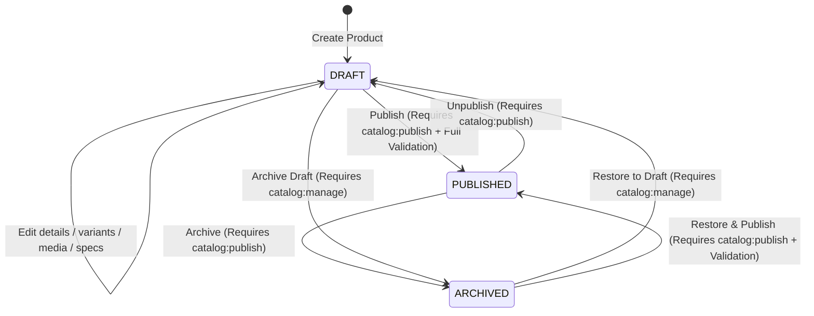

# GP-024 — Admin Product Manager Contract, Domain Reconciliation & Implementation Plan (CHK0)

## Status

**IN DISCOVERY / CONTRACT PENDING EXTERNAL APPROVAL (CHK0)**

---

## 1. Executive Summary & Starting Lineage

This document establishes the canonical contract, domain reconciliation, operational boundaries, and implementation plan for **GP-024 (Admin Product Manager)**.

GP-024 implements administrative catalog authoring for Gamer Perú, providing authorized staff with the ability to create, edit, duplicate, archive, and publish hardware products, variants, SKUs, integer prices, media galleries, technical specifications, and SEO metadata.

### Baseline Lineage Verification

- **Repository**: `latamcreativa/GamerPeru`
- **Branch**: `main`
- **Starting HEAD SHA**: `c72025bc6bc8fa768a506cf53472bbaf75d17895`
- **Parent Commit**: `c72025bc6bc8fa768a506cf53472bbaf75d17895` (GP-023 Formal Closure)
- **GP-023 Status**: `CLOSED / EXTERNALLY APPROVED / FROZEN` (CI Run ID `33618459290`, Conclusion `success`)
- **Migration 0012 Git Blob**: `e80c30ae9d0f86e14486b0fd5c782eb9ec3f7119` (Frozen)
- **Migration 0013 Status**: Non-existent (Migration sequence strictly preserved through 0012)
- **Infrastructure Status**: Hosted Supabase and Cloudflare R2 remain 100% untouched.

---

## 2. Canonical Scope & Explicit Boundaries

### In Scope (GP-024)

1. **Product Authoring**: Creation, updating, drafting, archiving, and duplicating of conceptual hardware models (`products`).
2. **Variant & SKU Management**: Authoring and configuring concrete sellable items (`product_variants`), SKUs, integer prices in Soles cents (`PEN`), compare-at prices, cost prices, physical weights, and swatch attributes.
3. **Media Management**: Attaching, ordering, designating primary images, linking variant-specific images, and alt text authoring backed by Cloudflare R2 public storage (`media_assets`, `product_media`).
4. **Category Specifications**: Linking and validating dynamic hardware technical specifications against versioned category schemas (`product_specifications`, `category_specification_schemas`).
5. **SEO & Metadata**: Authoring/deriving product slugs, meta descriptions, OpenGraph tags, and Schema.org structured data inputs.
6. **Status Lifecycle**: Managing state transitions between `DRAFT`, `PUBLISHED`, and `ARCHIVED` with fail-closed publish validation.
7. **RBAC & Auditing**: Authoritative server-side permission enforcement (`catalog:manage`, `catalog:publish`) and immutable audit trail generation (`audit_events`).
8. **Admin UX**: Product list, search, filter, pagination, creation flow, and comprehensive product editor.

### Explicitly Out of Scope

1. **Product Story Builder (GP-026)**: Visual block-based editorial story authoring (`product_stories`, `product_story_revisions`, 13 modular visual block types) is strictly OUT OF SCOPE. GP-024 will preserve existing story links by reference but will NOT provide story editing surfaces.
2. **AI Product Research & Import (GP-025)**: LLM-assisted product research, specification scraping, and batch product-name importing are strictly OUT OF SCOPE. Ordinary manual authoring only.
3. **Brand & Category Taxonomy CRUD**: Full administrative CRUD for creating new Brand and Category records is not explicitly part of GP-024. Product authoring selects from existing reference brands and categories. (See Section 10 for reference-data boundary decision).
4. **Collection Merchandising**: Collections and ProductCollections are not part of GP-024.
5. **Direct Warehouse Stock Manipulation**: Adjusting physical warehouse stock balances or ledger movements belongs to GP-029 (Inventory Admin). GP-024 configures catalog sellability, variant pricing, and attributes; it does not author inventory adjustments.

---

## 3. Dependency Validation & Historical Documentation Drift Audit

GP-024 declares dependencies on **GP-004** (Commerce Domain Model) and **GP-022** (Admin Foundation), and follows the recently closed **GP-023** (Admin Dashboard).

### Dependency Status Verification

1. **GP-004 (Commerce Domain Model)**:
   - Status: `CLOSED / EXTERNALLY APPROVED`
   - Canonical Evidence: [`docs/roadmap/GP-004-CLOSURE.md`](./GP-004-CLOSURE.md), [`docs/architecture/COMMERCE_DOMAIN_MODEL.md`](../architecture/COMMERCE_DOMAIN_MODEL.md).
   - Domain Model established 11 bounded contexts and 58 physical entity blueprints.

2. **GP-022 (Admin Foundation)**:
   - Status: `CLOSED / EXTERNALLY APPROVED`
   - Canonical Evidence: [`docs/roadmap/GP-022-CLOSURE.md`](./GP-022-CLOSURE.md) (Formal Closure Checkpoint `0ee964936127fd4a7e602af09527c3e87175aaf5`).
   - Delivered: Protected Admin Shell layout, server-side RBAC guard (`requireAdminAccess`, `requirePermission`), `inventory:manage` permission (migration 0012), and E2E security test suites.
   - **Historical Documentation Drift Note**: While `docs/roadmap/GP-022.md` still textually displays `Status: PLANNED`, this is confirmed as historical documentation drift only. `docs/roadmap/GP-022-CLOSURE.md` is the authoritative closure record. Per instructions, `docs/roadmap/GP-022.md` is NOT modified during CHK0 and GP-022 is NOT reopened.

3. **GP-023 (Admin Dashboard)**:
   - Status: `CLOSED / EXTERNALLY APPROVED / FROZEN`
   - Canonical Evidence: [`docs/roadmap/GP-023-CLOSURE.md`](./GP-023-CLOSURE.md) (Commit `c72025bc6bc8fa768a506cf53472bbaf75d17895`).
   - Delivered: Real-time read-only operational metric aggregates across 5 domains. GP-023 metrics and shell navigation conventions remain completely frozen and untouched.

---

## 4. Physical Product Entity Contract

Based on the actual physical Drizzle schema at [`src/db/schema/catalog/products.ts`](../../src/db/schema/catalog/products.ts), the authoritative fields for `products` are:

| Field / Column     | Database Type    | TypeScript Type                        | Required / Optional | Default            | Constraints & Indexes                               | Editable in Admin?              | Storefront & SEO Impact                                           |
| :----------------- | :--------------- | :------------------------------------- | :------------------ | :----------------- | :-------------------------------------------------- | :------------------------------ | :---------------------------------------------------------------- |
| `id`               | `uuid`           | `string`                               | Required            | `generateUuidV7()` | Primary Key, B-Tree                                 | No (Immutable)                  | Internal aggregate identity                                       |
| `brand_id`         | `uuid`           | `string`                               | Required            | None               | FK $\to$ `brands.id` (`ON DELETE RESTRICT`)         | Yes (Requires `catalog:manage`) | Changes brand badge, PDP title, brand breadcrumb                  |
| `category_id`      | `uuid`           | `string`                               | Required            | None               | FK $\to$ `categories.id` (`ON DELETE RESTRICT`)     | Yes (Requires `catalog:manage`) | Changes category page, facets, spec schema compatibility          |
| `name`             | `varchar(200)`   | `string`                               | Required            | None               | Gin trigram index `products_name_trgm_idx`          | Yes (Requires `catalog:manage`) | Primary PDP H1, listing title, `<title>` metadata                 |
| `slug`             | `varchar(200)`   | `string`                               | Required            | None               | `UNIQUE`, check `^[a-z0-9]+(?:-[a-z0-9]+)*$`        | Yes (With Warning)              | Canonical URL `/productos/[slug]`. Changing breaks existing URLs! |
| `subtitle`         | `varchar(255)`   | `string \| null`                       | Optional            | `null`             | Gin trigram index `products_subtitle_trgm_idx`      | Yes (Requires `catalog:manage`) | PDP subtitle, 1st priority for SEO meta description               |
| `description`      | `text`           | `string \| null`                       | Optional            | `null`             | None                                                | Yes (Requires `catalog:manage`) | PDP editorial markdown, 2nd priority for SEO meta description     |
| `status`           | `catalog_status` | `"DRAFT" \| "PUBLISHED" \| "ARCHIVED"` | Required            | `"DRAFT"`          | Enum `catalog_status`, index `(status, isFeatured)` | Yes (Transition gated)          | Public visibility. Only `PUBLISHED` appears on storefront         |
| `is_featured`      | `boolean`        | `boolean`                              | Required            | `false`            | Index `(status, isFeatured)`                        | Yes (Requires `catalog:manage`) | Determines homepage / showcase hero prominence                    |
| `primary_media_id` | `uuid`           | `string \| null`                       | Optional            | `null`             | FK $\to$ `media_assets.id` (`ON DELETE SET NULL`)   | Yes (Requires `catalog:manage`) | Primary thumbnail, PDP hero fallback, OpenGraph social image      |
| `created_at`       | `timestamptz`    | `Date`                                 | Required            | `NOW()`            | B-Tree in pagination indexes                        | No (Auto-set)                   | Sorting by creation date                                          |
| `updated_at`       | `timestamptz`    | `Date`                                 | Required            | `NOW()`            | `$onUpdateFn(() => new Date())`                     | No (Auto-updated)               | Used for optimistic concurrency check                             |

### Schema Accuracy Confirmation

- Zero invented fields.
- `products` does NOT contain pricing fields. Pricing belongs strictly to `product_variants`.
- `products` does NOT contain a separate `seo_title` or `seo_description` column; storefront PDP SEO dynamically derives title and description from `name`, `brand.name`, `subtitle`, and `description`.
- `products` does NOT contain a `deleted_at` column; soft-deletion is represented by `status = 'ARCHIVED'`.

---

## 5. Physical ProductVariant & SKU Contract

Based on the actual physical Drizzle schema at [`src/db/schema/catalog/product-variants.ts`](../../src/db/schema/catalog/product-variants.ts), the authoritative fields for `product_variants` are:

| Field / Column           | Database Type    | TypeScript Type                        | Required / Optional | Default            | Constraints & Checks                         | Editable in Admin?              | Commerce & Storefront Impact                                          |
| :----------------------- | :--------------- | :------------------------------------- | :------------------ | :----------------- | :------------------------------------------- | :------------------------------ | :-------------------------------------------------------------------- |
| `id`                     | `uuid`           | `string`                               | Required            | `generateUuidV7()` | Primary Key                                  | No (Immutable)                  | Referenced by cart items, order items, inventory items                |
| `product_id`             | `uuid`           | `string`                               | Required            | None               | FK $\to$ `products.id` (`ON DELETE CASCADE`) | No (Immutable)                  | Parent product family                                                 |
| `sku`                    | `varchar(50)`    | `string`                               | Required            | None               | `UNIQUE`, uppercase alphanumeric/hyphens     | Conditional (See Decision)      | Machine inventory identifier, order snapshot identifier               |
| `title`                  | `varchar(150)`   | `string`                               | Required            | None               | Min 1 char                                   | Yes                             | Swatch title (e.g. "Negro / Omron Optical Switches")                  |
| `price_cents`            | `integer`        | `number`                               | Required            | None               | Check `price_cents > 0`                      | Yes (Requires `catalog:manage`) | Authoritative selling price in Peruvian Soles (`PEN`)                 |
| `compare_at_price_cents` | `integer`        | `number \| null`                       | Optional            | `null`             | Check `IS NULL OR >= 0`                      | Yes (Requires `catalog:manage`) | Strikethrough original price                                          |
| `cost_cents`             | `integer`        | `number \| null`                       | Optional            | `null`             | Check `IS NULL OR >= 0`                      | Yes (Internal Staff only)       | Wholesale cost for internal margin tracking; never sent to storefront |
| `weight_grams`           | `integer`        | `number \| null`                       | Optional            | `null`             | Check `IS NULL OR > 0`                       | Yes                             | Physical product weight for shipping/specs                            |
| `attributes`             | `jsonb`          | `Record<string, string>`               | Required            | `{}`               | Key-value pairs (swatches)                   | Yes                             | Color, switch, layout attributes                                      |
| `status`                 | `variant_status` | `"ACTIVE" \| "INACTIVE" \| "ARCHIVED"` | Required            | `"ACTIVE"`         | Enum `variant_status`                        | Yes                             | Sellability condition. Must be `ACTIVE` to buy                        |
| `display_order`          | `integer`        | `number`                               | Required            | `0`                | Check `display_order >= 0`                   | Yes                             | Determines order in PDP variant selector                              |
| `created_at`             | `timestamptz`    | `Date`                                 | Required            | `NOW()`            | B-Tree                                       | No                              | Audit & ordering                                                      |
| `updated_at`             | `timestamptz`    | `Date`                                 | Required            | `NOW()`            | `$onUpdateFn`                                | No                              | Optimistic concurrency check                                          |

### Storefront Sellability Invariant

The project-wide canonical invariant established in GP-004 and GP-023 is strictly preserved:
$$\text{Sellable SKU} \iff (\text{Product.status} = \text{'PUBLISHED'} \land \text{ProductVariant.status} = \text{'ACTIVE'})$$

- If `Product.status !== 'PUBLISHED'`, zero variants are discoverable or purchasable on the storefront.
- If `ProductVariant.status !== 'ACTIVE'`, the variant cannot be added to cart, displayed as purchasable, or checked out.

### Contract Decision Required: SKU Immutability Post-Commerce Rule

> [!IMPORTANT]
> **CONTRACT DECISION REQUIRED: Can a SKU be modified after creation?**
>
> **Analysis**:
>
> 1. `order_items` stores an immutable `sku_snapshot: varchar(50)` captured at purchase time. However, `order_items.variant_id` also maintains a foreign key pointing to `product_variants.id` with `ON DELETE RESTRICT`.
> 2. `inventory_items` references `product_variants.id`, but physical warehouse operations, supplier purchase orders, customs declarations, barcode labels, and physical invoices rely strictly on the textual SKU string (`WLM-BX-MAG-BLK-8K`).
> 3. Modifying a SKU after stock has been received or orders have been fulfilled breaks the physical trace between warehouse bins and customer order history.
>
> **Proposed Canonical Rule**:
>
> - **Draft Phase (No Commerce)**: If a `ProductVariant` has ZERO inventory items, ZERO inventory ledger entries, and ZERO order items, staff with `catalog:manage` MAY edit the `sku` string (e.g. to fix a typo before launch).
> - **Commerce Active (Immutable)**: If a `ProductVariant` has ANY existing `inventory_items`, `inventory_ledger` entries, or `order_items`, the `sku` column becomes **STRICTLY IMMUTABLE**. The Admin UI must disable the SKU input and display a lock badge explaining that historical stock/orders attach to this SKU. To change a physical SKU, staff must deactivate or archive the existing variant and create a new variant with the new SKU.

---

## 6. Product Status Lifecycle & Transition Contract

The physical enum is `catalog_status`: `"DRAFT"`, `"PUBLISHED"`, `"ARCHIVED"`.



### Transition Rules

1. **Initial Creation**: Every newly created product enters `status = 'DRAFT'`. Zero products may be created directly in `PUBLISHED` state.
2. **Draft Editing**: While in `DRAFT`, any field (name, slug, brand, category, specs, variants, pricing, media) can be edited freely without blocking publish validation.
3. **Publish Transition (`DRAFT -> PUBLISHED` or `ARCHIVED -> PUBLISHED`)**:
   - Strictly requires the `catalog:publish` permission.
   - Evaluates the fail-closed **Publish Readiness Validator** (Section 17). If any hard blocker fails, the transaction is rejected and the product remains in its previous state.
4. **Unpublish Transition (`PUBLISHED -> DRAFT`)**:
   - Strictly requires `catalog:publish`.
   - Product immediately disappears from public storefront, search results, category pages, and PDP routes.
   - In-flight carts containing variants from this product will fail checkout availability validation.
5. **Archive Transition (`PUBLISHED -> ARCHIVED` or `DRAFT -> ARCHIVED`)**:
   - `PUBLISHED -> ARCHIVED` requires `catalog:publish`.
   - `DRAFT -> ARCHIVED` requires `catalog:manage`.
   - Represents the canonical "Delete" in CRUD for products with historical references.
6. **Restore Transition (`ARCHIVED -> DRAFT`)**:
   - Requires `catalog:manage`. Reopens the archived product for editing in draft status.
7. **What "D" in CRUD Means (Destructive vs Soft Deletion)**:
   - **Historical Commerce Invariant**: Hard SQL deletion (`DELETE FROM products WHERE id = ...`) is **STRICTLY FORBIDDEN** once any variant has inventory records, ledger entries, or order line snapshots (`ON DELETE RESTRICT` will reject it at the database level).
   - "Delete" in the Admin Product Manager UI maps semantically to **Archive** (`status = 'ARCHIVED'`).
   - Hard deletion is permitted ONLY for orphaned drafts that have ZERO variants with inventory or orders, and only via explicit Super Admin action with confirmation. The standard Admin action is Archive.

---

## 7. Money & Currency Contract

Gamer Perú enforces a zero floating-point policy across all layers.

### Storage & Calculation Rules

- **Canonical Currency**: `PEN` (Peruvian Soles, ISO 4217).
- **Physical Column Types**: `integer("price_cents")`, `integer("compare_at_price_cents")`, `integer("cost_cents")`.
- **Database Constraints**:
  - `price_cents > 0` (selling price must be strictly positive).
  - `compare_at_price_cents IS NULL OR compare_at_price_cents >= 0`.
  - `cost_cents IS NULL OR cost_cents >= 0`.
  - Maximum value: PostgreSQL signed 32-bit `INTEGER` max is `2,147,483,647` cents ($\approx \text{S/ } 21,474,836.47$), which exceeds any gaming peripheral price.

### Admin Input / Display Conversion

- **Display Formatting**: Uses `formatCentsToPen` from `src/lib/admin/dashboard-format.ts`:
  $$12990 \text{ cents} \implies \text{"S/ 129.90"}$$
- **Input Parsing Algorithm (Zero Floating Point)**:
  Form inputs accept strings such as `"129.90"` or `"S/ 129.90"`.
  ```typescript
  export function parsePenInputToCents(
    rawInput: string
  ): { success: true; cents: number } | { success: false; error: string } {
    const cleaned = rawInput
      .trim()
      .replace(/^S\/\s*/i, "")
      .replace(/,/g, "");
    if (!/^\d+(\.\d{1,2})?$/.test(cleaned)) {
      return { success: false, error: "Formato de precio inválido. Ejemplo: 129.90" };
    }
    const [solesPart, centsPart = ""] = cleaned.split(".");
    const soles = BigInt(solesPart);
    const cents = BigInt(centsPart.padEnd(2, "0"));
    const totalCents = soles * 100n + cents;
    if (totalCents <= 0n) {
      return { success: false, error: "El precio debe ser mayor a cero." };
    }
    if (totalCents > 2147483647n) {
      return { success: false, error: "El precio excede el límite permitido." };
    }
    return { success: true, cents: Number(totalCents) };
  }
  ```
- **Invariant**: No `parseFloat(input) * 100` is permitted anywhere in Admin mutation handlers.

---

## 8. Brand & Category Reference-Data Boundary

> [!WARNING]
> **REFERENCE_DATA_BOUNDARY_REQUIRES_EXTERNAL_DECISION**
>
> **Audit Finding**:
>
> 1. `products.brand_id` and `products.category_id` are `NOT NULL` foreign keys referencing `brands.id` and `categories.id` with `ON DELETE RESTRICT`.
> 2. The storefront PDP reader (`buildPublishedProductBaseBySlugQuery`) performs `INNER JOIN brands` and `INNER JOIN categories` filtering on `brands.status = 'PUBLISHED'` and `categories.status = 'PUBLISHED'`.
> 3. If a product references a Brand or Category that does not exist or is not `PUBLISHED`, the storefront query returns 0 rows (404).
> 4. `GP-024.md` declares scope as: `"Products/variants/SKU/price/media/specs/SEO CRUD/archive/duplicate"`. It does NOT declare Brand CRUD or Category CRUD.
> 5. A full audit of `ROADMAP.md` (GP-000 through GP-052) confirms that **NO dedicated "Brand Admin" or "Category Admin" GP exists in the roadmap**.
> 6. In a clean, unseeded local PostgreSQL database (or fresh production database), `brands`, `categories`, and `category_specification_schemas` tables are completely empty! (Migrations 0000-0012 seed RBAC roles and permissions, but zero catalog reference data).

### Options for External Decision

| Option                                                                                    | Description                                                                                                                                                                                                                                                                                                                                                      | Pros                                                                                                                          | Cons & Risks                                                                                                    |
| :---------------------------------------------------------------------------------------- | :--------------------------------------------------------------------------------------------------------------------------------------------------------------------------------------------------------------------------------------------------------------------------------------------------------------------------------------------------------------- | :---------------------------------------------------------------------------------------------------------------------------- | :-------------------------------------------------------------------------------------------------------------- |
| **Option A (Recommended): Reference Data Seed Migration + Read-Only Selectors in GP-024** | Author a canonical seed migration / bootstrap command for core Gamer Perú reference taxonomy (Brands: WLMouse, Pulsar, Lamzu, Wooting, Endgame Gear, Artisan; Categories: Mouses, Teclados, Audio, Mousepads, Accesorios; plus CategorySpecificationSchemas v1). In GP-024, the Product Manager provides searchable `<select>` dropdowns for Brand and Category. | Preserves strict GP-024 scope boundary; eliminates local DB 404s; guarantees consistent spec schemas across all environments. | Requires an authorized seed migration before production catalog entry.                                          |
| **Option B: Add Lightweight Brand & Category Creation Modals to GP-024**                  | Expand GP-024 scope to include "Crear Marca" and "Crear Categoría" slide-over modals within the product editor if a desired brand/category does not yet exist.                                                                                                                                                                                                   | Enables autonomous self-service bootstrapping from Admin UI without running database scripts.                                 | Scope expansion for GP-024; adds complexity around slug uniqueness, logos, parent categories, and spec schemas. |
| **Option C: Authorize a Future Dedicated Taxonomy Admin GP (e.g. GP-024B)**               | Defer all Brand/Category editing to a new future roadmap item. In GP-024, staff can only select from whatever exists in the database.                                                                                                                                                                                                                            | Keeps GP-024 strictly isolated.                                                                                               | Leaves the operational bootstrap question unresolved unless seed data is populated manually.                    |

**Recommended Decision**: Option A. The canonical peripheral brands and categories should be provisioned via an authorized reference seed, while GP-024 provides resilient dropdown selectors that fetch active, published brands and categories.

---

## 9. Collection Boundary

- **Physical Schema Audit**: A grep across all Drizzle schema definitions and migrations 0000-0012 confirms that `collections` and `product_collections` tables **DO NOT EXIST physically in the database**.
- **Scope Ruling**: Collection management is **STRICTLY OUT OF SCOPE** for GP-024. Zero collection assignment UI, selectors, or mutations will be implemented.

---

## 10. Category Specifications Contract

Hardware attributes are structured dynamically per category using PostgreSQL `JSONB` in `product_specifications`, validated against `category_specification_schemas`.

### Architectural Invariants (Reconciled with Storefront Reader)

1. **Category Linkage**: `product_specifications.schema_id` must reference a `category_specification_schemas` row whose `category_id` equals the product's `category_id`.
   - Storefront check: `if (specRow.schemaCategoryId !== productBase.category.id)` $\implies$ dropped (`pdp_cross_category_specification_schema_dropped`).
2. **Schema Version Consistency**: `product_specifications.schema_version` must equal `category_specification_schemas.schema_version`.
   - Storefront check: `if (specRow.productSchemaVersion !== specRow.categorySchemaVersion)` $\implies$ dropped (`pdp_specification_schema_version_mismatch_dropped`).
3. **Fail-Closed Field Validation**:
   - When Admin saves technical specifications, every field key in `spec_values` is validated against `field_definitions` of the category's active schema using `validateSpecificationFieldDefinitions` (`src/lib/discovery-filters/schema-validation.ts`):
     - **Enum fields (`dataType: "enum"`)**: Value must match one of the defined `options[].value`.
     - **Numeric fields (`dataType: "number"`)**: Value must be a finite number, and if `min`/`max` are defined in schema, must satisfy $\text{min} \le \text{value} \le \text{max}$.
     - **Boolean fields (`dataType: "boolean"`)**: Value must be boolean.
     - **String fields (`dataType: "string"`)**: Value must be string.
4. **Category Change Behavior**:
   - If an Admin user changes a product's Category from e.g. "Mouses" to "Teclados", the existing mouse specifications become invalid.
   - **Contract Rule**: Changing `category_id` on an existing product in the editor triggers a confirmation dialog warning that existing specifications will be cleared. The Admin mutation must replace the `product_specifications` record with the new category's active schema or clear `spec_values` to prevent persisting orphaned cross-category specifications.

---

## 11. Media & Cloudflare R2 Contract

Based on ADR-004, `src/lib/storage/r2.ts`, and `src/db/schema/catalog/media-assets.ts`:

### Storage & Delivery Architecture

1. **Bucket**: `R2_PUBLIC_MEDIA_BUCKET` (default `gamerperu-public-media`).
2. **Delivery Origin**: `NEXT_PUBLIC_CDN_URL` (production `https://media.gamerperu.com`, local development `http://localhost:3000/media`).
3. **Security Class**: Must be set strictly to `security_class = 'PUBLIC_MEDIA'`.
4. **Allowed Media Types**:
   - PDP Storefront exclusively renders images (`asset.mimeType.startsWith("image/")`).
   - Allowed MIME types: `image/webp`, `image/jpeg`, `image/png`, `image/avif`.
   - Videos and documents are rejected for PDP gallery imagery in v1.
5. **Size Limit**: Maximum 10MB per image file.
6. **Object Key Convention**:
   $$\text{products/}\{slug\}/\{uuidv7\}-\{sanitizedFilename\}.\text{webp}$$
   Keys must not contain path traversal (`..`), backslashes, control characters, or query/hash fragments.
7. **Privileged Upload Lifecycle**:
   - Step 1: Client requests pre-signed upload intent from server action (guarded by `requirePermission("catalog:manage")`).
   - Step 2: Server generates pre-signed PUT URL using `@aws-sdk/s3-request-presigner` against R2 bucket with 10-minute expiry.
   - Step 3: Browser uploads raw binary directly to Cloudflare R2 via `PUT`.
   - Step 4: Browser notifies server action with object key, file size, MIME type, dimensions (`width`, `height`), and optional SHA-256 checksum.
   - Step 5: Server creates `media_assets` row and links to `product_media` within a PostgreSQL transaction.
   - **Security Invariant**: Cloudflare R2 access keys and secret keys NEVER reach the browser.
8. **Primary Media Semantics**:
   - `products.primary_media_id` points to the designated hero asset.
   - If unset, the PDP reader falls back to the first `product_media` row with `display_order = 0`.
   - In the Admin gallery editor, staff can click "Establecer como principal" on any uploaded image.
9. **Variant-Specific Media**:
   - `product_media.variant_id` is nullable.
   - When set, the image is associated with a specific colorway/swatch variant. When the customer selects that variant on the PDP, the gallery jumps to that image.

---

## 12. Storefront SEO & Metadata Contract

Based on [`src/lib/catalog/pdp-seo.ts`](../../src/lib/catalog/pdp-seo.ts):

### Derived Metadata Rules

1. **Canonical URL**: `https://${APP_CONFIG.canonicalHost}/productos/${product.slug}`
2. **Page Title (`<title>`)**:
   $$\{product.name\} \text{ — } \{product.brand.name\} \text{ \| Gamer Perú}$$
3. **Meta Description**:
   - 1st Priority: `product.subtitle` (if non-empty, normalized to $\le 160$ chars).
   - 2nd Priority: `product.description` (if non-empty, normalized to $\le 160$ chars).
   - Fallback: `"Conoce " + product.name + " de " + product.brand.name + " en Gamer Perú. Revisa sus características, variantes y precio en soles."`
4. **Social Image (OpenGraph / Twitter)**:
   - Evaluates `resolveProductSocialImage(product)`:
     - Candidate 1: `product.primaryMedia` (ONLY if `variantId === null` and MIME is `image/*`).
     - Candidate 2: First global image in `product.media` where `variantId === null`.
     - Candidate 3: `null` (strictly rejects variant-specific images, videos, documents, or brand logos).
5. **Schema.org Structured Data**:
   - Emits `@context: "https://schema.org"` with `@graph` containing `Product`, `BreadcrumbList`, and optional `FAQPage`.
   - Product offers node is emitted if all active variants share the same price.
6. **Robots Indexability**:
   - `PUBLISHED` products emit `robots: { index: true, follow: true }`.
   - `DRAFT` and `ARCHIVED` products return 404 on the public storefront, ensuring search engines never index unapproved products.

### Published Slug Changes & URL Redirection

> [!WARNING]
> **SLUG REDIRECTION GAP**:
> The physical database schema (migrations 0000-0012) contains **NO redirect table** or slug alias history.
> If staff changes the `slug` of an already `PUBLISHED` product:
>
> - The canonical URL changes immediately.
> - The old URL will immediately return 404 (Not Found) on the storefront.
> - Search engines and external customer bookmarks will encounter a broken link.
>
> **Contract Rule**:
>
> - The Admin UI must display a clear warning when editing the slug of a `PUBLISHED` product: _"Modificar el slug de un producto publicado cambiará su URL canónica y puede generar enlaces rotos en motores de búsqueda. Procede con precaución."_
> - Full automatic 301 redirection history is deferred to a future SEO enhancement gate (GP-036 / GP-037).

---

## 13. Duplicate Product Contract

"Duplicate" is explicitly in scope for GP-024.

### Duplication Semantics

When staff duplicates a product:

| Element                  | Duplication Behavior        | Notes                                                                                                                                         |
| :----------------------- | :-------------------------- | :-------------------------------------------------------------------------------------------------------------------------------------------- |
| `id`                     | **REGENERATED**             | New UUIDv7 primary key                                                                                                                        |
| `name`                   | **COPIED WITH SUFFIX**      | `"${original.name} (Copia)"` (truncated to $\le 200$ chars if needed)                                                                         |
| `slug`                   | **REGENERATED**             | `"${original.slug}-copia-${uniqueSuffix}"` (validated against slug regex)                                                                     |
| `status`                 | **RESET TO DRAFT**          | **ALWAYS** `status = 'DRAFT'`, regardless of original status                                                                                  |
| `brand_id`               | **COPIED**                  | Same brand reference                                                                                                                          |
| `category_id`            | **COPIED**                  | Same category reference                                                                                                                       |
| `subtitle`               | **COPIED**                  | Same subtitle                                                                                                                                 |
| `description`            | **COPIED**                  | Same markdown description                                                                                                                     |
| `is_featured`            | **RESET TO FALSE**          | New duplicate is never featured by default                                                                                                    |
| `primary_media_id`       | **COPIED BY REFERENCE**     | Points to existing `media_assets.id`                                                                                                          |
| `product_media`          | **COPIED**                  | New `product_media` rows created with new IDs, linking new `productId` to existing `mediaAssetId`                                             |
| `product_specifications` | **COPIED**                  | New row created with new `productId`, same `schemaId`, `schemaVersion`, and `specValues`                                                      |
| `product_variants`       | **COPIED WITH UNIQUE SKUs** | Variants are duplicated with new UUIDv7 IDs; `sku` is suffixed with `"-COPY-" + suffix`; title, price, attributes copied; `status = 'ACTIVE'` |
| `inventory_items`        | **NEVER DUPLICATED**        | Duplicate has **0 physical stock** (no inventory records created)                                                                             |
| `inventory_ledger`       | **NEVER DUPLICATED**        | Zero historical stock movements                                                                                                               |
| `order_items`            | **NEVER DUPLICATED**        | Zero historical orders                                                                                                                        |
| `product_stories`        | **NOT DUPLICATED**          | Story builder is out of scope; duplicate product has no story revision attached                                                               |
| `audit_events`           | **NEW EVENT**               | Emits `catalog:product:duplicate` audit event capturing source and target IDs                                                                 |

---

## 14. Archive / Restore Contract

"Archive" is explicitly in scope for GP-024.

### Archiving Rules

1. **Permissions**:
   - Archiving a `PUBLISHED` product: Requires `catalog:publish`.
   - Archiving a `DRAFT` product: Requires `catalog:manage`.
2. **Storefront Consequence**:
   - `status` transitions to `'ARCHIVED'`.
   - Storefront queries filter strictly on `status = 'PUBLISHED'`, so the product immediately disappears from PDP, category pages, brand pages, and search.
3. **Cart & Checkout Consequence**:
   - Any variant belonging to an archived product fails real-time availability checks in `validateCartItemsForCheckout`. The customer is informed that the item is no longer available.
4. **Commerce History Immutability**:
   - All historical `order_items` snapshots remain completely unaffected and immutable.
   - `inventory_items` and `inventory_ledger` records remain intact, preserving physical stock facts.
5. **Variant Status Handling**:
   - When a product is archived, its variants do not need to be mutated in the database because the parent `Product.status = 'ARCHIVED'` already invalidates the sellability invariant ($\text{Product.status} = \text{'PUBLISHED'} \land \text{ProductVariant.status} = \text{'ACTIVE'}$).
6. **Restore Workflow**:
   - An archived product can be restored to `DRAFT` status by staff with `catalog:manage`.
   - Restoring directly to `PUBLISHED` requires `catalog:publish` and re-running the full Publish Readiness Validator.

---

## 15. Publish Readiness Validator Contract

Before a product can transition to `PUBLISHED`, the system executes a deterministic validator.

### Hard Blockers (Must all pass; failure rejects transition)

1. **Name**: `product.name.trim().length >= 3` and $\le 200$ chars.
2. **Slug**: Valid kebab-case format (`^[a-z0-9]+(?:-[a-z0-9]+)*$`) and globally unique in `products`.
3. **Brand Verification**:
   - `product.brand_id` must exist.
   - **Crucial**: Referenced Brand must have `status = 'PUBLISHED'` (otherwise the storefront query `INNER JOIN brands WHERE brands.status = 'PUBLISHED'` will return 404).
4. **Category Verification**:
   - `product.category_id` must exist.
   - **Crucial**: Referenced Category must have `status = 'PUBLISHED'` (otherwise the storefront query `INNER JOIN categories WHERE categories.status = 'PUBLISHED'` will return 404).
5. **Sellable Variants**:
   - Product must have at least **ONE** variant with `status = 'ACTIVE'`.
   - Every active variant must have:
     - Non-empty, unique `sku`.
     - `price_cents > 0`.
     - Valid `attributes` JSON object.
6. **Technical Specifications**:
   - If the category has an active specification schema, `product_specifications` must exist, match `category_id` and `schema_version`, and all required fields must be present and valid.
7. **Primary Media**:
   - At least one valid public image must be attached (`primary_media_id !== null` or at least one row in `product_media` with `mime_type` starting with `image/`).

### Soft Quality Warnings (Displayed in Admin UI; do NOT block publish)

1. Missing `subtitle` (falls back to description for SEO).
2. Short `description` ($< 50$ chars).
3. No `compare_at_price_cents` (no discount displayed).
4. Missing `weight_grams` on variants.
5. Zero Available To Sell (ATS) stock across warehouses (product will display as "Agotado" on storefront, which is a legitimate commercial state).

---

## 16. RBAC Permission Matrix

Using only canonical permissions that physically exist in PostgreSQL (`src/lib/auth/rbac.ts`):

- `catalog:manage`
- `catalog:publish`
- `catalog:ai_research` (GP-025, out of scope for GP-024)

| Admin Product Manager Action                      | Required Permission                   | SUPER_ADMIN | ADMIN_CATALOG | ADMIN_ORDERS | ADMIN_SUPPORT |   CUSTOMER   |
| :------------------------------------------------ | :------------------------------------ | :---------: | :-----------: | :----------: | :-----------: | :----------: |
| **View Product List (`/admin/productos`)**        | `catalog:manage` OR `catalog:publish` |   Granted   |    Granted    | Denied (403) | Denied (403)  | Denied (403) |
| **View Product Editor (`/admin/productos/[id]`)** | `catalog:manage` OR `catalog:publish` |   Granted   |    Granted    | Denied (403) | Denied (403)  | Denied (403) |
| **Create Draft Product**                          | `catalog:manage`                      |   Granted   |    Granted    | Denied (403) | Denied (403)  | Denied (403) |
| **Edit Draft Details / Copy / SEO**               | `catalog:manage`                      |   Granted   |    Granted    | Denied (403) | Denied (403)  | Denied (403) |
| **Edit Published Details / Copy / SEO**           | `catalog:manage`                      |   Granted   |    Granted    | Denied (403) | Denied (403)  | Denied (403) |
| **Create / Edit Variants & Pricing**              | `catalog:manage`                      |   Granted   |    Granted    | Denied (403) | Denied (403)  | Denied (403) |
| **Upload / Attach / Reorder Media**               | `catalog:manage`                      |   Granted   |    Granted    | Denied (403) | Denied (403)  | Denied (403) |
| **Edit Technical Specifications**                 | `catalog:manage`                      |   Granted   |    Granted    | Denied (403) | Denied (403)  | Denied (403) |
| **Duplicate Product**                             | `catalog:manage`                      |   Granted   |    Granted    | Denied (403) | Denied (403)  | Denied (403) |
| **Archive Draft Product**                         | `catalog:manage`                      |   Granted   |    Granted    | Denied (403) | Denied (403)  | Denied (403) |
| **Restore Archived Product to Draft**             | `catalog:manage`                      |   Granted   |    Granted    | Denied (403) | Denied (403)  | Denied (403) |
| **Publish Product (`* -> PUBLISHED`)**            | **`catalog:publish`**                 |   Granted   |    Granted    | Denied (403) | Denied (403)  | Denied (403) |
| **Unpublish Product (`PUBLISHED -> DRAFT`)**      | **`catalog:publish`**                 |   Granted   |    Granted    | Denied (403) | Denied (403)  | Denied (403) |
| **Archive Published Product**                     | **`catalog:publish`**                 |   Granted   |    Granted    | Denied (403) | Denied (403)  | Denied (403) |

---

## 17. AuditEvent Contract

Privileged catalog mutations append immutable audit records to `audit_events` within the same database transaction.

### Audit Schema

- `actorType`: `'ADMIN'`
- `actorId`: `authContext.authUserId`
- `action`: Canonical action string
- `targetType`: `'product'`, `'product_variant'`, `'product_media'`, `'product_specifications'`
- `targetId`: String representation of entity UUID
- `metadata`: Sanitized JSON diff
- `ipAddress`: Client IP address from request headers
- `requestId`: Correlation / request ID

### Canonical Actions & Sanitized Payloads

| Action String               | Target Type              | Sanitized Metadata Payload                                           |
| :-------------------------- | :----------------------- | :------------------------------------------------------------------- |
| `catalog:product:create`    | `product`                | `{ name, slug, brand_id, category_id, status: 'DRAFT' }`             |
| `catalog:product:update`    | `product`                | Changed fields only (e.g. `{ before: { name }, after: { name } }`)   |
| `catalog:product:publish`   | `product`                | `{ previous_status, active_variant_count, primary_media_id }`        |
| `catalog:product:unpublish` | `product`                | `{ previous_status: 'PUBLISHED', target_status: 'DRAFT' }`           |
| `catalog:product:archive`   | `product`                | `{ previous_status }`                                                |
| `catalog:product:restore`   | `product`                | `{ target_status: 'DRAFT' }`                                         |
| `catalog:product:duplicate` | `product`                | `{ source_product_id, new_product_id, variant_count }`               |
| `catalog:variant:create`    | `product_variant`        | `{ product_id, sku, title, price_cents }`                            |
| `catalog:variant:update`    | `product_variant`        | Changed fields (e.g. `{ sku, price_cents_diff: { before, after } }`) |
| `catalog:media:attach`      | `product_media`          | `{ product_id, media_asset_id, variant_id, display_order }`          |
| `catalog:media:remove`      | `product_media`          | `{ product_id, media_asset_id }`                                     |
| `catalog:specs:update`      | `product_specifications` | `{ product_id, schema_id, schema_version, field_count }`             |

**Data Minimization Invariant**: No raw image binaries, base64 data, presigned URLs, or secrets are ever recorded in `audit_events.metadata`.

---

## 18. Transaction & Concurrency Contract

### Atomic Multi-Row Operations

The following workflows must execute inside a single PostgreSQL ACID transaction (`await db.transaction(async (tx) => { ... })`):

1. **Create Product Initial Flow**:
   - `INSERT INTO products`
   - `INSERT INTO product_variants` (at least one initial default variant)
   - `INSERT INTO audit_events`
2. **Duplicate Product Flow**:
   - `INSERT INTO products` (duplicate record)
   - `INSERT INTO product_variants` (duplicate variants with unique SKUs)
   - `INSERT INTO product_media` (duplicate media linkages)
   - `INSERT INTO product_specifications` (duplicate specs)
   - `INSERT INTO audit_events`
3. **Publish Transition Flow**:
   - Execute publish validation queries against current state.
   - `UPDATE products SET status = 'PUBLISHED', updated_at = NOW() WHERE id = ...`
   - `INSERT INTO audit_events`
4. **Specifications Update**:
   - `INSERT INTO product_specifications ... ON CONFLICT (product_id) DO UPDATE ...`
   - `UPDATE products SET updated_at = NOW() WHERE id = ...`
   - `INSERT INTO audit_events`

### Concurrency & Race Conditions

1. **Slug Collisions**: Handled deterministically by PostgreSQL `UNIQUE INDEX products_slug_idx`. If two admins submit the same slug simultaneously, the second transaction fails with a Postgres unique constraint violation (`23505`). The application maps this to a user-friendly error: _"El slug ya está en uso por otro producto."_
2. **SKU Collisions**: Handled deterministically by PostgreSQL `UNIQUE INDEX product_variants_sku_idx`.
3. **Optimistic Locking Guard**:
   - To prevent Admin A silently overwriting edits made by Admin B:
   - The editor form submits the `updatedAt` ISO timestamp that was fetched when the page loaded.
   - The server mutation executes:
     `UPDATE products SET ... WHERE id = $1 AND updated_at = $2`
   - If zero rows are updated, the server throws a `409 Conflict`: _"Este producto ha sido modificado por otro usuario mientras lo editabas. Por favor recarga la página para ver los cambios más recientes."_

---

## 19. Mutation Safety & Idempotency Rules

- **Server-Side Validation**: All incoming mutation payloads are validated server-side using strict Zod schemas before database queries execute.
- **Replay Protection**:
  - Critical actions like "Publicar" or "Duplicar" use client-side button disabling and transaction guards.
  - Duplication generates a deterministic UUIDv7 on the server, avoiding duplicate records if a form is double-submitted.
- **Idempotent Status Transitions**:
  - Calling `publishProduct` on an already `PUBLISHED` product is an idempotent NO-OP (returns existing product without re-appending duplicate audit events).
  - Calling `archiveProduct` on an already `ARCHIVED` product is an idempotent NO-OP.

---

## 20. Server / Client Security Boundary

1. **Privileged Writes Execute Server-Side**: All mutations are implemented via Next.js Server Actions with `"use server"` or authenticated Route Handlers.
2. **Zero Client Trust**:
   - Roles, permissions, and staff identity are never accepted from form fields, query parameters, or client state.
   - Every mutation immediately invokes:
     `const authContext = await requirePermission("catalog:manage");` (or `"catalog:publish"`)
   - Identity is derived strictly via cryptographic verification (`getVerifiedIdentity` $\to$ Supabase JWT claims $\to$ direct PostgreSQL RBAC resolution).
3. **Zero Secrets in Browser**: Cloudflare R2 credentials, database connection strings, and service role keys are strictly `server-only`.

---

## 21. Admin Route Architecture & UX Information Architecture

### Proposed Route Structure

Following existing Gamer Perú admin conventions (`/admin/(protected)/...`):

1. **Product List**: `/admin/productos`
   - Data table displaying products with status badge, thumbnail, brand, category, active variant count, price range, stock alert indicator, and last updated date.
   - Search bar (by name or slug).
   - Filter dropdowns: Status (`Todos`, `Publicados`, `Borradores`, `Archivados`), Marca, Categoría.
   - Action: "Nuevo Producto" primary button.
2. **New Product Creation**: `/admin/productos/nuevo`
   - Streamlined creation form: Name, Brand, Category, Initial Variant SKU & Price in Soles.
   - Slug auto-generated in real-time with override capability.
   - Creates initial `DRAFT` product and redirects to editor.
3. **Product Editor**: `/admin/productos/[id]`
   - Organized into clean, accessible tabs / sections:
     - **Pestaña 1: General**: Name, Slug, Subtitle, Editorial Description (Markdown), Brand, Category, Featured toggle.
     - **Pestaña 2: Variantes y Precios**: Variant table, SKU, Title, Price (`PEN`), Compare-at Price, Cost, Weight, Attributes (color, switch), Active/Inactive toggle, Add Variant modal.
     - **Pestaña 3: Galería Multimedia**: Upload dropzone, image grid, drag-to-reorder / display order, "Establecer como principal", variant assignment dropdown, alt text editor.
     - **Pestaña 4: Especificaciones Técnicas**: Dynamic form generated from category schema (enum dropdowns, number inputs with units, booleans).
     - **Pestaña 5: SEO y Metadatos**: Live SERP preview, canonical URL preview, OpenGraph card preview, validation feedback.
   - **Sticky Action Bar**:
     - Status badge (`BORRADOR`, `PUBLICADO`, `ARCHIVADO`).
     - "Guardar Cambios" button.
     - "Duplicar" button.
     - "Archivar" / "Restaurar" button.
     - "Publicar" button (with pre-flight readiness checklist modal).
4. **Navigation Integration**:
   - `src/lib/admin/navigation.ts` will be updated during implementation to expose:
     ```typescript
     {
       id: "products",
       label: "Productos",
       href: "/admin/productos",
       iconName: "Package",
       description: "Gestión de catálogo, variantes y precios",
       requiredPermission: "catalog:manage",
     }
     ```

---

## 22. Product List Query Contract

The Admin product list query needs to provide operational scannability without causing N+1 database queries.

### Query Design

```sql
SELECT
  p.id,
  p.name,
  p.slug,
  p.status,
  p.is_featured,
  p.updated_at,
  b.name AS brand_name,
  c.name AS category_name,
  ma.object_key AS primary_media_key,
  ma.alt_text AS primary_media_alt,
  COUNT(pv.id) AS total_variants,
  COUNT(CASE WHEN pv.status = 'ACTIVE' THEN 1 END) AS active_variants,
  MIN(pv.price_cents) AS min_price_cents,
  MAX(pv.price_cents) AS max_price_cents,
  COALESCE(SUM(ii.quantity_on_hand - ii.quantity_reserved - ii.quantity_allocated), 0) AS total_ats
FROM products p
INNER JOIN brands b ON p.brand_id = b.id
INNER JOIN categories c ON p.category_id = c.id
LEFT JOIN media_assets ma ON p.primary_media_id = ma.id
LEFT JOIN product_variants pv ON p.id = pv.product_id
LEFT JOIN inventory_items ii ON pv.id = ii.variant_id
WHERE ($1::text IS NULL OR p.status = $1)
  AND ($2::uuid IS NULL OR p.brand_id = $2)
  AND ($3::uuid IS NULL OR p.category_id = $3)
  AND ($4::text IS NULL OR p.name ILIKE '%' || $4 || '%' OR p.slug ILIKE '%' || $4 || '%')
GROUP BY p.id, b.name, c.name, ma.object_key, ma.alt_text
ORDER BY p.updated_at DESC
LIMIT $5 OFFSET $6;
```

- Executed in a single query with deterministic pagination.
- Price range formatted cleanly: `"S/ 129.90"` (if min = max) or `"S/ 129.90 - S/ 189.90"`.

---

## 23. Error & Validation UX Contract

1. **Sanitized User Errors**:
   - Internal Postgres exceptions, connection strings, and stack traces are caught server-side, logged to structured logging (`logger.error`), and converted into friendly, actionable UI error messages.
2. **Deterministic Error Mapping**:
   - `23505 (unique_violation)` on slug: _"El slug '...' ya está en uso. Por favor elige otro."_
   - `23505 (unique_violation)` on sku: _"El SKU '...' ya existe en otro producto o variante."_
   - `23503 (foreign_key_violation)`: _"La marca o categoría seleccionada no existe."_
   - `23514 (check_violation)` on price: _"El precio debe ser un número positivo en Soles."_
   - Stale update conflict: _"El producto fue modificado por otro usuario mientras lo editabas. Recarga la página para ver la versión actualizada."_
3. **Form Error Association**:
   - Validation errors link directly to the specific form input using `aria-describedby` and `aria-invalid="true"`.

---

## 24. Accessibility Contract (WCAG 2.1 AA)

1. **Keyboard Operability**: All controls (tabs, modals, variant additions, image uploads, publish actions) are 100% operable via keyboard (`Tab`, `Enter`, `Space`, `Escape`, arrow keys for tabs).
2. **Focus Management**:
   - Opening confirmation modals traps focus within the dialog.
   - Closing a modal returns focus to the triggering element.
   - Validation errors shift focus to the first invalid field.
3. **Contrast & Color**:
   - Minimum contrast ratio $\ge 4.5:1$ across dark and light modes.
   - Status badges use distinct icons and text labels, not color alone (e.g. `[●] Publicado`, `[○] Borrador`, `[⊘] Archivado`).
4. **Touch Targets**: All buttons, table row actions, and swatch pickers maintain minimum clickable areas of $44 \times 44\text{ px}$.
5. **Reduced Motion**: All animations and modal transitions respect `prefers-reduced-motion: reduce`.

---

## 25. Performance Contract

1. **Zero N+1 Queries**: List view and editor views execute batched queries or structured joins.
2. **Index Alignment**:
   - List filtering leverages `products_slug_idx`, `products_category_pagination_idx`, `products_brand_pagination_idx`, `products_name_trgm_idx`.
   - Variants query leverages `product_variants_product_id_status_idx`.
   - Media query leverages `product_media_product_idx`.
3. **Server Component Streaming**: The product editor uses React Server Components for base data loading and Suspense boundaries for heavy sub-panels (media, variants, specs).

---

## 26. Migration Readiness Analysis

### Authoritative Determination

$$\mathbf{SCHEMA\_CHANGE\_REQUIRED: NO}$$

**Rationale**:
Every physical table, foreign key, enum, and constraint required for GP-024 is **already present** in the database schema established in migrations 0000 through 0012:

- `products`: Complete with slug, status, brand, category, media pointer.
- `product_variants`: Complete with sku, pricing, attributes, weight, status.
- `media_assets` & `product_media`: Complete with Cloudflare R2 object keys, display orders, variant linkages.
- `category_specification_schemas` & `product_specifications`: Complete with versioned JSONB definitions.
- `audit_events`: Complete with actor, action, target, sanitized metadata.
- `roles`, `permissions`, `user_roles`: Complete with `catalog:manage` and `catalog:publish`.

### Migration / Index Candidates (Non-Blocking / Deferred)

1. **Candidate Index 1 (`products_admin_list_idx`)**:
   `CREATE INDEX products_admin_list_idx ON products (status, updated_at DESC);`
   - _Reason_: Optimizes Admin table sorting by `updated_at DESC` when filtered by status.
   - _Recommendation_: Not required for v1 catalog scale ($< 500$ products). Defer to performance hardening (GP-044).
2. **Candidate Index 2 (`product_variants_product_sku_idx`)**:
   - Existing unique index on `sku` is already optimal.
3. **Migration 0013 Status**: **NO MIGRATION 0013 WILL BE CREATED IN GP-024.**

---

## 27. Local Database & Initial Catalog Bootstrap Strategy

### Current Reality Audit

1. In a fresh local development database (`127.0.0.1:54322/postgres`), running `pnpm db:migrate` applies migrations 0000-0012.
2. This provisions the database schema and RBAC roles/permissions (migration 0006, 0012).
3. However, `brands`, `categories`, and `category_specification_schemas` contain **0 rows**.
4. Consequently:
   - Accessing `/categorias/mouses` returns 404 because `categories` row does not exist.
   - Accessing `/marcas/wlmouse` returns 404 because `brands` row does not exist.
   - Opening `/admin/productos/nuevo` would have empty Brand and Category dropdowns unless reference data exists.
5. In development, setting `DEV_CATALOG_PREVIEW=1` activates synthetic memory fixtures for the storefront, but synthetic data is NOT saved in PostgreSQL and cannot be edited by Admin.

### Operational Bootstrap Path

To resolve this cleanly without violating the migration freeze:

1. Define a seed script `scripts/bootstrap-catalog-reference-data.mjs` (or similar) that can be run on local and production databases to insert the canonical reference Brands (WLMouse, Pulsar, Lamzu, Wooting, Endgame Gear, Artisan) and Categories (Mouses, Teclados, Audio, Mousepads, Accesorios) with their initial `CategorySpecificationSchema` records.
2. Keep this bootstrap script decoupled from Drizzle migrations until external architecture approval authorizes a formal reference-data migration gate.

---

## 28. Comprehensive Implementation Test Plan Matrix

When implementation begins (in subsequent gates, not CHK0), the following test matrix will be executed:

| Test Category                 | Surface                                                 | Scope / Scenarios                                                                                                                                                                                                                                                                                                                                                                                                                                     |
| :---------------------------- | :------------------------------------------------------ | :---------------------------------------------------------------------------------------------------------------------------------------------------------------------------------------------------------------------------------------------------------------------------------------------------------------------------------------------------------------------------------------------------------------------------------------------------- |
| **Unit Tests**                | `tests/unit/admin-catalog-*.test.ts`                    | - Money parsing: `parsePenInputToCents` edge cases (commas, decimals, negatives, max ints).<br>- Publish readiness validator: hard blockers vs soft warnings.<br>- Slug normalization & regex validation.<br>- Spec validation against category schemas.<br>- Optimistic concurrency comparison logic.                                                                                                                                                |
| **RBAC Integration Tests**    | `tests/unit/admin-catalog-rbac.test.ts`                 | - `CUSTOMER` denied access to `/admin/productos` (throws `ForbiddenError`).<br>- `ADMIN_ORDERS` denied access (throws `ForbiddenError`).<br>- `ADMIN_CATALOG` permitted to create draft, edit, duplicate.<br>- `ADMIN_CATALOG` denied publish/unpublish if lacking `catalog:publish`.<br>- `SUPER_ADMIN` permitted all catalog operations.                                                                                                            |
| **Live Database Integration** | `tests/admin-integration/admin-product-manager.test.ts` | - Atomic creation of product + variant.<br>- Duplicate product: verifies new IDs, suffixed SKU, `DRAFT` status, 0 inventory, shared media reference.<br>- Archive product: verifies storefront exclusion and order history preservation.<br>- Category change: verifies spec invalidation / cleanup.<br>- Concurrency conflict: detects updated_at mismatch and throws 409.<br>- AuditEvent emission: verifies action, actor, target, sanitized diff. |
| **Admin Playwright E2E**      | `tests/e2e/admin-product-manager.spec.ts`               | - Complete product authoring flow: New Product $\to$ Variants $\to$ Media $\to$ Specs $\to$ Publish.<br>- Duplicate product flow in UI.<br>- Archive and restore flow in UI.<br>- Form error validation & focus management.<br>- Automated Axe accessibility audit (0 violations).<br>- Responsive layout checks across mobile and desktop.                                                                                                           |
| **Storefront Regression**     | `tests/e2e/catalog-storefront-regression.spec.ts`       | - Published product appears on PDP, category page, and brand page.<br>- Archived/draft product returns 404.<br>- Inactive variant is not selectable or purchasable.<br>- PDP structured data and metadata render accurately.                                                                                                                                                                                                                          |

---

## 29. Open Decisions Requiring External Architecture Approval

Before implementation begins, the following two decisions require external approval:

1. **Reference Data Boundary (Section 8)**: Confirm adoption of **Option A** (authoritative reference seed for Brands, Categories, and CategorySpecificationSchemas) versus expanding GP-024 to include full Brand/Category CRUD.
2. **SKU Immutability Rule (Section 5)**: Confirm adoption of the proposed rule: SKU is editable in Draft with 0 stock/orders, but becomes strictly immutable once any inventory ledger movement or order line snapshot attaches to the variant.

---

## 30. Conclusion & Gate Readiness

- CHK0 discovery is 100% complete.
- Domain reconciliation across physical schema, storefront readers, SEO, and RBAC is established.
- Physical schema requires zero Drizzle migrations for GP-024 (`SCHEMA_CHANGE_REQUIRED: NO`).
- All quality gates pass (`pnpm format:check`, `git diff --check`).
- Repository is ready for external review of `docs/roadmap/GP-024-CONTRACT.md`.
